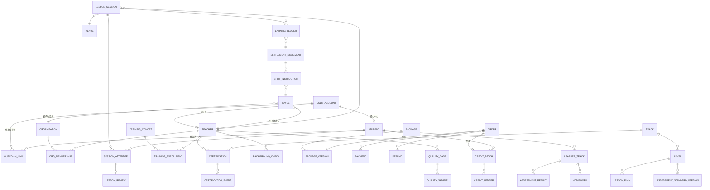

# 看乐认证教师平台 数据模型草案

## 0. 文档信息

- 状态：草案 v0.1，配合 [PRD](./PRD.md) 讨论
- 日期：2026-10-21（America/Los_Angeles）
- 假设存储：PostgreSQL（多主体分账、不可变流水、跨表事务与对账报表需要关系型数据库的事务与约束能力）
- 约定：
  - 金额一律以“分”为单位的整数（`bigint`），不使用浮点。
  - 时间一律存 UTC（`timestamptz`），业务日期按 `Asia/Shanghai` 解释。
  - 所有主键为 UUID；所有表有 `created_at`。
  - 带 `_ledger` / `_event` 后缀的表**只追加、不更新、不删除**。
  - 带 `_version` 后缀的表发布后不可修改，只能发布新版本。

---

## 1. 领域划分

```text
┌──────────────┐   ┌──────────────┐   ┌──────────────┐
│ ① 身份与主体  │   │ ② 课程体系    │   │ ③ 培训与认证  │
│ 账号 / 学员   │   │ 体系线 / 级别 │   │ 期次 / 认证   │
│ 监护人 / 老师 │   │ 课 / 测评标准 │   │ 背景审查      │
│ 机构 / 收款方 │   │              │   │              │
└──────┬───────┘   └──────┬───────┘   └──────┬───────┘
       │                  │                  │
┌──────┴───────┐   ┌──────┴───────┐   ┌──────┴───────┐
│ ④ 交易与资金  │   │ ⑤ 课时与课堂  │   │ ⑥ 学习与质检  │
│ 课时包 / 订单 │──▶│ 课时批次/流水 │──▶│ 档案 / 测评   │
│ 支付 / 分账   │   │ 课堂 / 出勤   │   │ 评价 / 抽查   │
│ 退款 / 对账   │   │ 场地 / 课酬   │   │ 质检工单      │
└──────────────┘   └──────────────┘   └──────────────┘
```

---

## 2. 实体关系图



---

## 3. 实体定义

### 3.1 身份与主体

| 实体 | 关键字段 | 说明 |
|---|---|---|
| `user_account` | `wechat_unionid`、`phone`、`display_name`、`status` | 登录身份，与业务角色分离 |
| `student` | `account_id?`、`name`、`birth_date`、`is_minor`（按生日计算） | 未成年学员可以没有自己的账号 |
| `guardian_link` | `guardian_account_id`、`student_id`、`relation`、`verified_at` | 未成年学员必须至少有一个已验证监护人 |
| `teacher` | `account_id`、`real_name`、`id_verified_at`、`status` | 老师档案；能否授课由认证决定，不由本表决定 |
| `organization` | `name`、`license_info`、`status` | 认证机构 |
| `org_membership` | `organization_id`、`teacher_id`、`role`、`valid_from/to` | 老师隶属机构的关系，可为空（独立老师） |
| `payee` | `kind`（individual / organization）、`teacher_id?`、`organization_id?`、`channel_receiver_id`、`status` | 分账接收方，对应支付通道里的接收方标识 |

### 3.2 课程体系

| 实体 | 关键字段 | 说明 |
|---|---|---|
| `track` | `code`、`name`、`audience`（adult / child / all） | 体系线，如成人声乐、少儿声乐、视唱练耳 |
| `level` | `track_id`、`ordinal`、`name`、`goals` | 级别 |
| `lesson_plan` | `level_id`、`ordinal`、`objective`、`content`、`homework_template`、`version` | 每课教案 |
| `assessment_standard_version` | `level_id`、`version`、`items`（jsonb）、`pass_rule`、`published_at` | 测评标准，发布后不可改 |
| `lesson_spec` | `track_id`、`format`（one_on_one / group）、`duration_min`、`max_students`、`min_cert_grade` | 可被一节课消费的规格，课时批次绑定到它 |

### 3.3 培训与认证

| 实体 | 关键字段 | 说明 |
|---|---|---|
| `training_cohort` | `track_id`、`name`、`trainer_ids`、`starts_at`、`fee_fen` | 培训期次 |
| `training_enrollment` | `cohort_id`、`teacher_id`、`status`、`written_score`、`demo_score`、`result` | 报名与考核结果 |
| `certification` | `teacher_id`、`track_id`、`grade`、`status`、`valid_from`、`valid_to` | 当前认证状态（由事件推导的投影） |
| `certification_event` | `certification_id`、`type`、`reason`、`actor_id`、`occurred_at` | 颁发 / 续期 / 升降级 / 暂停 / 恢复 / 吊销 / 过期，只追加 |
| `background_check` | `teacher_id`、`kind`、`result`、`checked_at`、`valid_to`、`evidence_ref` | 面向未成年人授课的强制查询记录 |

### 3.4 交易与资金

| 实体 | 关键字段 | 说明 |
|---|---|---|
| `package` | `name`、`lesson_spec_id`、`status` | 课时包商品 |
| `package_version` | `package_id`、`price_fen`、`lesson_count`、`valid_days`、`refund_terms`、`split_rule`（平台比例、通道费承担方）、`published_at` | 发布后不可改 |
| `order` | `student_id`、`payer_account_id`、`teacher_id`、`package_version_id`、`snapshot`（jsonb）、`amount_fen`、`status`、`idempotency_key` | 快照包含价格、条款、老师、分账比例 |
| `payment` | `order_id`、`channel`、`channel_txn_id`、`amount_fen`、`status`、`captured_at` | 通道支付记录 |
| `refund` | `order_id`、`amount_fen`、`reason`、`actor_id`、`status`、`channel_refund_id` | 退款 |
| `split_instruction` | `settlement_statement_id?`、`order_id?`、`payee_id`、`amount_fen`、`status`、`channel_split_id`、`idempotency_key` | 通过通道执行的分账指令 |
| `channel_statement_line` | `channel`、`bill_date`、`txn_id`、`amount_fen`、`kind`、`match_status` | 通道账单行，用于对账 |

### 3.5 课时与课堂

| 实体 | 关键字段 | 说明 |
|---|---|---|
| `credit_batch` | `student_id`、`lesson_spec_id`、`order_id?`、`quantity`、`unit_cost_fen`、`expires_at`、`source`（purchase / gift / compensation） | 一次发放的同源课时 |
| `credit_ledger` | `batch_id`、`type`（grant / reserve / release / consume / refund / expire / adjust）、`delta`、`session_id?`、`operation_id`、`actor_id` | 只追加；余额由流水汇总得出 |
| `venue` | `name`、`kind`（org_room / shared_room / community / adult_only_other / online）、`minor_allowed`、`address`、`geo?` | 场地；`geo` 仅为阶段 2 撮合预留 |
| `lesson_session` | `teacher_id`、`lesson_spec_id`、`venue_id`、`starts_at`、`ends_at`、`status`、`lesson_plan_id?` | 一次真实发生的课堂 |
| `session_attendee` | `session_id`、`student_id`、`status`（booked / leave / attended / absent）、`credit_batch_id?` | 唯一约束 `(session_id, student_id)` |
| `earning_ledger` | `session_id`、`teacher_id`、`payee_id`、`amount_fen`、`type`（earn / reverse）、`operation_id` | 课酬流水，只追加 |
| `settlement_statement` | `payee_id`、`period_start`、`period_end`、`total_fen`、`status` | 周期结算单，生成分账指令 |

### 3.6 学习与质检

| 实体 | 关键字段 | 说明 |
|---|---|---|
| `learner_track` | `student_id`、`track_id`、`current_level_id`、`current_teacher_id?`、`started_at` | 学员在某体系线上的进度；**属于学员与平台，不属于老师** |
| `homework` | `learner_track_id`、`session_id?`、`content`、`submission_ref?`、`teacher_feedback`、`status` | 作业 |
| `assessment_result` | `learner_track_id`、`level_id`、`standard_version_id`、`scores`（jsonb）、`passed`、`assessor_id` | 测评结果，按当时版本解释 |
| `lesson_feedback` | `session_id`、`student_id`、`teacher_note` | 老师的课堂反馈 |
| `lesson_review` | `session_attendee_id`、`rating`、`comment` | 学员 / 监护人评价 |
| `quality_case` | `teacher_id`、`trigger`（metric / complaint / random）、`status`、`resolution`、`actor_id` | 质检工单 |
| `quality_sample` | `quality_case_id`、`session_id`、`media_ref`、`score`、`reviewer_id`、`consent_ref` | 课堂录音 / 视频抽查，必须有授权记录 |
| `complaint` | `reporter_account_id`、`teacher_id?`、`session_id?`、`content`、`status`、`due_at` | 投诉 |
| `audit_log` | `actor_id`、`action`、`entity`、`entity_id`、`before`、`after`、`reason` | 所有敏感操作留痕 |

---

## 4. 状态机

### 4.1 认证 `certification.status`

```text
            颁发
 (无) ──────────────▶ active ◀────────── 恢复 ───────────┐
                        │  │                              │
               到期未复训 │  │ 质检 / 投诉                    │
                        ▼  ▼                              │
                    expired  suspended ───────────────────┘
                                │
                                │ 严重违规
                                ▼
                             revoked（终态）
```

- 只有 `active` 且 `valid_to` 未过期的认证可以授课和发起课时包购买。
- `suspended` 期间，已排课堂需要运营决定：由其他认证老师代课，或释放课时。

### 4.2 课时（以一节课为例）

```text
grant ──▶ 可用 ──reserve──▶ 已冻结 ──consume──▶ 已消费
            ▲                │
            └────release─────┘（请假 / 课堂取消）
可用 ──expire──▶ 已过期
可用 ──refund──▶ 已退款
```

### 4.3 课堂 `lesson_session.status`

```text
scheduled ──▶ completed ──▶ settled
     │
     └──▶ cancelled（释放全部冻结课时，不产生课酬）
```

### 4.4 订单 `order.status`

```text
created ──▶ paid ──▶ fulfilled（发放课时批次）──▶ partially_refunded / refunded
   │
   └──▶ closed（超时未支付）
```

---

## 5. 不变量与落地方式

| PRD 规则 | 数据层落地 |
|---|---|
| R-01 认证才能授课 | 创建 `lesson_session` 与 `order` 时，在同一事务内校验 `certification` 有效且 `grade >= lesson_spec.min_cert_grade` |
| R-02 少儿课场地与背景审查 | 任一出席学员 `is_minor` 时，要求 `venue.minor_allowed = true` 且老师有有效 `background_check` |
| R-03 不中转资金 | 平台不保存“老师可提现余额”；老师所得只以 `split_instruction` 形式经通道到达 `payee` |
| R-04 不可变流水 | `credit_ledger`、`earning_ledger`、`certification_event`、`audit_log` 只允许 INSERT（数据库权限层面撤销 UPDATE / DELETE） |
| R-05 不重复消费 | `credit_ledger` 唯一约束 `(session_id, student_id, type='consume')`；`earning_ledger` 唯一约束 `(session_id, teacher_id, type='earn')` |
| R-06 档案归属学员 | `learner_track` 与老师之间只有可变的 `current_teacher_id`；更换老师不迁移、不删除历史 |
| R-07 版本化 | `package_version`、`assessment_standard_version` 发布后只读；`order.snapshot` 冗余保存关键条款 |
| R-08 客户端不权威 | 金额、余额、分账一律由服务端根据版本与流水计算 |
| R-09 预收费上限 | `package_version` 发布时校验 `lesson_count`、`valid_days` 不超过城市参数 |
| R-10 留痕 | 认证变更、退款、分账规则发布均写 `audit_log`，要求 `reason` 非空 |

---

## 6. 刻意推迟的模型（阶段 2 以后）

- 老师可约时段与就近搜索：`teacher_availability`、`venue.geo` 的空间索引。
- 场地预订与场地方结算：`venue_booking`、场地方 `payee`。
- 跨老师通用课时（待创始人拍板）：如果允许，`credit_batch` 需要从“绑定老师”改为“绑定体系线与规格”，分账改为按课消时的实际授课老师计算。**这一点会影响 MVP 的分账设计，建议立项前就确定。**
- 多城市参数：城市维度的预收费上限、抽成比例、场地规则。

---

## 7. 开放问题

1. 分账时点：按课消逐节分账，还是按周期结算？前者资金最清晰，但通道调用多；后者需要处理周期内退款。
2. 通道费由谁承担：平台、老师，还是按比例分摊？
3. 小组课的课酬：按人头计算，还是按课堂固定加人头阶梯计算？
4. 机构老师的课酬：分给机构由机构再分，还是直接分给老师？
5. 测评由谁来做：任课老师自评，还是由其他认证老师或讲师交叉测评？交叉测评更可信，但成本更高。
