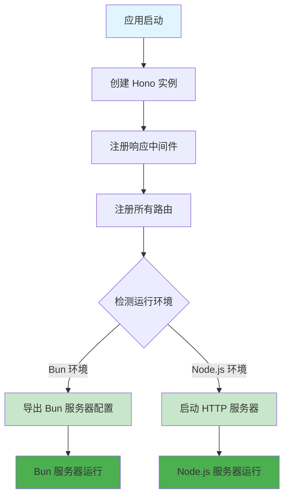

# 应用入口文件 (index.js)

## 功能描述

ikanyue-hono 项目的主入口文件，负责初始化 Hono 应用实例，配置中间件，注册路由，并根据运行环境（Node.js 或 Bun）启动服务器。

## mermaid 流程图



## 核心功能

### 1. 应用初始化

-   创建 Hono 应用实例
-   配置全局响应中间件
-   注册所有业务路由

### 2. 多环境支持

-   **Bun 环境**: 导出端口和 fetch 配置对象
-   **Node.js 环境**: 使用 @hono/node-server 启动 HTTP 服务

### 3. 环境检测

```javascript
const isBun = typeof Bun !== 'undefined';
```

## 依赖关系

-   [响应中间件](mdc:src/middleware/response.js.md) - 统一响应格式
-   [路由注册](mdc:src/routes/index.js.md) - 集中路由管理

## 配置说明

### 端口配置

-   默认端口: `1337`
-   环境变量: `PORT`

### 启动脚本

-   Node.js 开发: `npm run dev`
-   Node.js 生产: `npm start`
-   Bun 开发: `npm run dev:bun`
-   Bun 生产: `npm run start:bun`

## 输出示例

### Bun 环境

```
🚀 ikanyue-hono API 应用已准备就绪 (Bun 环境)
📍 端口: 1337
🕐 时间: 2024/12/26 10:01:18
```

### Node.js 环境

```
🚀 ikanyue-hono API 服务已启动 (Node.js 环境)
📍 服务地址: http://localhost:1337
🕐 启动时间: 2024/12/26 10:01:18
```

## 更新历史

| 版本 | 日期       | 说明                               |
| ---- | ---------- | ---------------------------------- |
| 1.0  | 2024-12-26 | 创建主入口文件，支持多环境运行     |
| 1.1  | 2024-12-26 | 整合 Bun 和 Node.js 逻辑到单一文件 |
