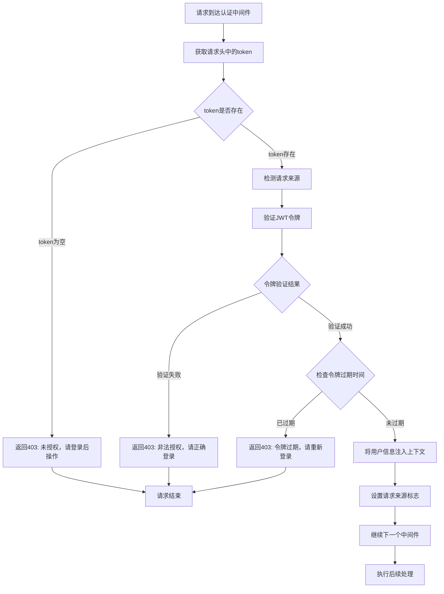

# 用户认证中间件

## 功能描述

验证用户的 JWT 令牌，确保只有已认证的用户才能访问受保护的接口，并将用户信息注入到上下文中。

## 认证处理流程



## 中间件信息

-   **文件位置**: `src/middleware/auth.js`
-   **类型**: 身份认证中间件
-   **对应原项目**: `api/policies/isAuth.js`

## 使用方法

### 基本用法

```javascript
const { authMiddleware } = require('../middleware/auth.js');

// 保护单个路由
app.post('/v1/protected', authMiddleware(), handlerFunction);
```

### 全局认证

```javascript
// 为所有需要认证的路由添加认证
const protectedRoutes = hono.route('/v1');
protectedRoutes.use('*', authMiddleware());
```

## 令牌获取

### 支持的请求头

中间件按优先级检查以下请求头：

1. `token`: 主要的令牌字段
2. `jwtoken`: 备用的令牌字段

### 请求头示例

```http
GET /v1/user/profile
token: jwt_token_here
```

或

```http
GET /v1/user/profile
jwtoken: jwt_token_here
```

## 验证过程

### 1. 令牌存在性检查

验证请求头中是否包含有效的令牌字符串。

### 2. 请求来源检测

通过检查以下请求头判断是否来自浏览器：

-   `sec-fetch-mode`
-   `sec-fetch-site`

### 3. JWT 令牌验证

调用 `jwtAuth.check()` 方法验证令牌的有效性和完整性。

### 4. 过期时间检查

验证令牌的 `expiredAt` 字段，确保令牌未过期。

## 上下文注入

### 用户信息注入

成功认证后，将用户信息注入到 Hono 上下文：

```javascript
c.set('user', user);
// user 对象包含：
// {
//     id: "user_id",
//     sn: "unique_sn",
//     role: "student" | "teacher",
//     isAdmin: boolean,
//     expiredAt: number
// }
```

### 请求来源标志

```javascript
c.set('isWeb', isWeb);
// isWeb: boolean - 是否来自浏览器
```

## 错误处理

### 错误响应格式

所有认证错误都返回统一格式：

```json
{
    "code": 403,
    "message": "错误描述",
    "data": null
}
```

### 错误场景

| 错误场景 | 错误代码 | 错误消息             |
| -------- | -------- | -------------------- |
| 缺少令牌 | 403      | 未授权，请登录后操作 |
| 令牌无效 | 403      | 非法授权，请正确登录 |
| 令牌过期 | 403      | 令牌过期，请重新登录 |

## 令牌生命周期

### 过期检查

使用 `dayjs` 库进行时间比较：

```javascript
if (user.expiredAt && user.expiredAt < dayjs().second()) {
    // 令牌已过期
}
```

### 刷新机制

-   过期的令牌需要通过刷新接口重新获取
-   或重新登录获取新的令牌

## 安全考虑

### 令牌传输

-   建议通过 HTTPS 传输令牌
-   支持多种请求头格式提高兼容性
-   令牌不记录在日志中

### 时间安全

-   精确的过期时间检查
-   防止时钟偏移攻击
-   合理的令牌有效期设置

## 兼容性说明

### 与原项目完全兼容

-   错误响应格式与原项目一致
-   支持的请求头字段保持不变
-   认证流程和逻辑完全对应

### 请求头兼容

-   支持 `token` 和 `jwtoken` 两种格式
-   兼容不同客户端的请求头设置

## 依赖关系

-   依赖工具类：[jwtAuth.js](mdc:src/utils/jwtAuth.js) - JWT 令牌处理
-   外部依赖：`dayjs` - 时间处理库

## 性能优化

### 轻量验证

-   无数据库查询，纯内存验证
-   快速的令牌解析和验证
-   最小化的时间计算开销

### 缓存友好

-   用户信息注入上下文供后续使用
-   避免重复验证和解析

## 使用示例

### 单个路由保护

```javascript
const { authMiddleware } = require('../middleware/auth.js');

app.post('/v1/user/profile', authMiddleware(), (c) => {
    const user = c.get('user');
    return c.data(user, '获取用户信息成功');
});
```

### 路由组保护

```javascript
const protectedGroup = new Hono();
protectedGroup.use('*', authMiddleware());

protectedGroup.post('/profile', profileHandler);
protectedGroup.post('/update', updateHandler);

app.route('/v1/user', protectedGroup);
```

### 获取用户信息

```javascript
function someHandler(c) {
    const user = c.get('user');
    const isWeb = c.get('isWeb');

    console.log('当前用户:', user.id);
    console.log('来自浏览器:', isWeb);

    // 继续处理...
}
```

## 调试信息

### 开发环境调试

```javascript
// 在处理器中查看用户信息
const user = c.get('user');
console.log('认证用户:', {
    id: user.id,
    role: user.role,
    expiredAt: new Date(user.expiredAt * 1000),
});
```

## 更新历史

-   2024-01-XX: 从原 Sails.js 项目迁移，保持完全兼容
-   2024-01-XX: 适配 Hono 框架的中间件模式
-   2024-01-XX: 增强请求来源检测功能
