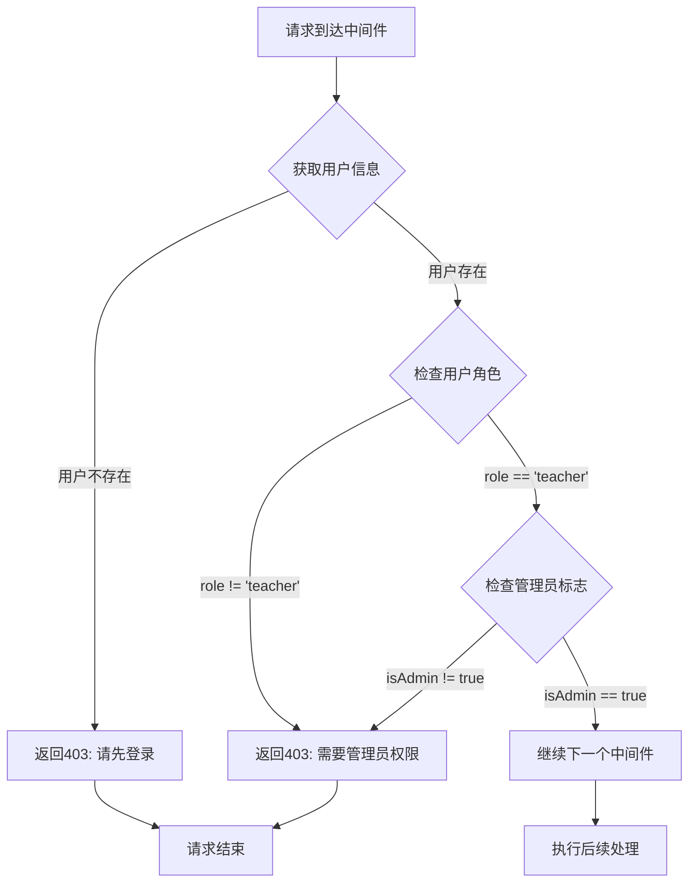

# 管理员权限验证中间件

## 功能描述

验证当前用户是否具有管理员权限，确保只有管理员才能访问系统管理相关的接口。

## 权限验证流程



## 中间件信息

-   **文件位置**: `src/middleware/isAdmin.js`
-   **类型**: 管理员权限验证中间件
-   **对应原项目**: `api/policies/isAdmin.js`

## 使用方法

### 基本用法

```javascript
const { isAdminMiddleware } = require('../middleware/isAdmin.js');

// 单独使用
app.post('/v1/admin/function', isAdminMiddleware(), handlerFunction);
```

### 与认证中间件链式调用

```javascript
const { authMiddleware } = require('../middleware/auth.js');
const { isAdminMiddleware } = require('../middleware/isAdmin.js');

// 先认证，再验证管理员权限
app.post('/v1/admin/users', authMiddleware(), isAdminMiddleware(), handlerFunction);
```

## 权限逻辑

### 验证条件

1. **用户已认证**: 必须通过 `authMiddleware` 认证
2. **角色验证**: `user.role` 必须等于 `'teacher'`
3. **管理员标志**: `user.isAdmin` 必须为 `true`

### 权限层级

-   管理员是教师的子集（只有教师才能成为管理员）
-   管理员具有最高权限，可以执行所有教师操作
-   学生和普通教师无法获得管理员权限

## 上下文依赖

### 依赖数据

从上下文获取用户信息：

```javascript
const user = c.get('user');
// 期望结构：
// {
//     id: "user_id",
//     sn: "unique_sn",
//     role: "teacher",
//     isAdmin: true
// }
```

### 前置中间件

必须在 [authMiddleware](mdc:src/middleware/auth.js) 之后使用，确保用户信息已注入上下文。

## 错误处理

### 错误响应格式

```json
{
    "code": 403,
    "message": "权限不足，需要管理员权限",
    "data": null
}
```

### 错误场景

| 场景           | 错误代码 | 错误消息                 |
| -------------- | -------- | ------------------------ |
| 未认证         | 403      | 未授权操作，请先登录     |
| 非教师角色     | 403      | 权限不足，需要管理员权限 |
| 教师但非管理员 | 403      | 权限不足，需要管理员权限 |

## 管理员功能范围

### 用户管理

-   创建/删除教师账户
-   审核教师申请
-   封禁/解封用户账户
-   查看所有用户信息

### 系统管理

-   系统配置管理
-   数据统计查看
-   日志审计
-   内容审核

## 安全考虑

### 权限验证

-   双重验证：角色 + 管理员标志
-   最小权限原则
-   严格的权限边界
-   统一的错误响应

### 审计要求

-   所有管理员操作应记录日志
-   敏感操作需要额外验证
-   定期权限审查

## 兼容性说明

### 与原项目完全兼容

-   管理员权限验证逻辑与原 Sails.js 项目一致
-   双重验证条件保持不变
-   错误响应格式统一

## 依赖关系

-   依赖中间件：[auth.js](mdc:src/middleware/auth.js) - 用户认证
-   依赖中间件：[response.js](mdc:src/middleware/response.js) - 响应格式化

## 使用示例

### 管理员专用接口

```javascript
// 管理员创建教师账户
app.post('/v1/teacher/create', authMiddleware(), isAdminMiddleware(), teacherCreateHandler);

// 管理员删除用户
app.post('/v1/user/delete', authMiddleware(), isAdminMiddleware(), userDeleteHandler);

// 管理员查看系统统计
app.post('/v1/admin/statistics', authMiddleware(), isAdminMiddleware(), statisticsHandler);
```

## 更新历史

-   2024-01-XX: 从原 Sails.js 项目迁移，保持完全兼容
-   2024-01-XX: 适配 Hono 框架的中间件模式
