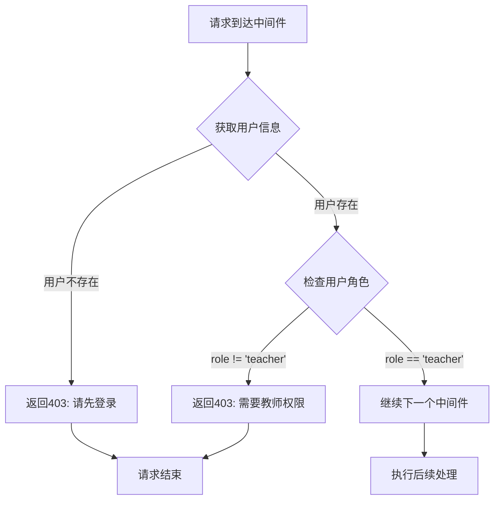

# 教师权限验证中间件

## 功能描述

验证当前用户是否具有教师权限，确保只有教师角色的用户才能访问需要教师权限的接口。

## 权限验证流程



## 中间件信息

-   **文件位置**: `src/middleware/isTeacher.js`
-   **类型**: 权限验证中间件
-   **对应原项目**: `api/policies/isTeacher.js`

## 使用方法

### 基本用法

```javascript
const { isTeacherMiddleware } = require('../middleware/isTeacher.js');

// 单独使用
app.post('/v1/teacher/function', isTeacherMiddleware(), handlerFunction);
```

### 与认证中间件链式调用

```javascript
const { authMiddleware } = require('../middleware/auth.js');
const { isTeacherMiddleware } = require('../middleware/isTeacher.js');

// 先认证，再验证教师权限
app.post('/v1/teacher/manage', authMiddleware(), isTeacherMiddleware(), handlerFunction);
```

## 权限逻辑

### 验证条件

1. **用户已认证**: 必须通过 `authMiddleware` 认证
2. **角色验证**: `user.role` 必须等于 `'teacher'`

### 权限继承

-   管理员自动具有教师权限（在具体业务中通过 isAdmin 检查）
-   学生用户无法通过教师权限验证

## 上下文依赖

### 依赖数据

从上下文获取用户信息：

```javascript
const user = c.get('user');
// 期望结构：
// {
//     id: "user_id",
//     sn: "unique_sn",
//     role: "teacher",
//     isAdmin: boolean
// }
```

### 前置中间件

必须在 [authMiddleware](mdc:src/middleware/auth.js) 之后使用，确保用户信息已注入上下文。

## 错误处理

### 错误响应格式

```json
{
    "code": 403,
    "message": "权限不足，需要教师权限",
    "data": null
}
```

### 错误场景

| 场景       | 错误代码 | 错误消息               |
| ---------- | -------- | ---------------------- |
| 未认证     | 403      | 未授权操作，请先登录   |
| 非教师角色 | 403      | 权限不足，需要教师权限 |

## 安全考虑

### 权限验证

-   严格的角色检查，不允许权限提升
-   依赖认证中间件的安全保障
-   统一的错误响应，不泄露敏感信息

### 性能优化

-   轻量级验证，仅检查内存中的用户信息
-   无额外数据库查询
-   快速失败原则

## 兼容性说明

### 与原项目完全兼容

-   权限验证逻辑与原 Sails.js 项目一致
-   错误响应格式保持统一
-   角色定义和验证规则不变

## 依赖关系

-   依赖中间件：[auth.js](mdc:src/middleware/auth.js) - 用户认证
-   依赖中间件：[response.js](mdc:src/middleware/response.js) - 响应格式化

## 使用示例

### 教师管理接口

```javascript
// 教师查看学生列表
app.post('/v1/student/find', authMiddleware(), isTeacherMiddleware(), studentFindHandler);

// 教师创建课程材料
app.post('/v1/audioMaterial/create', authMiddleware(), isTeacherMiddleware(), audioMaterialCreateHandler);
```

## 更新历史

-   2024-01-XX: 从原 Sails.js 项目迁移，保持完全兼容
-   2024-01-XX: 适配 Hono 框架的中间件模式
