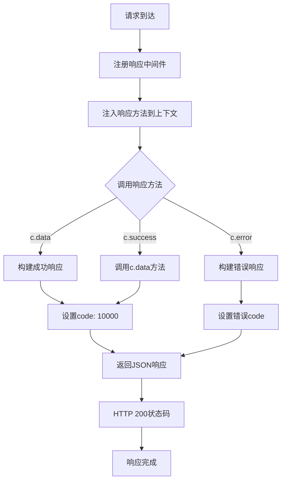

# 响应格式化中间件

## 功能描述

统一所有接口的响应格式，提供标准化的成功和错误响应方法，确保与原 Sails.js 项目的响应格式完全一致。

## 处理流程



## 中间件信息

-   **文件位置**: `src/middleware/response.js`
-   **类型**: 响应格式化
-   **对应原项目**: `api/responses/data.js` 和 `api/responses/error.js`

## 使用方法

### 基本用法

```javascript
// 在应用入口注册全局中间件
app.use('*', responseMiddleware());
```

### 在路由处理器中使用

```javascript
// 成功响应
return c.data(result, '操作成功');

// 错误响应
return c.error(400, '参数错误');
```

## 提供的方法

### c.data(optionalData, message)

标准成功响应方法，对应原项目的 `res.data()`

**参数**:

-   `optionalData` (any): 响应数据，默认 null
-   `message` (string): 响应消息，默认 null

**返回值**: 标准化的成功响应

**响应格式**:

```json
{
    "code": 10000,
    "message": "操作成功信息",
    "data": {
        // 响应数据
    }
}
```

**示例**:

```javascript
// 返回数据
return c.data({ id: 123, name: '张三' }, '查询成功');

// 仅返回成功状态
return c.data();
```

### c.error(code, message)

标准错误响应方法，对应原项目的 `res.error()`

**参数**:

-   `code` (number): 错误代码，默认 400
-   `message` (string): 错误消息，默认空字符串

**返回值**: 标准化的错误响应

**响应格式**:

```json
{
    "code": 400,
    "message": "错误信息",
    "data": null
}
```

**示例**:

```javascript
// 参数错误
return c.error(400, '缺少必要参数');

// 权限错误
return c.error(403, '权限不足');

// 服务器错误
return c.error(500, '服务器内部错误');
```

### c.success(data, message) - 向后兼容

为了向后兼容提供的方法，内部调用 `c.data()`

**参数**: 与 `c.data()` 相同

## 上下文操作

### 注入方法

中间件会在 Hono 上下文中注入以下方法：

```javascript
c.data = function (optionalData = null, message = null) {
    /* ... */
};
c.error = function (code = 400, msg = '') {
    /* ... */
};
c.success = function (data = null, message = null) {
    /* ... */
};
```

### 处理流程

1. 中间件初始化时将响应方法注入到上下文
2. 后续的路由处理器可以直接使用这些方法
3. 所有响应都遵循统一的格式标准

## 错误处理

### HTTP 状态码

所有响应（包括错误响应）都返回 HTTP 200 状态码，与原项目保持一致

### 错误代码映射

| 业务错误码 | 说明           | HTTP 状态码 |
| ---------- | -------------- | ----------- |
| 10000      | 操作成功       | 200         |
| 400        | 请求参数错误   | 200         |
| 401        | 认证失败       | 200         |
| 403        | 权限不足       | 200         |
| 404        | 资源不存在     | 200         |
| 409        | 资源冲突       | 200         |
| 500        | 服务器内部错误 | 200         |

## 兼容性说明

### 与原项目完全兼容

-   响应格式完全一致：`{code, message, data}` 结构
-   HTTP 状态码策略一致：所有响应都返回 200
-   方法名称对应：`data()` 对应 `res.data()`，`error()` 对应 `res.error()`

### 修改记录

-   将 `sails.log` 替换为 `console` 进行日志输出
-   使用 Hono 的 `c.json()` 方法替代 Sails 的响应机制
-   保持所有业务逻辑和数据结构不变

## 性能考虑

-   轻量级实现，无额外性能开销
-   方法注入只在中间件初始化时执行一次
-   JSON 序列化由 Hono 框架优化处理

## 更新历史

-   2024-01-XX: 从原 Sails.js 项目迁移，保持完全兼容
-   2024-01-XX: 添加向后兼容的 `success()` 方法
