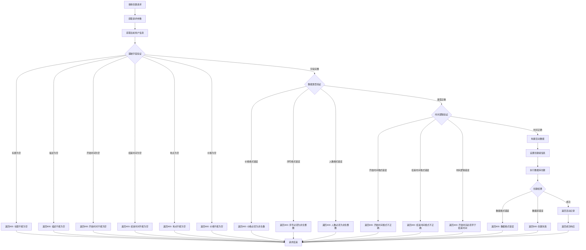

# 活动创建接口

## 功能描述

创建新的教学活动，支持设置活动标题、描述、时间、地点、价格等详细信息，需要管理员权限。

## 创建处理流程



## 接口信息

-   **路径**: `POST /v1/activity/create`
-   **权限**: 需要管理员权限
-   **对应原项目**: `api/controllers/activity/create.js`

## 请求参数

### 必传参数

| 参数名      | 类型   | 说明     | 示例                   |
| ----------- | ------ | -------- | ---------------------- |
| title       | string | 活动标题 | "编程工作坊"           |
| description | string | 活动描述 | "学习 JavaScript 基础" |
| startTime   | string | 开始时间 | "2024-02-01T09:00:00Z" |
| endTime     | string | 结束时间 | "2024-02-01T17:00:00Z" |
| location    | string | 活动地点 | "北京市朝阳区"         |
| price       | number | 活动价格 | 299                    |

### 可选参数

| 参数名          | 类型   | 说明         | 默认值     | 示例                  |
| --------------- | ------ | ------------ | ---------- | --------------------- |
| coverImage      | string | 封面图片     | ""         | "cover.jpg"           |
| images          | array  | 图片集合     | []         | ["img1.jpg"]          |
| externalLink    | string | 外部链接     | ""         | "https://example.com" |
| tags            | array  | 标签数组     | []         | ["编程", "教育"]      |
| sequence        | number | 排序序号     | 0          | 100                   |
| maxParticipants | number | 最大参与人数 | 0          | 30                    |
| status          | string | 活动状态     | "inactive" | "active"              |
| type            | string | 活动类型     | ""         | "workshop"            |

### 参数验证

-   **标题**: 不能为空或仅包含空格
-   **描述**: 不能为空或仅包含空格
-   **时间**: 必须为有效的 ISO 8601 格式
-   **价格**: 必须为非负数
-   **序号**: 必须为非负整数
-   **参与人数**: 必须为非负整数

## 响应格式

### 成功响应

```json
{
    "code": 10000,
    "message": "活动创建成功",
    "data": {
        "id": "new_activity_id",
        "title": "编程工作坊",
        "description": "学习 JavaScript 基础知识",
        "startTime": "2024-02-01T09:00:00Z",
        "endTime": "2024-02-01T17:00:00Z",
        "location": "北京市朝阳区",
        "price": 299,
        "coverImage": "",
        "images": [],
        "externalLink": "",
        "tags": ["编程", "教育"],
        "sequence": 0,
        "maxParticipants": 30,
        "currentParticipants": 0,
        "status": "inactive",
        "type": "workshop",
        "creator": "admin_id",
        "created": "2024-01-01 10:00:00",
        "updated": "2024-01-01 10:00:00"
    }
}
```

### 错误响应

```json
{
    "code": 400,
    "message": "活动标题不能为空",
    "data": null
}
```

```json
{
    "code": 500,
    "message": "创建失败，请稍后重试",
    "data": null
}
```

## 业务逻辑

### 字段处理

1. **文本清理**: 自动清除标题、描述、地点的前后空格
2. **数组处理**: 确保 tags 和 images 为数组格式
3. **数值转换**: 自动转换价格、序号、参与人数为数值类型
4. **默认值设置**: 为可选参数设置合理的默认值

### 时间验证

-   验证时间格式的有效性
-   确保开始时间早于结束时间
-   支持 ISO 8601 时间格式

### 权限控制

-   只有管理员可以创建活动
-   创建者信息自动从认证上下文获取
-   活动默认状态为 "inactive"（需要手动激活）

## 数据库操作

### 使用的集合

-   **activities**: 活动信息主表

### 创建字段

```javascript
{
    title: string,              // 活动标题
    description: string,        // 活动描述
    startTime: string,          // 开始时间 (ISO 8601)
    endTime: string,            // 结束时间 (ISO 8601)
    location: string,           // 活动地点
    price: number,              // 活动价格
    coverImage: string,         // 封面图片
    images: array,              // 图片集合
    externalLink: string,       // 外部链接
    tags: array,                // 标签数组
    sequence: number,           // 排序序号
    maxParticipants: number,    // 最大参与人数
    currentParticipants: number,// 当前参与人数
    status: string,             // 活动状态
    type: string,               // 活动类型
    creator: string             // 创建者ID
}
```

### 自动字段

-   `id`: 系统自动生成的唯一标识
-   `created`: 创建时间戳
-   `updated`: 更新时间戳
-   `currentParticipants`: 当前参与人数（初始为 0）

## 权限要求

### 中间件链

```javascript
authMiddleware() → isAdminMiddleware() → activityCreateHandler()
```

### 用户信息依赖

需要从上下文获取已认证的管理员信息：

```javascript
const user = c.get('user');
// 期望包含：{ id, sn, role: 'teacher', isAdmin: true }
```

## 活动状态管理

### 状态说明

| 状态      | 说明   | 可见性   |
| --------- | ------ | -------- |
| inactive  | 未激活 | 仅管理员 |
| active    | 已激活 | 所有用户 |
| cancelled | 已取消 | 所有用户 |
| completed | 已结束 | 所有用户 |

### 状态流转

-   新建活动默认为 "inactive"
-   管理员审核后可设置为 "active"
-   支持取消和完成状态的设置

## 文件管理

### 图片处理

-   `coverImage`: 封面图片文件名
-   `images`: 图片文件名数组
-   文件上传应通过专门的文件上传接口完成
-   图片字段存储文件名，实际 URL 由查询接口生成

### 文件验证

-   建议在客户端验证图片格式和大小
-   检查文件上传状态
-   验证文件访问权限

## 错误处理

### 参数验证错误

| 错误场景     | 错误代码 | 错误消息                 |
| ------------ | -------- | ------------------------ |
| 标题为空     | 400      | 活动标题不能为空         |
| 描述为空     | 400      | 活动描述不能为空         |
| 开始时间为空 | 400      | 活动开始时间不能为空     |
| 结束时间为空 | 400      | 活动结束时间不能为空     |
| 地点为空     | 400      | 活动地点不能为空         |
| 价格为空     | 400      | 活动价格不能为空         |
| 价格格式错误 | 400      | 活动价格必须为非负数     |
| 时间格式错误 | 400      | 开始时间格式不正确       |
| 时间逻辑错误 | 400      | 开始时间必须早于结束时间 |

### 数据库错误

| 错误场景     | 错误代码 | 错误消息                 |
| ------------ | -------- | ------------------------ |
| 数据格式错误 | 400      | 数据格式错误，请检查输入 |
| 创建失败     | 500      | 创建失败，请稍后重试     |
| 系统异常     | 500      | 服务器内部错误           |

## 性能考虑

### 数据验证

-   在应用层进行全面的参数验证
-   避免无效数据传递到数据库层
-   提供详细的错误信息反馈

### 并发处理

-   PocketBase 自动处理并发创建
-   唯一约束由数据库层保证
-   事务安全由数据库保障

## 依赖关系

-   依赖工具类：[pocketbase.js](mdc:src/utils/pocketbase.js) - 数据库操作
-   依赖中间件：[auth.js](mdc:src/middleware/auth.js) - 用户认证
-   依赖中间件：[isAdmin.js](mdc:src/middleware/isAdmin.js) - 管理员权限验证
-   依赖中间件：[response.js](mdc:src/middleware/response.js) - 响应格式化
-   外部依赖：`await-to-js` - 错误处理

## 使用示例

### 基础创建

```bash
curl -X POST http://localhost:1337/v1/activity/create \
  -H "Content-Type: application/json" \
  -H "Authorization: Bearer admin_token" \
  -d '{
    "title": "编程工作坊",
    "description": "学习 JavaScript 基础知识",
    "startTime": "2024-02-01T09:00:00Z",
    "endTime": "2024-02-01T17:00:00Z",
    "location": "北京市朝阳区",
    "price": 299
  }'
```

### 完整信息创建

```bash
curl -X POST http://localhost:1337/v1/activity/create \
  -H "Content-Type: application/json" \
  -H "Authorization: Bearer admin_token" \
  -d '{
    "title": "编程工作坊",
    "description": "学习 JavaScript 基础知识，适合初学者",
    "startTime": "2024-02-01T09:00:00Z",
    "endTime": "2024-02-01T17:00:00Z",
    "location": "北京市朝阳区科技园",
    "price": 299,
    "type": "workshop",
    "tags": ["编程", "教育", "JavaScript"],
    "maxParticipants": 30,
    "sequence": 100,
    "externalLink": "https://example.com/register",
    "status": "active"
  }'
```

## 扩展功能

### 未来优化

-   支持批量创建活动
-   添加活动模板功能
-   集成日历系统
-   支持重复活动设置

### 相关接口

-   查询接口：[find.js](mdc:src/routes/activity/find.js)
-   更新接口：[update.js](mdc:src/routes/activity/update.js)
-   删除接口：[delete.js](mdc:src/routes/activity/delete.js)

## 更新历史

-   2024-01-XX: 从原 Sails.js 项目迁移，保持完全兼容
-   2024-01-XX: 增强参数验证和时间逻辑检查
