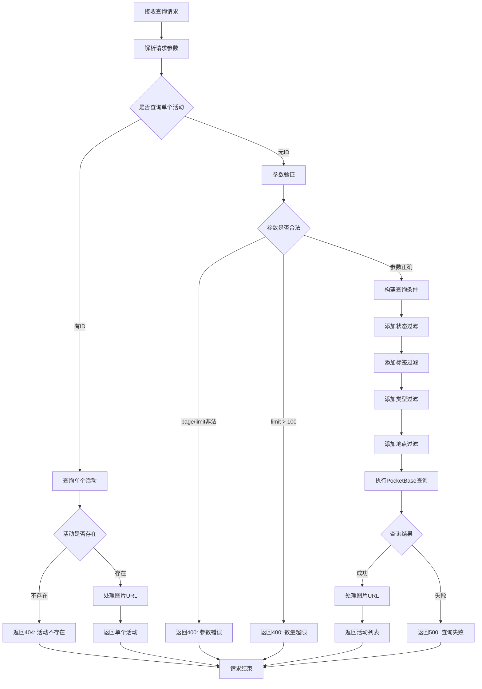

# 活动查询接口

## 功能描述

分页查询活动列表或获取单个活动详情，支持按状态、标签、类型、地点等多种条件进行过滤，并自动处理图片 URL 转换。

## 查询处理流程



## 接口信息

-   **路径**: `POST /v1/activity/find`
-   **权限**: 需要基础认证
-   **对应原项目**: `api/controllers/activity/find.js`

## 请求参数

### 可选参数

| 参数名   | 类型   | 说明     | 默认值     | 示例         |
| -------- | ------ | -------- | ---------- | ------------ |
| id       | string | 活动 ID  | ""         | "record_123" |
| page     | number | 页码     | 1          | 2            |
| limit    | number | 每页数量 | 20         | 10           |
| status   | string | 活动状态 | "active"   | "inactive"   |
| sort     | string | 排序字段 | "-created" | "-sequence"  |
| tags     | string | 标签过滤 | ""         | "教育,培训"  |
| type     | string | 活动类型 | ""         | "workshop"   |
| location | string | 地点过滤 | ""         | "北京"       |

### 参数说明

-   `id`: 如果提供则返回单个活动详情，忽略其他参数
-   `status`: 可选值为 "active"、"inactive"、"all"
-   `tags`: 多个标签用逗号分隔，支持模糊匹配
-   `sort`: 支持 PocketBase 排序语法，如 "-created"、"sequence"

## 响应格式

### 单个活动响应

```json
{
    "code": 10000,
    "message": "查询成功",
    "data": {
        "id": "activity_123",
        "title": "编程工作坊",
        "description": "学习 JavaScript 基础知识",
        "startTime": "2024-02-01 09:00:00",
        "endTime": "2024-02-01 17:00:00",
        "location": "北京市朝阳区",
        "price": 299,
        "type": "workshop",
        "status": "active",
        "tags": ["编程", "教育"],
        "coverImage": "cover.jpg",
        "coverImageUrl": "https://example.com/api/files/activities/123/cover.jpg",
        "images": ["img1.jpg", "img2.jpg"],
        "imageUrls": [
            "https://example.com/api/files/activities/123/img1.jpg",
            "https://example.com/api/files/activities/123/img2.jpg"
        ],
        "maxParticipants": 30,
        "currentParticipants": 15,
        "externalLink": "https://example.com",
        "sequence": 100,
        "creator": "teacher_id",
        "created": "2024-01-01 10:00:00",
        "updated": "2024-01-01 11:00:00"
    }
}
```

### 活动列表响应

```json
{
    "code": 10000,
    "message": "查询成功",
    "data": {
        "items": [
            {
                "id": "activity_123",
                "title": "编程工作坊",
                "description": "学习 JavaScript 基础知识",
                "startTime": "2024-02-01 09:00:00",
                "endTime": "2024-02-01 17:00:00",
                "location": "北京市朝阳区",
                "price": 299,
                "status": "active",
                "coverImageUrl": "https://example.com/api/files/activities/123/cover.jpg"
            }
        ],
        "totalItems": 25,
        "totalPages": 3,
        "page": 1,
        "perPage": 10
    }
}
```

### 错误响应

```json
{
    "code": 404,
    "message": "活动不存在",
    "data": null
}
```

## 业务逻辑

### 查询模式

1. **单个活动查询**: 提供 `id` 参数时返回完整活动详情
2. **列表查询**: 不提供 `id` 时进行分页列表查询

### 过滤条件

-   **状态过滤**: 支持按活动状态筛选
-   **标签过滤**: 支持多标签组合查询
-   **类型过滤**: 按活动类型精确匹配
-   **地点过滤**: 按地点模糊匹配

### 图片处理

-   自动转换 `coverImage` 为完整 URL
-   自动转换 `images` 数组为完整 URL 数组
-   使用 PocketBase 文件服务生成访问链接

## 数据库操作

### 使用的集合

-   **activities**: 活动信息主表

### 查询优化

-   支持复合条件过滤
-   按创建时间或序号排序
-   合理的分页限制

### 索引建议

-   `status`: 状态查询
-   `tags`: 标签搜索
-   `type`: 类型过滤
-   `location`: 地点搜索
-   `created`: 排序字段

## 权限要求

### 认证需求

-   需要通过基础认证中间件
-   学生和教师都可以查询活动
-   管理员具有完整查询权限

### 数据访问

-   所有认证用户都可以查看已发布的活动
-   活动状态控制可见性

## 图片处理特性

### URL 转换

-   `coverImage` → `coverImageUrl`: 单个封面图
-   `images` → `imageUrls`: 图片数组
-   使用 PocketBase 文件服务 API

### 文件访问

-   自动生成带签名的文件访问 URL
-   支持图片缩放和格式转换
-   处理文件不存在的情况

## 性能考虑

### 查询优化

-   限制单次查询数量最大为 100
-   合理使用索引提高查询速度
-   避免不必要的字段查询

### 缓存策略

-   可考虑对热门活动进行缓存
-   图片 URL 缓存优化
-   分页结果缓存

## 错误处理

### 参数验证错误

| 错误场景     | 错误代码 | 错误消息                   |
| ------------ | -------- | -------------------------- |
| 页码非正整数 | 400      | 页码和每页数量必须为正整数 |
| 数量超限     | 400      | 每页数量不能超过 100       |

### 数据库错误

| 错误场景   | 错误代码 | 错误消息             |
| ---------- | -------- | -------------------- |
| 活动不存在 | 404      | 活动不存在           |
| 查询失败   | 500      | 查询失败，请稍后重试 |
| 系统异常   | 500      | 服务器内部错误       |

## 依赖关系

-   依赖工具类：[pocketbase.js](mdc:src/utils/pocketbase.js) - 数据库操作
-   依赖中间件：[auth.js](mdc:src/middleware/auth.js) - 用户认证
-   依赖中间件：[response.js](mdc:src/middleware/response.js) - 响应格式化
-   外部依赖：`await-to-js` - 错误处理

## 使用示例

### 查询单个活动

```bash
curl -X POST http://localhost:1337/v1/activity/find \
  -H "Content-Type: application/json" \
  -H "Authorization: Bearer your_token" \
  -d '{
    "id": "activity_123"
  }'
```

### 查询活动列表

```bash
curl -X POST http://localhost:1337/v1/activity/find \
  -H "Content-Type: application/json" \
  -H "Authorization: Bearer your_token" \
  -d '{
    "page": 1,
    "limit": 10,
    "status": "active"
  }'
```

### 标签过滤查询

```bash
curl -X POST http://localhost:1337/v1/activity/find \
  -H "Content-Type: application/json" \
  -H "Authorization: Bearer your_token" \
  -d '{
    "tags": "编程,教育",
    "type": "workshop",
    "page": 1,
    "limit": 20
  }'
```

### 地点搜索

```bash
curl -X POST http://localhost:1337/v1/activity/find \
  -H "Content-Type: application/json" \
  -H "Authorization: Bearer your_token" \
  -d '{
    "location": "北京",
    "status": "active",
    "sort": "-startTime"
  }'
```

## 相关接口

-   活动创建：[create.js](mdc:src/routes/activity/create.js)
-   活动更新：[update.js](mdc:src/routes/activity/update.js)
-   活动删除：[delete.js](mdc:src/routes/activity/delete.js)

## 更新历史

-   2024-01-XX: 从原 Sails.js 项目迁移，保持完全兼容
-   2024-01-XX: 增强图片处理和多条件过滤功能
