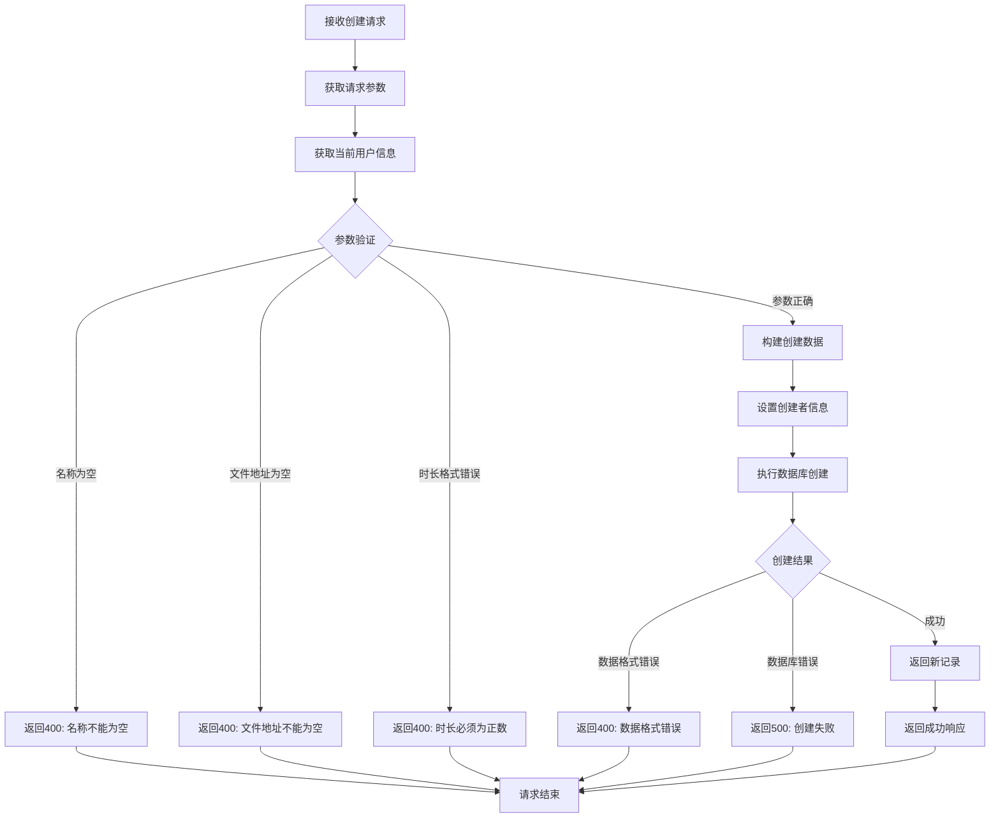

# 音频材料创建接口

## 功能描述

创建新的音频材料记录，支持教师上传音频文件信息并管理相关的元数据，包括名称、描述、标签等。

## 创建处理流程



## 接口信息

-   **路径**: `POST /v1/audioMaterial/create`
-   **权限**: 需要教师权限
-   **对应原项目**: `api/controllers/audioMaterial/create.js`

## 请求参数

### 必传参数

| 参数名  | 类型   | 说明         | 示例                             |
| ------- | ------ | ------------ | -------------------------------- |
| name    | string | 音频材料名称 | "英语听力练习 1"                 |
| fileUrl | string | 音频文件地址 | "https://example.com/audio1.mp3" |

### 可选参数

| 参数名      | 类型   | 说明         | 默认值 | 示例               |
| ----------- | ------ | ------------ | ------ | ------------------ |
| description | string | 音频材料描述 | ""     | "基础英语听力材料" |
| duration    | number | 音频时长(秒) | 0      | 180                |
| tags        | array  | 标签列表     | []     | ["英语", "听力"]   |

### 参数验证

-   `name`: 不能为空或仅包含空格
-   `fileUrl`: 不能为空或仅包含空格
-   `duration`: 如果提供，必须为正数
-   `tags`: 必须为数组格式

## 响应格式

### 成功响应

```json
{
    "code": 10000,
    "message": "音频材料创建成功",
    "data": {
        "id": "new_record_id",
        "name": "英语听力练习1",
        "description": "基础英语听力材料",
        "fileUrl": "https://example.com/audio1.mp3",
        "duration": 180,
        "tags": ["英语", "听力"],
        "createdBy": "teacher_id",
        "status": "active",
        "created": "2024-01-01 10:00:00",
        "updated": "2024-01-01 10:00:00"
    }
}
```

### 错误响应

```json
{
    "code": 400,
    "message": "音频材料名称不能为空",
    "data": null
}
```

```json
{
    "code": 500,
    "message": "创建失败，请稍后重试",
    "data": null
}
```

## 业务逻辑

### 数据处理

1. **参数清理**: 自动清除名称和描述的前后空格
2. **默认值设置**: 为可选参数设置合理的默认值
3. **创建者信息**: 自动设置当前登录教师为创建者
4. **状态设置**: 新创建的材料默认为活跃状态

### 权限控制

-   只有教师角色的用户可以创建音频材料
-   创建者信息自动从认证上下文获取
-   管理员也可以创建音频材料

## 数据库操作

### 使用的集合

-   **audioMaterials**: 音频材料主表

### 创建字段

```javascript
{
    name: string,           // 材料名称
    description: string,    // 材料描述
    fileUrl: string,        // 文件地址
    duration: number,       // 时长(秒)
    tags: array,           // 标签数组
    createdBy: string,     // 创建者ID
    status: string         // 状态(active/inactive)
}
```

### 自动字段

-   `id`: 系统自动生成的唯一标识
-   `created`: 创建时间戳
-   `updated`: 更新时间戳

## 权限要求

### 中间件链

```javascript
authMiddleware() → isTeacherMiddleware() → audioMaterialCreateHandler()
```

### 用户信息依赖

需要从上下文获取已认证的用户信息：

```javascript
const user = c.get('user');
// 期望包含：{ id, sn, role: 'teacher', isAdmin }
```

## 文件管理

### 文件上传

-   当前接口仅处理已上传文件的信息记录
-   文件上传应通过专门的文件上传接口完成
-   `fileUrl` 应为有效的文件访问地址

### 文件验证

-   建议在客户端或文件上传接口验证音频格式
-   检查文件可访问性
-   验证文件大小和时长

## 错误处理

### 参数验证错误

| 错误场景     | 错误代码 | 错误消息             |
| ------------ | -------- | -------------------- |
| 名称为空     | 400      | 音频材料名称不能为空 |
| 文件地址为空 | 400      | 音频文件地址不能为空 |
| 时长格式错误 | 400      | 音频时长必须为正数   |

### 数据库错误

| 错误场景     | 错误代码 | 错误消息                 |
| ------------ | -------- | ------------------------ |
| 数据格式错误 | 400      | 数据格式错误，请检查输入 |
| 创建失败     | 500      | 创建失败，请稍后重试     |
| 系统异常     | 500      | 服务器内部错误           |

## 性能考虑

### 数据验证

-   在应用层进行基础参数验证
-   避免无效数据传递到数据库层
-   合理的错误信息反馈

### 并发处理

-   PocketBase 自动处理并发创建
-   唯一约束由数据库层保证
-   事务安全由数据库保障

## 依赖关系

-   依赖工具类：[pocketbase.js](mdc:src/utils/pocketbase.js) - 数据库操作
-   依赖中间件：[auth.js](mdc:src/middleware/auth.js) - 用户认证
-   依赖中间件：[isTeacher.js](mdc:src/middleware/isTeacher.js) - 教师权限验证
-   依赖中间件：[response.js](mdc:src/middleware/response.js) - 响应格式化
-   外部依赖：`await-to-js` - 错误处理

## 使用示例

### 基础创建

```bash
curl -X POST http://localhost:1337/v1/audioMaterial/create \
  -H "Content-Type: application/json" \
  -H "Authorization: Bearer teacher_token" \
  -d '{
    "name": "英语听力练习1",
    "fileUrl": "https://example.com/audio1.mp3"
  }'
```

### 完整信息创建

```bash
curl -X POST http://localhost:1337/v1/audioMaterial/create \
  -H "Content-Type: application/json" \
  -H "Authorization: Bearer teacher_token" \
  -d '{
    "name": "英语听力练习1",
    "description": "基础英语听力材料，适合初学者",
    "fileUrl": "https://example.com/audio1.mp3",
    "duration": 180,
    "tags": ["英语", "听力", "初级"]
  }'
```

## 扩展功能

### 未来优化

-   支持批量创建音频材料
-   添加分类管理功能
-   支持音频格式转换
-   集成文件上传接口

### 相关接口

-   查询接口：[find.js](mdc:src/routes/audioMaterial/find.js)
-   更新接口：[update.js](mdc:src/routes/audioMaterial/update.js)
-   删除接口：[delete.js](mdc:src/routes/audioMaterial/delete.js)

## 更新历史

-   2024-01-XX: 从原 Sails.js 项目迁移，保持完全兼容
-   2024-01-XX: 增强参数验证和错误处理机制
