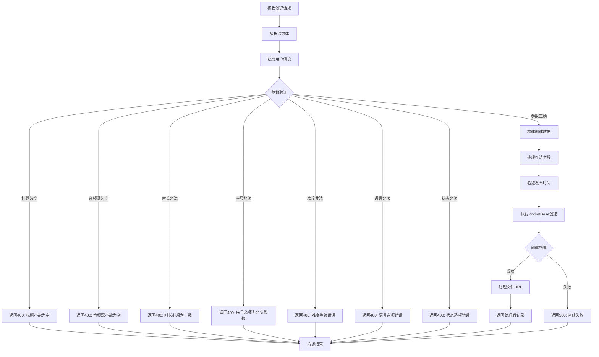

# 音频材料创建接口

## 功能描述

创建新的音频材料记录，支持设置标题、类型、描述、音频源、内容等完整信息，需要教师权限。

## 创建处理流程



## 接口信息

- **路径**: `POST /v1/audioMaterial/create`
- **权限**: 需要教师权限
- **对应原项目**: `api/controllers/audioMaterial/create.js`

## 请求参数

### 必需参数

| 参数名      | 类型   | 说明         | 示例             |
| ----------- | ------ | ------------ | ---------------- |
| title       | string | 音频材料标题 | "英语听力练习 1" |
| audioSource | string | 音频源文件   | "audio_file.mp3" |

### 可选参数

| 参数名      | 类型   | 说明            | 默认值  | 示例               |
| ----------- | ------ | --------------- | ------- | ------------------ |
| type        | string | 音频类型        | ""      | "listening"        |
| description | string | 音频描述        | ""      | "基础英语听力材料" |
| content     | string | 音频内容        | ""      | "详细的音频内容"   |
| publishedAt | string | 发布时间        | ""      | "2024-01-01"       |
| author      | string | 作者            | ""      | "张老师"           |
| duration    | number | 音频时长（秒）  | 0       | 180                |
| sequence    | number | 排序序号        | 0       | 1                  |
| status      | string | 状态            | "draft" | "published"        |
| coverImage  | string | 封面图片        | ""      | "cover.jpg"        |
| language    | string | 语言            | ""      | "中文"             |
| difficulty  | number | 难度等级（1-5） | 0       | 3                  |
| tags        | string | 标签            | ""      | "听力,初级"        |

### 参数限制

- `title`: 必填，不能为空字符串
- `audioSource`: 必填，不能为空字符串
- `duration`: 可选，必须为正数
- `sequence`: 可选，必须为非负整数
- `difficulty`: 可选，必须为 1-5 之间的整数
- `language`: 可选，只能是"中文"或"英文"
- `status`: 只能是"draft"或"published"
- `publishedAt`: 可选，必须为有效的日期格式

## 响应格式

### 成功响应

```json
{
  "code": 10000,
  "message": "音频材料创建成功",
  "data": {
    "id": "new_record_id",
    "title": "英语听力练习1",
    "type": "listening",
    "description": "基础英语听力材料",
    "audioSource": "audio_file.mp3",
    "audioSourceUrl": "https://s3.amazonaws.com/bucket/audio_materials/new_record_id/audio_file.mp3",
    "content": "详细的音频内容",
    "publishedAt": "2024-01-01",
    "author": "张老师",
    "duration": 180,
    "sequence": 1,
    "status": "draft",
    "coverImage": "cover.jpg",
    "coverImageUrl": "https://s3.amazonaws.com/bucket/audio_materials/new_record_id/cover.jpg",
    "language": "中文",
    "difficulty": 3,
    "tags": "听力,初级",
    "created": "2024-01-01 10:00:00",
    "updated": "2024-01-01 10:00:00"
  }
}
```

**注意**：响应中自动包含文件字段的完整 URL（`audioSourceUrl`、`coverImageUrl`），便于前端直接使用。

### 错误响应

```json
{
  "code": 400,
  "message": "音频材料标题不能为空",
  "data": null
}
```

```json
{
  "code": 400,
  "message": "音频源文件不能为空",
  "data": null
}
```

```json
{
  "code": 400,
  "message": "难度等级必须为1-5之间的整数",
  "data": null
}
```

## 业务逻辑

### 字段处理

1. **必需字段验证**: 检查 title 和 audioSource 不能为空
2. **数值类型处理**: duration 转换为浮点数，sequence 和 difficulty 转换为整数
3. **枚举值验证**: 检查 language 和 status 的有效值
4. **时间格式验证**: 验证 publishedAt 的日期格式
5. **可选字段处理**: 只有非空字段才会被添加到创建数据中
6. **文件 URL 生成**: 自动为 audioSource 和 coverImage 生成完整访问 URL

### 文件 URL 处理

- **S3 存储优先**: 检查环境变量配置，优先使用 S3 存储 URL
- **本地文件降级**: 未配置 S3 时使用 PocketBase 本地文件服务
- **字段兼容**: 支持 PocketBase 文件字段类型和传统字符串格式
- **URL 字段**: 为 `audioSource` 生成 `audioSourceUrl`，为 `coverImage` 生成 `coverImageUrl`

### 数据构建

- **基础数据**: title 和 audioSource 作为必需字段
- **条件添加**: 只有提供了非空值的可选字段才会添加
- **类型转换**: 自动处理数值类型转换
- **默认值**: status 默认为"draft"

## 数据库操作

### 使用的集合

- **audio_materials**: 音频材料主表

### 创建字段

基于 PocketBase 真实字段结构：

- title: 标题（必需）
- type: 类型
- description: 描述（富文本）
- audioSource: 音频源文件 URL（必需）
- content: 内容（富文本）
- publishedAt: 发布时间
- author: 作者
- duration: 时长（数值）
- sequence: 排序号（数值）
- status: 状态（枚举：draft/published）
- coverImage: 封面图片 URL
- language: 语言（枚举：中文/英文）
- difficulty: 难度等级（数值 1-5）
- tags: 标签
- created: 创建时间（自动）
- updated: 更新时间（自动）

## 权限要求

### 认证需求

- 需要通过教师权限认证中间件
- 获取当前用户信息作为创建者

### 数据权限

- 教师可以创建音频材料
- 管理员具有完整创建权限

## 依赖关系

- 依赖工具类：[pocketbase.js](mdc:src/utils/pocketbase.js) - 数据库操作
- 依赖工具类：[fileUrl.js](mdc:src/utils/fileUrl.js) - 文件 URL 处理
- 依赖中间件：[auth.js](mdc:src/middleware/auth.js) - 用户认证
- 依赖中间件：[response.js](mdc:src/middleware/response.js) - 响应格式化
- 外部依赖：`await-to-js` - 错误处理

## 使用示例

### 基础创建

```bash
curl -X POST http://localhost:1337/v1/audioMaterial/create \
  -H "Content-Type: application/json" \
  -H "Authorization: Bearer teacher_token" \
  -d '{
    "title": "英语听力练习1",
    "audioSource": "audio_file.mp3"
  }'
```

### 完整信息创建

```bash
curl -X POST http://localhost:1337/v1/audioMaterial/create \
  -H "Content-Type: application/json" \
  -H "Authorization: Bearer teacher_token" \
  -d '{
    "title": "高级英语听力练习",
    "type": "listening",
    "description": "适合高级学员的英语听力训练材料",
    "audioSource": "advanced_listening.mp3",
    "content": "包含商务对话、学术讲座等高难度内容",
    "publishedAt": "2024-01-15",
    "author": "李老师",
    "duration": 300,
    "sequence": 5,
    "status": "published",
    "coverImage": "advanced_cover.jpg",
    "language": "英文",
    "difficulty": 4,
    "tags": "听力,高级,商务"
  }'
```

## 扩展功能

### 未来优化

- 支持批量创建音频材料
- 添加分类管理功能
- 支持音频格式转换
- 集成文件上传接口

### 相关接口

- 查询接口：[find.js](mdc:src/routes/audioMaterial/find.js)
- 更新接口：[update.js](mdc:src/routes/audioMaterial/update.js)
- 删除接口：[delete.js](mdc:src/routes/audioMaterial/delete.js)

## 更新历史

- 2024-01-XX: 从原 Sails.js 项目迁移，保持完全兼容
- 2024-01-XX: 增强参数验证和错误处理机制
