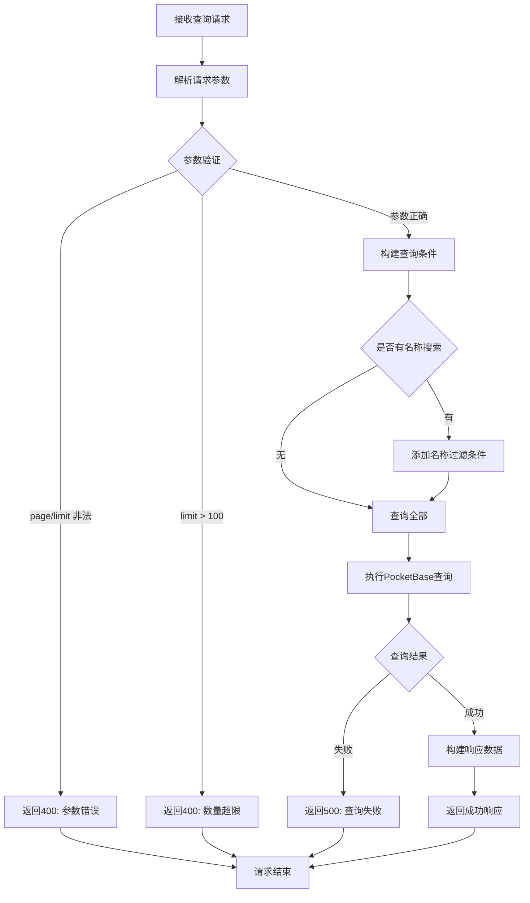

# 音频材料查询接口

## 功能描述

分页查询音频材料列表，支持按名称进行模糊搜索，返回包含分页信息的音频材料数据。

## 查询处理流程



## 接口信息

-   **路径**: `POST /v1/audioMaterial/find`
-   **权限**: 需要基础认证
-   **对应原项目**: `api/controllers/audioMaterial/find.js`

## 请求参数

### 可选参数

| 参数名 | 类型   | 说明         | 默认值 | 示例       |
| ------ | ------ | ------------ | ------ | ---------- |
| page   | number | 页码         | 1      | 2          |
| limit  | number | 每页数量     | 10     | 20         |
| name   | string | 音频材料名称 | ""     | "英语听力" |

### 参数限制

-   `page`: 必须为正整数
-   `limit`: 必须为正整数，最大值 100
-   `name`: 支持模糊匹配

## 响应格式

### 成功响应

```json
{
    "code": 10000,
    "message": "查询成功",
    "data": {
        "items": [
            {
                "id": "record_id",
                "name": "英语听力练习1",
                "description": "基础英语听力材料",
                "fileUrl": "https://example.com/audio1.mp3",
                "duration": 180,
                "tags": ["英语", "听力"],
                "createdBy": "teacher_id",
                "created": "2024-01-01 10:00:00",
                "updated": "2024-01-01 10:00:00"
            }
        ],
        "totalItems": 25,
        "totalPages": 3,
        "page": 1,
        "perPage": 10
    }
}
```

### 错误响应

```json
{
    "code": 400,
    "message": "页码和每页数量必须为正整数",
    "data": null
}
```

```json
{
    "code": 500,
    "message": "查询失败，请稍后重试",
    "data": null
}
```

## 业务逻辑

### 查询条件

1. **分页参数**: 验证 page 和 limit 的有效性
2. **名称搜索**: 如果提供 name 参数，进行模糊匹配
3. **排序规则**: 按创建时间倒序排列

### 搜索功能

-   **模糊匹配**: 使用 PocketBase 的 `~` 操作符
-   **大小写不敏感**: 自动处理大小写匹配
-   **空值处理**: 空字符串时查询全部

## 数据库操作

### 使用的集合

-   **audioMaterials**: 音频材料主表

### 查询字段

-   查询所有字段
-   按 `created` 字段倒序排序
-   支持分页和过滤

### 查询示例

```javascript
// 无搜索条件
pb.collection('audioMaterials').getList(1, 10, {
    sort: '-created',
});

// 按名称搜索
pb.collection('audioMaterials').getList(1, 10, {
    filter: 'name ~ "英语"',
    sort: '-created',
});
```

## 权限要求

### 认证需求

-   需要通过基础认证中间件
-   学生和教师都可以查询
-   管理员具有完整查询权限

### 数据过滤

-   当前版本返回所有音频材料
-   后续可根据用户角色进行数据过滤

## 性能考虑

### 查询优化

-   限制单次查询数量最大为 100
-   使用 PocketBase 的内置分页功能
-   索引建议：name 字段、created 字段

### 缓存策略

-   可考虑对热门查询结果进行缓存
-   缓存失效策略与音频材料更新关联

## 错误处理

### 参数验证错误

| 错误场景     | 错误代码 | 错误消息                   |
| ------------ | -------- | -------------------------- |
| 页码非正整数 | 400      | 页码和每页数量必须为正整数 |
| 数量超限     | 400      | 每页数量不能超过 100       |

### 数据库错误

| 错误场景 | 错误代码 | 错误消息             |
| -------- | -------- | -------------------- |
| 查询失败 | 500      | 查询失败，请稍后重试 |
| 系统异常 | 500      | 服务器内部错误       |

## 依赖关系

-   依赖工具类：[pocketbase.js](mdc:src/utils/pocketbase.js) - 数据库操作
-   依赖中间件：[auth.js](mdc:src/middleware/auth.js) - 用户认证
-   依赖中间件：[response.js](mdc:src/middleware/response.js) - 响应格式化
-   外部依赖：`await-to-js` - 错误处理

## 使用示例

### 基础查询

```bash
curl -X POST http://localhost:1337/v1/audioMaterial/find \
  -H "Content-Type: application/json" \
  -H "Authorization: Bearer your_token" \
  -d '{}'
```

### 分页查询

```bash
curl -X POST http://localhost:1337/v1/audioMaterial/find \
  -H "Content-Type: application/json" \
  -H "Authorization: Bearer your_token" \
  -d '{
    "page": 2,
    "limit": 20
  }'
```

### 名称搜索

```bash
curl -X POST http://localhost:1337/v1/audioMaterial/find \
  -H "Content-Type: application/json" \
  -H "Authorization: Bearer your_token" \
  -d '{
    "name": "英语",
    "page": 1,
    "limit": 10
  }'
```

## 更新历史

-   2024-01-XX: 从原 Sails.js 项目迁移，保持完全兼容
-   2024-01-XX: 添加参数验证和错误处理优化
