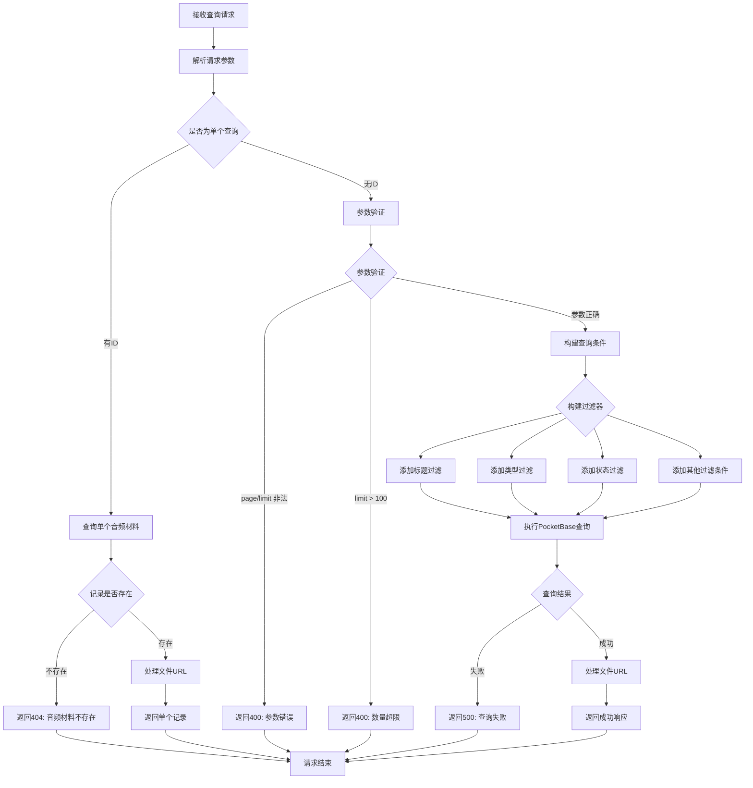

# 音频材料查询接口

## 功能描述

分页查询音频材料列表或获取单个音频材料详情，支持多种过滤条件，包括标题搜索、类型过滤、状态过滤等，自动处理音频文件和封面图片的 S3 URL 生成。

## 查询处理流程



## 接口信息

- **路径**: `POST /v1/audioMaterial/find`
- **权限**: 需要基础认证
- **对应原项目**: `api/controllers/audioMaterial/find.js`

## 请求参数

### 可选参数

| 参数名     | 类型   | 说明        | 默认值      | 示例        |
| ---------- | ------ | ----------- | ----------- | ----------- |
| id         | string | 音频材料 ID | ""          | "abc123"    |
| page       | number | 页码        | 1           | 2           |
| limit      | number | 每页数量    | 20          | 10          |
| title      | string | 标题搜索    | ""          | "英语听力"  |
| type       | string | 类型过滤    | ""          | "listening" |
| author     | string | 作者搜索    | ""          | "张老师"    |
| status     | string | 状态过滤    | "published" | "draft"     |
| language   | string | 语言过滤    | ""          | "中文"      |
| difficulty | string | 难度过滤    | ""          | "3"         |
| tags       | string | 标签搜索    | ""          | "初级"      |
| sort       | string | 排序方式    | "-created"  | "title"     |

### 参数限制

- `page`: 必须为正整数
- `limit`: 必须为正整数，最大值 100
- `status`: "published", "draft", "all"
- `language`: "中文", "英文"
- `difficulty`: 1-5 的整数
- `sort`: 支持字段名前加"-"表示倒序

## 响应格式

### 成功响应（单个记录）

```json
{
  "code": 10000,
  "message": "查询成功",
  "data": {
    "id": "record_id",
    "title": "英语听力练习1",
    "type": "listening",
    "description": "基础英语听力材料",
    "audioSource": "audio_file.mp3",
    "audioSourceUrl": "https://s3.amazonaws.com/bucket/collection_id/record_id/audio_file.mp3",
    "content": "音频内容描述",
    "publishedAt": "2024-01-01",
    "author": "张老师",
    "duration": 180,
    "sequence": 1,
    "status": "published",
    "coverImage": "cover.jpg",
    "coverImageUrl": "https://s3.amazonaws.com/bucket/collection_id/record_id/cover.jpg",
    "language": "中文",
    "difficulty": 3,
    "tags": "听力,初级",
    "created": "2024-01-01 10:00:00",
    "updated": "2024-01-01 10:00:00"
  }
}
```

### 成功响应（列表）

```json
{
  "code": 10000,
  "message": "查询成功",
  "data": {
    "items": [
      {
        "id": "record_id",
        "title": "英语听力练习1",
        "type": "listening",
        "description": "基础英语听力材料",
        "audioSource": "audio_file.mp3",
        "audioSourceUrl": "https://s3.amazonaws.com/bucket/collection_id/record_id/audio_file.mp3",
        "coverImage": "cover.jpg",
        "coverImageUrl": "https://s3.amazonaws.com/bucket/collection_id/record_id/cover.jpg",
        "duration": 180,
        "status": "published",
        "language": "中文",
        "difficulty": 3,
        "created": "2024-01-01 10:00:00"
      }
    ],
    "totalItems": 25,
    "totalPages": 3,
    "page": 1,
    "perPage": 20
  }
}
```

### 错误响应

```json
{
  "code": 404,
  "message": "音频材料不存在",
  "data": null
}
```

```json
{
  "code": 400,
  "message": "页码和每页数量必须为正整数",
  "data": null
}
```

## 业务逻辑

### 查询模式

1. **单个查询**: 提供 id 参数时，返回指定音频材料详情
2. **列表查询**: 不提供 id 时，返回分页列表

### 文件 URL 处理

**processAudioMaterialFiles 函数**：

- 检查环境变量 S3_URL 和 S3_BUCKET
- 如果配置了 S3，使用 S3 URL 格式
- 否则使用 PocketBase 本地文件 URL
- 处理 audioSource 和 coverImage 字段
- 生成 audioSourceUrl 和 coverImageUrl 字段

### 查询条件支持

- **标题搜索**: 模糊匹配 title 字段
- **类型过滤**: 精确匹配 type 字段
- **作者搜索**: 模糊匹配 author 字段
- **状态过滤**: 精确匹配 status 字段
- **语言过滤**: 精确匹配 language 字段
- **难度过滤**: 精确匹配 difficulty 字段
- **标签搜索**: 模糊匹配 tags 字段

## 数据库操作

### 使用的集合

- **audio_materials**: 音频材料主表

### 查询字段

基于 PocketBase 真实字段结构：

- id: 主键
- title: 标题
- type: 类型
- description: 描述（富文本）
- audioSource: 音频源文件 URL
- content: 内容（富文本）
- publishedAt: 发布时间
- author: 作者
- duration: 时长（秒）
- sequence: 排序号
- status: 状态（draft/published）
- coverImage: 封面图片 URL
- language: 语言（中文/英文）
- difficulty: 难度等级（1-5）
- tags: 标签
- created: 创建时间
- updated: 更新时间

## 性能考虑

### S3 URL 优化

- 优先使用 S3 直链，减少服务器流量
- 支持 CDN 加速访问
- 文件 URL 缓存在客户端

### 查询优化

- 支持多字段组合过滤
- 使用 PocketBase 内置索引
- 限制单次查询数量最大 100 条

## 依赖关系

- 依赖工具类：[pocketbase.js](mdc:src/utils/pocketbase.js) - 数据库操作
- 依赖中间件：[auth.js](mdc:src/middleware/auth.js) - 用户认证
- 依赖中间件：[response.js](mdc:src/middleware/response.js) - 响应格式化
- 外部依赖：`await-to-js` - 错误处理

## 使用示例

### 查询单个音频材料

```bash
curl -X POST http://localhost:1337/v1/audioMaterial/find \
  -H "Content-Type: application/json" \
  -H "Authorization: Bearer your_token" \
  -d '{"id": "audio_material_id"}'
```

### 多条件查询列表

```bash
curl -X POST http://localhost:1337/v1/audioMaterial/find \
  -H "Content-Type: application/json" \
  -H "Authorization: Bearer your_token" \
  -d '{
    "page": 1,
    "limit": 10,
    "title": "英语",
    "status": "published",
    "language": "中文",
    "difficulty": "3"
  }'
```

## 更新历史

- 2024-01-XX: 从原 Sails.js 项目迁移，保持完全兼容
- 2024-01-XX: 添加参数验证和错误处理优化
