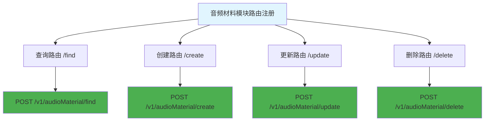

# 音频材料模块路由 (routes/audioMaterial/index.js)

## 功能描述
音频材料模块的路由配置，包含音频材料相关的所有接口路由注册。

## mermaid 流程图

## 路由配置

| 路径 | 方法 | 功能 | 权限要求 |
|------|------|------|----------|
| `/find` | POST | 查询音频材料 | 需要认证 |
| `/create` | POST | 创建音频材料 | 需要认证 |
| `/update` | POST | 更新音频材料 | 需要认证 |
| `/delete` | POST | 删除音频材料 | 需要认证 |

## 依赖关系

- [查询处理器](mdc:src/routes/audioMaterial/find.js.md)
- [创建处理器](mdc:src/routes/audioMaterial/create.js.md)
- [更新处理器](mdc:src/routes/audioMaterial/update.js.md)
- [删除处理器](mdc:src/routes/audioMaterial/delete.js.md)
- [认证中间件](mdc:src/middleware/auth.js.md)

## 更新历史

| 版本 | 日期 | 说明 |
|------|------|------|
| 1.0 | 2024-12-26 | 创建音频材料模块路由配置 |
