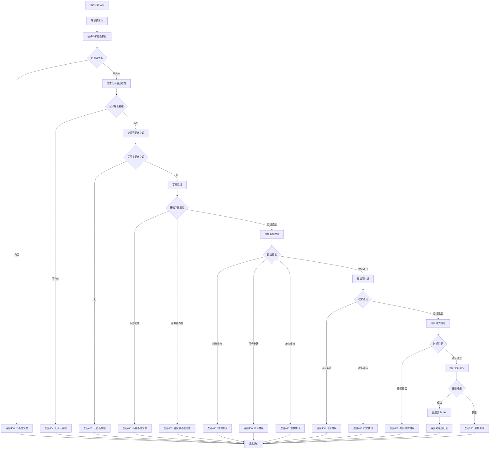

# 音频材料更新接口

## 功能描述

更新现有音频材料的信息，支持修改标题、类型、描述、音频源、内容等所有字段，需要教师权限。

## 更新处理流程



## 接口信息

- **路径**: `POST /v1/audioMaterial/update`
- **权限**: 需要教师权限
- **对应原项目**: `api/controllers/audioMaterial/update.js`

## 请求参数

### 必需参数

| 参数名 | 类型   | 说明        | 示例        |
| ------ | ------ | ----------- | ----------- |
| id     | string | 音频材料 ID | "audio_123" |

### 可选更新字段

| 参数名      | 类型   | 说明            | 示例             |
| ----------- | ------ | --------------- | ---------------- |
| title       | string | 音频材料标题    | "高级英语听力"   |
| type        | string | 音频类型        | "listening"      |
| description | string | 音频描述        | "适合高级学员"   |
| audioSource | string | 音频源文件      | "advanced.mp3"   |
| content     | string | 音频内容        | "详细内容描述"   |
| publishedAt | string | 发布时间        | "2024-01-15"     |
| author      | string | 作者            | "李老师"         |
| duration    | number | 音频时长（秒）  | 300              |
| sequence    | number | 排序序号        | 5                |
| status      | string | 状态            | "published"      |
| coverImage  | string | 封面图片        | "new_cover.jpg"  |
| language    | string | 语言            | "英文"           |
| difficulty  | number | 难度等级（1-5） | 4                |
| tags        | string | 标签            | "听力,高级,商务" |

### 参数限制

- `id`: 必填，不能为空
- `title`: 如果提供，不能为空字符串
- `audioSource`: 如果提供，不能为空字符串
- `duration`: 如果提供，必须为非负数
- `sequence`: 如果提供，必须为非负整数
- `difficulty`: 如果提供，必须为 1-5 之间的整数
- `language`: 如果提供，只能是"中文"或"英文"
- `status`: 如果提供，只能是"draft"或"published"
- `publishedAt`: 如果提供，必须为有效日期格式

## 响应格式

### 成功响应

```json
{
  "code": 10000,
  "message": "音频材料更新成功",
  "data": {
    "id": "audio_123",
    "title": "高级英语听力练习",
    "type": "listening",
    "description": "适合高级学员的英语听力训练",
    "audioSource": "advanced_listening.mp3",
    "audioSourceUrl": "https://s3.amazonaws.com/bucket/audio_materials/audio_123/advanced_listening.mp3",
    "content": "包含商务对话、学术讲座等",
    "publishedAt": "2024-01-15",
    "author": "李老师",
    "duration": 300,
    "sequence": 5,
    "status": "published",
    "coverImage": "advanced_cover.jpg",
    "coverImageUrl": "https://s3.amazonaws.com/bucket/audio_materials/audio_123/advanced_cover.jpg",
    "language": "英文",
    "difficulty": 4,
    "tags": "听力,高级,商务",
    "created": "2024-01-01 10:00:00",
    "updated": "2024-01-15 15:30:00"
  }
}
```

### 错误响应

```json
{
  "code": 400,
  "message": "音频材料ID不能为空",
  "data": null
}
```

```json
{
  "code": 404,
  "message": "音频材料不存在",
  "data": null
}
```

```json
{
  "code": 400,
  "message": "没有提供要更新的字段",
  "data": null
}
```

## 业务逻辑

### 更新流程

1. **记录验证**: 检查音频材料是否存在
2. **字段过滤**: 只处理允许更新的字段
3. **参数验证**: 对每个字段进行相应验证
4. **类型转换**: 自动处理数值类型转换
5. **数据更新**: 执行 PocketBase 更新操作
6. **文件 URL 处理**: 为更新后的记录生成完整文件访问 URL

### 允许更新字段

支持更新以下字段：

- title, type, description, audioSource, content
- publishedAt, author, duration, sequence, status
- coverImage, language, difficulty, tags

### 验证规则

- **基础验证**: 非空字段不能为空字符串
- **数值验证**: duration 为浮点数，sequence 和 difficulty 为整数
- **枚举验证**: language 和 status 必须为预定义值
- **时间验证**: publishedAt 必须为有效日期格式

## 数据库操作

### 使用的集合

- **audio_materials**: 音频材料主表

### 更新字段

基于 PocketBase 真实字段结构：

- title: 标题
- type: 类型
- description: 描述（富文本）
- audioSource: 音频源文件 URL
- content: 内容（富文本）
- publishedAt: 发布时间
- author: 作者
- duration: 时长（数值）
- sequence: 排序号（数值）
- status: 状态（枚举：draft/published）
- coverImage: 封面图片 URL
- language: 语言（枚举：中文/英文）
- difficulty: 难度等级（数值 1-5）
- tags: 标签
- updated: 更新时间（自动）

## 权限要求

### 认证需求

- 需要通过教师权限认证中间件
- 只有教师和管理员可以更新音频材料

### 数据权限

- 当前版本允许更新任何音频材料
- 后续可添加创建者权限验证

## 依赖关系

- 依赖工具类：[pocketbase.js](mdc:src/utils/pocketbase.js) - 数据库操作
- 依赖工具类：[fileUrl.js](mdc:src/utils/fileUrl.js) - 文件 URL 处理
- 依赖中间件：[auth.js](mdc:src/middleware/auth.js) - 用户认证
- 依赖中间件：[response.js](mdc:src/middleware/response.js) - 响应格式化
- 外部依赖：`await-to-js` - 错误处理

## 使用示例

### 基础字段更新

```bash
curl -X POST http://localhost:1337/v1/audioMaterial/update \
  -H "Content-Type: application/json" \
  -H "Authorization: Bearer teacher_token" \
  -d '{
    "id": "audio_123",
    "title": "新的音频标题",
    "description": "更新后的描述"
  }'
```

### 状态和属性更新

```bash
curl -X POST http://localhost:1337/v1/audioMaterial/update \
  -H "Content-Type: application/json" \
  -H "Authorization: Bearer teacher_token" \
  -d '{
    "id": "audio_123",
    "status": "published",
    "difficulty": 4,
    "language": "英文",
    "publishedAt": "2024-01-15"
  }'
```

### 完整信息更新

```bash
curl -X POST http://localhost:1337/v1/audioMaterial/update \
  -H "Content-Type: application/json" \
  -H "Authorization: Bearer teacher_token" \
  -d '{
    "id": "audio_123",
    "title": "高级商务英语听力",
    "type": "business",
    "description": "专业商务英语听力训练",
    "audioSource": "business_english.mp3",
    "author": "王老师",
    "duration": 600,
    "sequence": 10,
    "status": "published",
    "coverImage": "business_cover.jpg",
    "language": "英文",
    "difficulty": 5,
    "tags": "商务,英语,高级"
  }'
```
