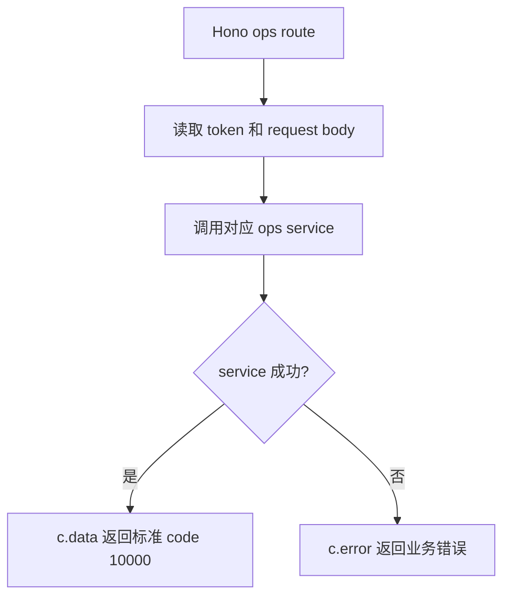

# handlers.js

轻量运营后台路由处理器集合。该文件只负责从 Hono Context 读取参数和请求体，再委托给 auth、points、reward services。

## 关键入口

- `login/register/me/changePassword`: 教务后台账号生命周期。
- `studentPoints/addStudentPoints`: 管理员查看学员积分台账并添加积分。
- `offlineRedeem`: 管理员选择实物后按服务端价格扣减积分，线下交付实物。
- `listRewards/createReward/updateReward`: 管理轻量实物兑换列表。

## 约定

- 返回 `{ ok, data }` 的 auth service 使用 `sendResult`。
- 积分和实物 service 直接返回 data 或抛业务错误，handler 使用 `safe` 转为标准响应。
- 本分支不暴露 dashboard、通用 CRUD、测评、报告、运营位、富文本上传。
