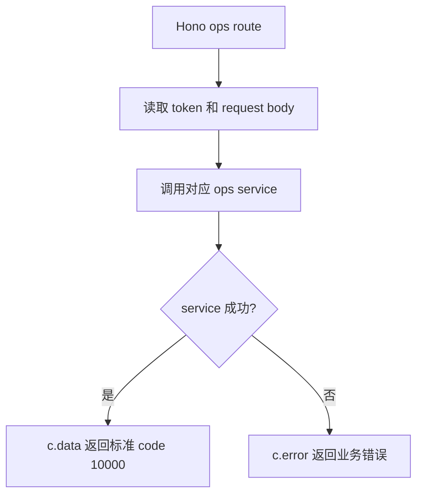

# handlers.js

运营后台路由处理器集合。该文件只负责从 Hono Context 读取参数和请求体，再委托给 ops services。

## 关键入口

- `login/register/me/changePassword`: 教务后台账号生命周期。
- `dashboard/publicOperationSlots`: 后台总览和小程序公开运营位。
- `list/detail/create/update`: 通用运营资源 CRUD。
- `uploadRichTextImage`: 富文本图片上传，委托 `richTextAssetService.uploadImage`。
- assessment/reporting 相关 handler 委托给对应 service。

## 约定

- 返回 `{ ok, data }` 的 service 使用 `safeResult`。
- 直接返回 data 或抛错的 service 使用 `safe`。
- 鉴权错误统一识别 `OpsAuthorizationError`。
