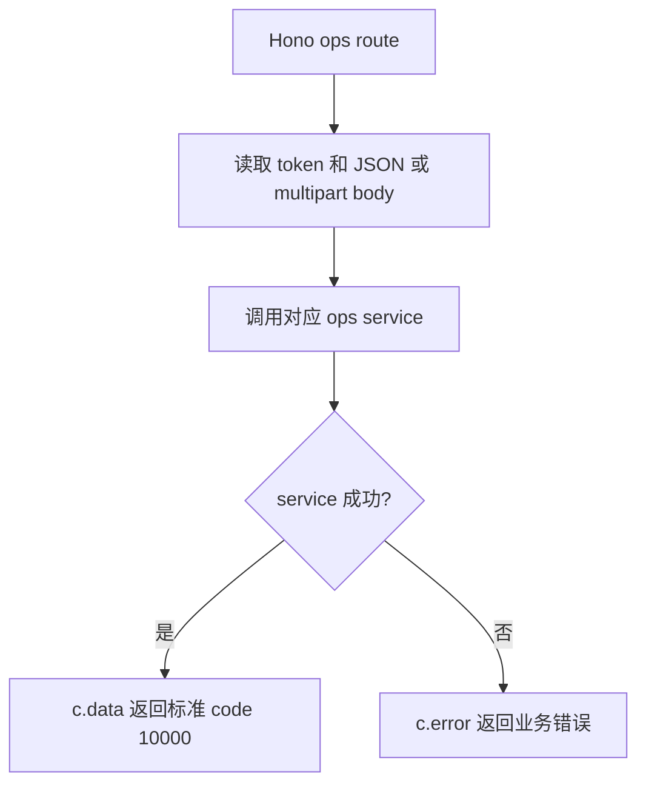

# handlers.js

轻量运营后台路由处理器集合。该文件只负责从 Hono Context 读取参数和请求体，再委托给 auth、student admin、points、reward services。

## 关键入口

- `login/register/me/changePassword`: 教务后台账号生命周期。
- `listManagedStudents/createManagedStudent/updateManagedStudent`: 管理员维护轻量学员目录与启用状态，不连接完整教务功能。
- `studentPoints/addStudentPoints`: 管理员查看学员积分台账并添加积分。
- `offlineRedeem`: 管理员选择实物后按服务端价格扣减积分，线下交付实物。
- `listRewards/createReward/updateReward`: 管理轻量实物兑换列表。
- `uploadRewardImage`: 解析 multipart 图片并委托 reward service 校验管理员、文件类型和 5MB 大小限制，再写入 PocketBase 文件字段。

## 约定

- 返回 `{ ok, data }` 的 auth service 使用 `sendResult`。
- 学员、积分和实物 service 直接返回 data 或抛业务错误，handler 使用 `safe` 转为标准响应。
- 图片上传请求只接受服务端解析后的文件对象；multipart 解析失败返回 400，不把 PocketBase 或 MinIO 凭据暴露给浏览器。
- 上传成功响应中的图片地址由 reward service 投影：生产环境使用公开对象存储地址，本地回退 PocketBase `/api/files`。
- 学员管理仅支持列表、新增、编辑和启用/停用，不提供硬删除或积分流水级联。
- 本分支不暴露 dashboard、通用 CRUD、班级课程、测评、报告、运营位、富文本上传。
