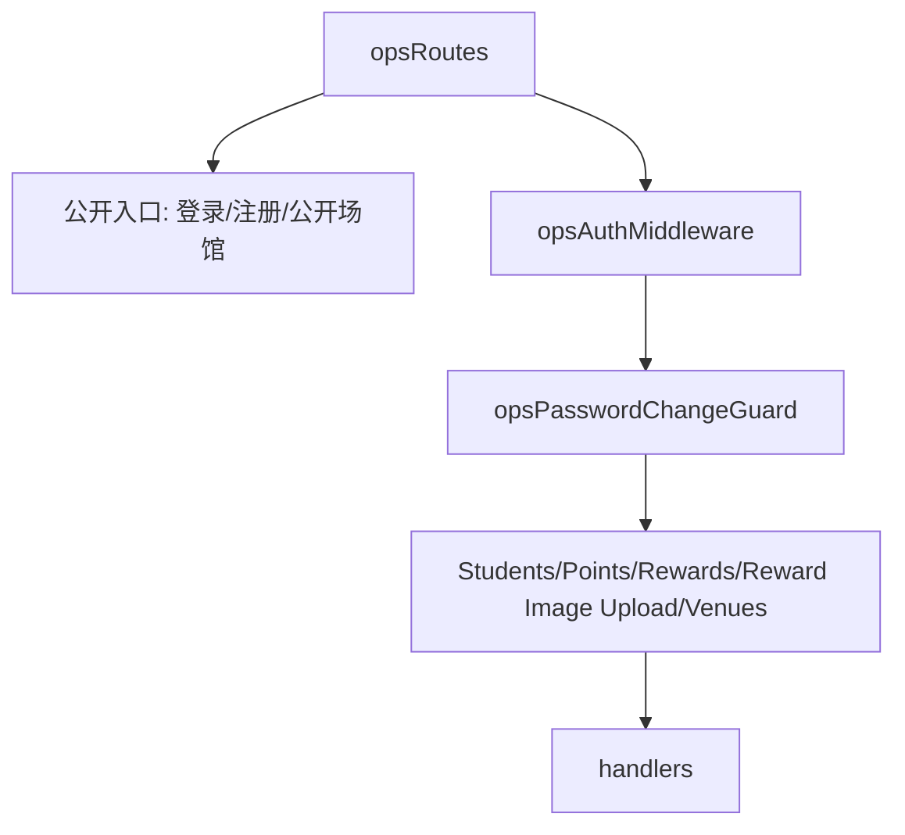

# index.js

轻量运营后台路由注册文件。`/ops/*` 在本分支只挂载后台认证、学员目录、积分台账、实物列表、线下兑换和场馆管理；另挂一个无需登录的 `GET /v1/public/venues` 供小程序读取启用场馆。

## 路由层级

- 公开入口：登录、注册，以及 `GET /v1/public/venues`（只返回启用场馆的展示字段与 `bookable`）。
- 认证入口：`/ops/auth/me` 和修改密码。
- 积分入口：查看学员积分、添加积分、线下兑换扣分。
- 场馆入口：`GET/POST /ops/venues`、`POST /ops/venues/:id`，管理员维护名称、简介、地址、营业时间、电话、可约课、启用状态和排序；只停用不删除。
- 实物入口：查看、创建、更新实物兑换项，以及 `POST /ops/reward-items/:id/image` 管理员图片上传。

## 顺序要求

本分支不注册 `/ops/:resource` 动态路由；新增 ops 能力必须显式列出固定路径。

图片上传仍经过 `opsAuthMiddleware` 和密码变更守卫。浏览器不直连 PocketBase 管理接口，文件写入由 Hono 委托 PocketBase，读取地址由服务端映射为公开 MinIO bucket URL。
