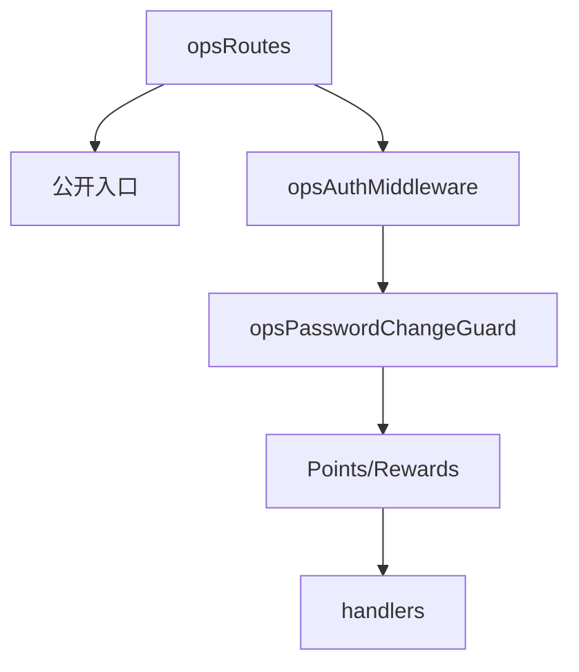

# index.js

轻量运营后台路由注册文件。`/ops/*` 在本分支只挂载后台认证、积分台账、实物列表和线下兑换。

## 路由层级

- 公开入口：登录、注册。
- 认证入口：`/ops/auth/me` 和修改密码。
- 积分入口：查看学员积分、添加积分、线下兑换扣分。
- 实物入口：查看、创建、更新实物兑换项。

## 顺序要求

本分支不注册 `/ops/:resource` 动态路由；新增 ops 能力必须显式列出固定路径。
