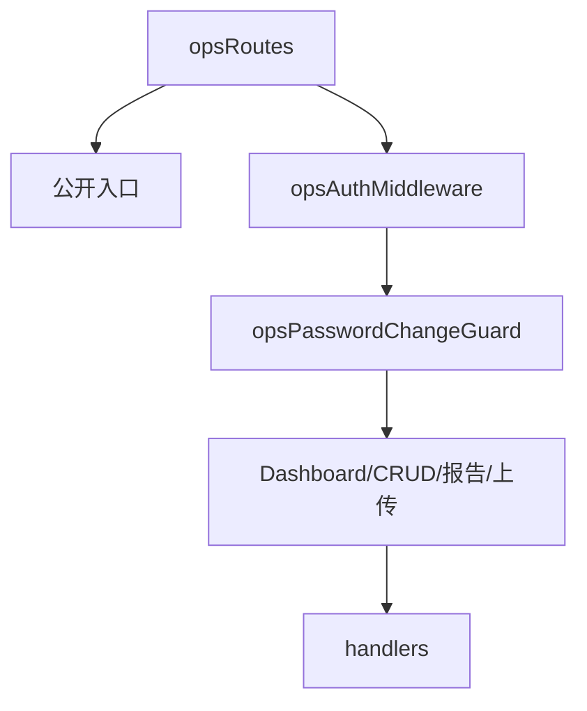

# index.js

运营后台路由注册文件。所有 `/ops/*` 路由在这里挂载，并按公开入口、认证入口、通用资源入口分层。

## 路由层级

- 公开入口：登录、注册、公开分享、公开运营位。
- 认证入口：`/ops/auth/me` 和修改密码。
- 业务入口：dashboard、测评模板、报告事件、报告实例、通用资源 CRUD。
- 上传入口：`POST /ops/uploads/rich-text-image`，用于后台富文本图片。

## 顺序要求

上传、报告等固定路径必须放在 `/ops/:resource` 动态路径之前，否则会被通用资源路由吞掉。
