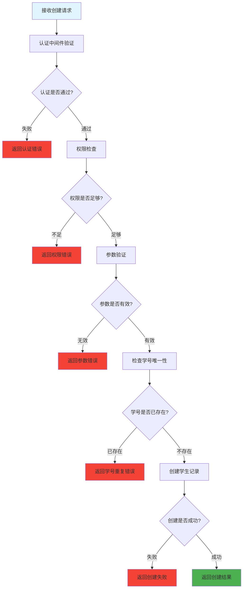

# 创建学生信息 (routes/student/create.js)

## 功能描述

创建学生信息接口，允许具有相应权限的用户创建新的学生档案，并进行必要的数据验证。

## mermaid 流程图



## 接口信息

-   **路径**: `POST /v1/student/create`
-   **权限**: 需要认证 + 教师权限
-   **Content-Type**: application/json

## 请求参数

| 参数名    | 类型   | 必填 | 说明         |
| --------- | ------ | ---- | ------------ |
| name      | string | 是   | 学生姓名     |
| email     | string | 是   | 学生邮箱     |
| studentId | string | 是   | 学号（唯一） |
| grade     | string | 是   | 年级         |
| class     | string | 否   | 班级         |
| phone     | string | 否   | 联系电话     |
| avatar    | string | 否   | 头像 URL     |
| profile   | object | 否   | 扩展资料     |

## 请求示例

```json
{
    "name": "李明",
    "email": "liming@example.com",
    "studentId": "2024001",
    "grade": "高一",
    "class": "1班",
    "phone": "13800138001",
    "profile": {
        "bio": "热爱学习的学生",
        "interests": ["数学", "物理"],
        "skills": ["编程", "绘画"]
    }
}
```

## 响应格式

### 成功响应

```json
{
    "code": 10000,
    "message": null,
    "data": {
        "id": "student_id_generated",
        "name": "李明",
        "email": "liming@example.com",
        "studentId": "2024001",
        "grade": "高一",
        "class": "1班",
        "phone": "13800138001",
        "status": "active",
        "created": "2024-12-26T10:08:12.000Z"
    }
}
```

### 错误响应

```json
{
    "code": 40001,
    "message": "参数验证失败: 姓名不能为空",
    "data": null
}
```

## 验证规则

### 必填字段验证

-   **姓名**: 不能为空，长度 2-50 字符
-   **邮箱**: 有效的邮箱格式
-   **学号**: 不能为空，长度 6-20 字符，仅包含字母数字
-   **年级**: 不能为空

### 可选字段验证

-   **电话**: 有效的手机号格式
-   **邮箱**: 邮箱格式验证，重复性检查

### 业务规则验证

-   **学号唯一性**: 检查数据库中是否已存在
-   **邮箱唯一性**: 确保邮箱地址未被使用

## 错误代码

| 错误代码 | 说明                     |
| -------- | ------------------------ |
| 40001    | 参数验证失败             |
| 40101    | 认证失败                 |
| 40301    | 权限不足（需要教师权限） |
| 40901    | 学号已存在               |
| 40902    | 邮箱已存在               |
| 50001    | 创建学生失败             |

## 权限要求

### 最低权限

-   用户必须通过认证
-   用户角色必须为教师或管理员

### 权限检查

```javascript
// 伪代码示例
if (user.role !== 'teacher' && user.role !== 'admin') {
    return c.error(40301, '权限不足，需要教师或管理员权限');
}
```

## 依赖关系

-   [PocketBase 工具](mdc:src/utils/pocketbase.js.md) - 数据库操作
-   [认证中间件](mdc:src/middleware/auth.js.md) - 用户认证
-   [教师权限中间件](mdc:src/middleware/isTeacher.js.md) - 权限验证
-   [响应中间件](mdc:src/middleware/response.js.md) - 统一响应格式

## 使用示例

```bash
curl -X POST http://localhost:1337/v1/student/create \
  -H "Content-Type: application/json" \
  -H "Authorization: Bearer TEACHER_TOKEN" \
  -d '{
    "name": "王小明",
    "email": "wangxiaoming@example.com",
    "studentId": "2024002",
    "grade": "高二",
    "class": "3班"
  }'
```

## 数据库操作

### 创建记录

```javascript
// 伪代码示例
const studentData = {
    ...validatedData,
    status: 'active',
    created: new Date().toISOString(),
    updated: new Date().toISOString(),
};

const newStudent = await pb.collection('students').create(studentData);
```

## 更新历史

| 版本 | 日期       | 说明             |
| ---- | ---------- | ---------------- |
| 1.0  | 2024-12-26 | 创建学生信息接口 |
