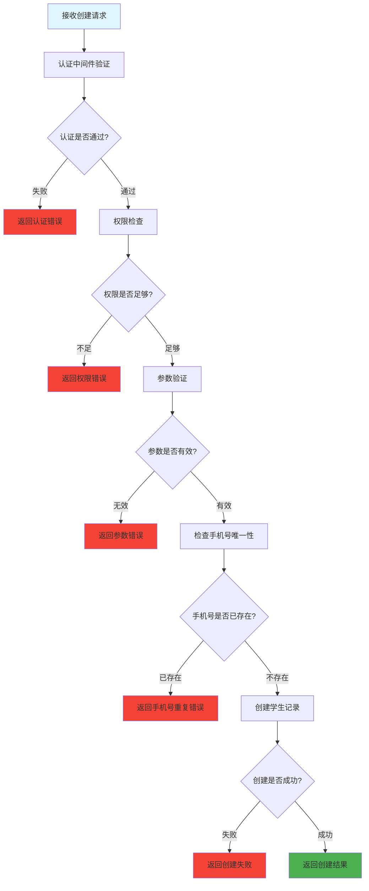

# 创建学生信息 (routes/student/create.js)

## 功能描述

创建学生信息接口，允许具有相应权限的用户创建新的学生档案，并进行必要的数据验证。

## mermaid 流程图



## 接口信息

-   **路径**: `POST /v1/student/create`
-   **权限**: 需要认证 + 教师权限
-   **Content-Type**: application/json

## 请求参数

| 参数名    | 类型   | 必填 | 说明                      |
| --------- | ------ | ---- | ------------------------- |
| cellphone | string | 是   | 手机号（唯一标识）        |
| password  | string | 是   | 密码                      |
| realname  | string | 否   | 真实姓名                  |
| nickName  | string | 否   | 昵称                      |
| avatar    | string | 否   | 头像 URL                  |
| gender    | number | 否   | 性别 (0:未知，1:男，2:女) |
| age       | number | 否   | 年龄，默认 18             |
| province  | string | 否   | 省份                      |
| city      | string | 否   | 城市                      |
| address   | string | 否   | 地址                      |
| hours     | number | 否   | 课时，默认 0              |

## 请求示例

```json
{
    "cellphone": "13800138000",
    "password": "123456",
    "realname": "张三",
    "nickName": "小张",
    "avatar": "https://example.com/avatar.jpg",
    "gender": 1,
    "age": 20,
    "province": "广东省",
    "city": "深圳市",
    "address": "南山区科技园",
    "hours": 0
}
```

## 响应格式

### 成功响应

```json
{
    "code": 10000,
    "message": null,
    "data": {
        "id": "student_id_generated",
        "name": "李明",
        "email": "liming@example.com",
        "studentId": "2024001",
        "grade": "高一",
        "class": "1班",
        "phone": "13800138001",
        "status": "active",
        "created": "2024-12-26T10:08:12.000Z"
    }
}
```

### 错误响应

```json
{
    "code": 40001,
    "message": "参数验证失败: 姓名不能为空",
    "data": null
}
```

## 验证规则

### 必填字段验证

-   **手机号**: 不能为空，必须是有效的手机号格式
-   **密码**: 不能为空

### 可选字段验证

-   **性别**: 数字类型，0-2 之间
-   **年龄**: 数字类型，默认 18
-   **课时**: 数字类型，默认 0

### 业务规则验证

-   **手机号唯一性**: 检查数据库中是否已存在
-   **密码加密**: 使用 MD5 算法加密存储

## 错误代码

| 错误代码 | 说明                     |
| -------- | ------------------------ |
| 40001    | 参数验证失败             |
| 40101    | 认证失败                 |
| 40301    | 权限不足（需要教师权限） |
| 40901    | 手机号已注册             |
| 50001    | 创建学生失败             |

## 权限要求

### 最低权限

-   用户必须通过认证
-   用户角色必须为教师或管理员

### 权限检查

```javascript
// 伪代码示例
if (user.role !== 'teacher' && user.role !== 'admin') {
    return c.error(40301, '权限不足，需要教师或管理员权限');
}
```

## 依赖关系

-   [PocketBase 工具](mdc:src/utils/pocketbase.js.md) - 数据库操作
-   [认证中间件](mdc:src/middleware/auth.js.md) - 用户认证
-   [教师权限中间件](mdc:src/middleware/isTeacher.js.md) - 权限验证
-   [响应中间件](mdc:src/middleware/response.js.md) - 统一响应格式

## 使用示例

```bash
curl -X POST http://localhost:1337/v1/student/create \
  -H "Content-Type: application/json" \
  -H "Authorization: Bearer TEACHER_TOKEN" \
  -d '{
    "name": "王小明",
    "email": "wangxiaoming@example.com",
    "studentId": "2024002",
    "grade": "高二",
    "class": "3班"
  }'
```

## 数据库操作

### 创建记录

```javascript
// 伪代码示例
const studentData = {
    ...validatedData,
    status: 'active',
    created: new Date().toISOString(),
    updated: new Date().toISOString(),
};

const newStudent = await pb.collection('students').create(studentData);
```

## 更新历史

| 版本 | 日期       | 说明             |
| ---- | ---------- | ---------------- |
| 1.0  | 2024-12-26 | 创建学生信息接口 |
