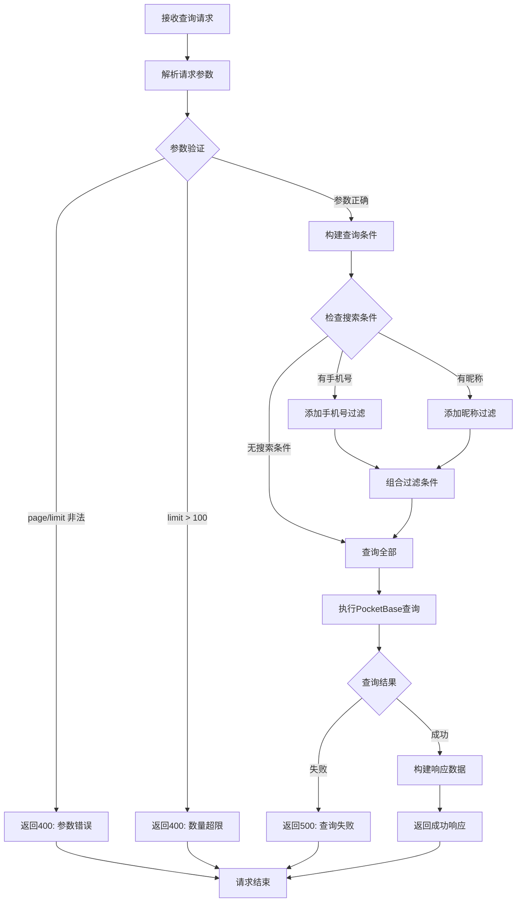

# 学生查询接口

## 功能描述

分页查询学生列表，支持按手机号和昵称进行模糊搜索，用于教师管理学生信息。

## 查询处理流程



## 接口信息

-   **路径**: `POST /v1/student/find`
-   **权限**: 需要教师权限
-   **对应原项目**: `api/controllers/student/find.js`

## 请求参数

### 可选参数

| 参数名    | 类型   | 说明       | 默认值 | 示例   |
| --------- | ------ | ---------- | ------ | ------ |
| page      | number | 页码       | 1      | 2      |
| limit     | number | 每页数量   | 10     | 20     |
| cellphone | string | 手机号搜索 | ""     | "138"  |
| nickName  | string | 昵称搜索   | ""     | "张三" |

### 参数限制

-   `page`: 必须为正整数
-   `limit`: 必须为正整数，最大值 100
-   `cellphone`: 支持模糊匹配
-   `nickName`: 支持模糊匹配

## 响应格式

### 成功响应

```json
{
    "code": 10000,
    "message": "查询成功",
    "data": {
        "items": [
            {
                "id": "student_id",
                "sn": "unique_sn",
                "cellphone": "13800138000",
                "nickName": "张三",
                "avatar": "https://example.com/avatar.jpg",
                "realName": "张三丰",
                "gender": "male",
                "birthday": "1990-01-01",
                "blocked": false,
                "lastLoginAt": "2024-01-01 10:00:00",
                "created": "2024-01-01 09:00:00",
                "updated": "2024-01-01 10:00:00"
            }
        ],
        "totalItems": 50,
        "totalPages": 5,
        "page": 1,
        "perPage": 10
    }
}
```

### 错误响应

```json
{
    "code": 400,
    "message": "页码和每页数量必须为正整数",
    "data": null
}
```

```json
{
    "code": 500,
    "message": "查询失败，请稍后重试",
    "data": null
}
```

## 业务逻辑

### 查询条件

1. **分页参数**: 验证 page 和 limit 的有效性
2. **搜索条件**: 支持手机号和昵称的组合搜索
3. **排序规则**: 按创建时间倒序排列
4. **字段过滤**: 只返回必要的字段，排除敏感信息

### 搜索功能

-   **模糊匹配**: 使用 PocketBase 的 `~` 操作符
-   **条件组合**: 多个条件使用 `&&` 连接
-   **大小写不敏感**: 自动处理大小写匹配

## 数据库操作

### 使用的集合

-   **students**: 学生信息主表

### 返回字段

出于安全考虑，只返回以下字段：

-   `id`: 记录 ID
-   `sn`: 学号
-   `cellphone`: 手机号
-   `nickName`: 昵称
-   `avatar`: 头像
-   `realName`: 真实姓名
-   `gender`: 性别
-   `birthday`: 生日
-   `blocked`: 是否被封禁
-   `lastLoginAt`: 最后登录时间
-   `created`: 创建时间
-   `updated`: 更新时间

### 排除字段

为保护隐私，不返回以下敏感字段：

-   `password`: 密码
-   `tokenKey`: JWT 密钥
-   `lastLoginIp`: 登录 IP

## 权限要求

### 中间件链

```javascript
authMiddleware() → isTeacherMiddleware() → studentFindHandler()
```

### 教师权限

-   只有教师角色可以查询学生信息
-   管理员具有完整查询权限
-   学生无法查询其他学生信息

## 搜索优化

### 索引建议

为提高查询性能，建议在以下字段创建索引：

-   `cellphone`: 手机号搜索
-   `nickName`: 昵称搜索
-   `created`: 排序字段

### 查询示例

```javascript
// 按手机号搜索
pb.collection('students').getList(1, 10, {
    filter: 'cellphone ~ "138"',
    sort: '-created',
});

// 组合搜索
pb.collection('students').getList(1, 10, {
    filter: 'cellphone ~ "138" && nickName ~ "张"',
    sort: '-created',
});
```

## 性能考虑

### 查询优化

-   限制单次查询数量最大为 100
-   使用字段过滤减少数据传输
-   合理使用索引提高查询速度

### 缓存策略

-   可考虑对热门查询结果进行缓存
-   缓存失效策略与学生信息更新关联

## 错误处理

### 参数验证错误

| 错误场景     | 错误代码 | 错误消息                   |
| ------------ | -------- | -------------------------- |
| 页码非正整数 | 400      | 页码和每页数量必须为正整数 |
| 数量超限     | 400      | 每页数量不能超过 100       |

### 数据库错误

| 错误场景 | 错误代码 | 错误消息             |
| -------- | -------- | -------------------- |
| 查询失败 | 500      | 查询失败，请稍后重试 |
| 系统异常 | 500      | 服务器内部错误       |

## 隐私保护

### 数据脱敏

-   手机号中间四位可考虑脱敏显示
-   真实姓名可根据权限级别部分隐藏
-   登录信息仅管理员可见

### 访问控制

-   严格的权限验证
-   审计日志记录
-   敏感操作权限分离

## 依赖关系

-   依赖工具类：[pocketbase.js](mdc:src/utils/pocketbase.js) - 数据库操作
-   依赖中间件：[auth.js](mdc:src/middleware/auth.js) - 用户认证
-   依赖中间件：[isTeacher.js](mdc:src/middleware/isTeacher.js) - 教师权限验证
-   依赖中间件：[response.js](mdc:src/middleware/response.js) - 响应格式化
-   外部依赖：`await-to-js` - 错误处理

## 使用示例

### 基础查询

```bash
curl -X POST http://localhost:1337/v1/student/find \
  -H "Content-Type: application/json" \
  -H "Authorization: Bearer teacher_token" \
  -d '{}'
```

### 分页查询

```bash
curl -X POST http://localhost:1337/v1/student/find \
  -H "Content-Type: application/json" \
  -H "Authorization: Bearer teacher_token" \
  -d '{
    "page": 2,
    "limit": 20
  }'
```

### 按手机号搜索

```bash
curl -X POST http://localhost:1337/v1/student/find \
  -H "Content-Type: application/json" \
  -H "Authorization: Bearer teacher_token" \
  -d '{
    "cellphone": "138",
    "page": 1,
    "limit": 10
  }'
```

### 组合搜索

```bash
curl -X POST http://localhost:1337/v1/student/find \
  -H "Content-Type: application/json" \
  -H "Authorization: Bearer teacher_token" \
  -d '{
    "cellphone": "138",
    "nickName": "张",
    "page": 1,
    "limit": 10
  }'
```

## 相关接口

-   学生创建：[create.js](mdc:src/routes/student/create.js)
-   学生更新：[update.js](mdc:src/routes/student/update.js)
-   学生删除：[delete.js](mdc:src/routes/student/delete.js)

## 更新历史

-   2024-01-XX: 从原 Sails.js 项目迁移，保持完全兼容
-   2024-01-XX: 增强隐私保护和字段过滤机制
