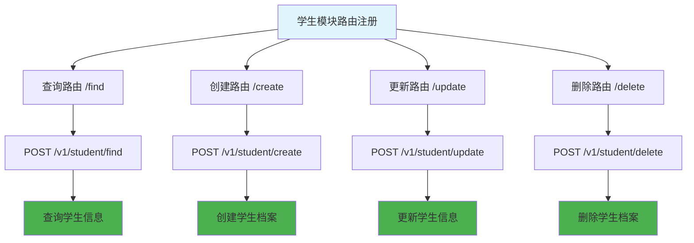

# 学生模块路由 (routes/student/index.js)

## 功能描述

学生模块的路由配置，包含学生相关的所有接口路由注册，提供学生信息的完整 CRUD 操作。

## mermaid 流程图



## 路由配置

### 接口列表

| 路径      | 方法 | 功能     | 权限要求 |
| --------- | ---- | -------- | -------- |
| `/find`   | POST | 查询学生 | 需要认证 |
| `/create` | POST | 创建学生 | 需要认证 |
| `/update` | POST | 更新学生 | 需要认证 |
| `/delete` | POST | 删除学生 | 需要认证 |

### 完整路径

-   `POST /v1/student/find` - 查询学生信息
-   `POST /v1/student/create` - 创建学生档案
-   `POST /v1/student/update` - 更新学生信息
-   `POST /v1/student/delete` - 删除学生档案

## 权限控制

### 认证要求

所有学生模块接口都需要用户认证

### 角色权限

-   **学生**: 只能查看和更新自己的信息
-   **教师**: 可以查看所有学生信息，创建和更新学生档案
-   **管理员**: 拥有所有权限，包括删除操作

## 依赖关系

### 路由处理器

-   [查询处理器](mdc:src/routes/student/find.js.md) - 学生信息查询
-   [创建处理器](mdc:src/routes/student/create.js.md) - 学生档案创建
-   [更新处理器](mdc:src/routes/student/update.js.md) - 学生信息更新
-   [删除处理器](mdc:src/routes/student/delete.js.md) - 学生档案删除

### 中间件依赖

-   [认证中间件](mdc:src/middleware/auth.js.md) - 用户身份验证
-   [教师权限中间件](mdc:src/middleware/isTeacher.js.md) - 教师权限验证
-   [管理员权限中间件](mdc:src/middleware/isAdmin.js.md) - 管理员权限验证

## 数据模型

### 学生信息结构

```json
{
    "id": "student_id",
    "name": "学生姓名",
    "email": "student@example.com",
    "studentId": "学号",
    "grade": "年级",
    "class": "班级",
    "phone": "联系电话",
    "avatar": "头像URL",
    "status": "active|inactive",
    "profile": {
        "bio": "个人简介",
        "interests": ["兴趣爱好"],
        "skills": ["技能标签"]
    },
    "created": "2024-12-26T10:08:12.000Z",
    "updated": "2024-12-26T10:08:12.000Z"
}
```

## 业务规则

### 1. 学生档案创建

-   必填字段: 姓名、邮箱、学号
-   学号唯一性检查
-   邮箱格式验证

### 2. 信息更新

-   支持部分字段更新
-   保留审计日志
-   敏感信息需要特殊权限

### 3. 档案删除

-   软删除机制
-   关联数据清理
-   操作日志记录

## 使用示例

### 查询学生

```bash
curl -X POST http://localhost:1337/v1/student/find \
  -H "Content-Type: application/json" \
  -H "Authorization: Bearer TOKEN" \
  -d '{"page": 1, "limit": 20}'
```

### 创建学生

```bash
curl -X POST http://localhost:1337/v1/student/create \
  -H "Content-Type: application/json" \
  -H "Authorization: Bearer TOKEN" \
  -d '{
    "name": "张三",
    "email": "zhangsan@example.com",
    "studentId": "2024001",
    "grade": "高一",
    "class": "1班"
  }'
```

## 错误处理

### 常见错误代码

-   `40001` - 参数验证失败
-   `40101` - 认证失败
-   `40301` - 权限不足
-   `40901` - 学号已存在
-   `50001` - 数据库操作失败

## 更新历史

| 版本 | 日期       | 说明                 |
| ---- | ---------- | -------------------- |
| 1.0  | 2024-12-26 | 创建学生模块路由配置 |
