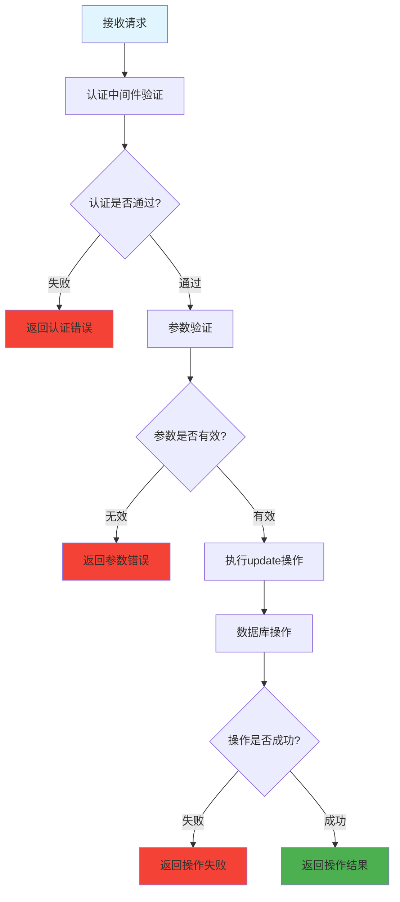

# 更新学生信息 (routes/student/update.js)

## 功能描述
更新学生信息接口，处理student的update操作相关的业务逻辑和数据操作。

## mermaid 流程图



## 接口信息

- **路径**: `POST /v1/student/update`
- **权限**: 需要认证
- **Content-Type**: application/json

## 请求参数

| 参数名 | 类型 | 必填 | 说明 |
|--------|------|------|------|
| 待补充 | string | 是 | 参数说明 |

## 响应格式

### 成功响应
```json
{
  "code": 10000,
  "message": null,
  "data": {
    // 响应数据
  }
}
```

### 错误响应
```json
{
  "code": 错误代码,
  "message": "错误信息",
  "data": null
}
```

## 依赖关系

- [PocketBase工具](mdc:src/utils/pocketbase.js.md) - 数据库操作
- [认证中间件](mdc:src/middleware/auth.js.md) - 用户认证

## 更新历史

| 版本 | 日期 | 说明 |
|------|------|------|
| 1.0 | 2024-12-26 | 创建更新学生信息接口 |
