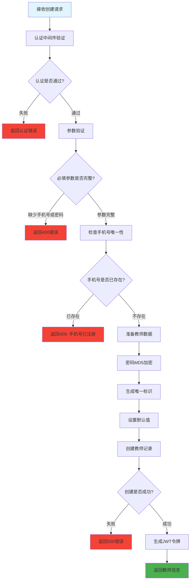

# 创建教师信息 (routes/teacher/create.js)

## 功能描述

创建教师信息接口，允许创建新的教师账户，支持手机号注册，密码 MD5 加密，生成 JWT 令牌。

## mermaid 流程图



## 接口信息

-   **路径**: `POST /v1/teacher/create`
-   **权限**: 需要认证
-   **Content-Type**: application/json

## 请求参数

| 参数名    | 类型   | 必填 | 说明                      |
| --------- | ------ | ---- | ------------------------- |
| cellphone | string | 是   | 手机号（唯一标识）        |
| password  | string | 是   | 密码                      |
| realname  | string | 否   | 真实姓名                  |
| nickName  | string | 否   | 昵称                      |
| avatar    | string | 否   | 头像 URL                  |
| gender    | number | 否   | 性别 (0:未知，1:男，2:女) |
| age       | number | 否   | 年龄                      |
| province  | string | 否   | 省份                      |
| city      | string | 否   | 城市                      |
| address   | string | 否   | 地址                      |
| hours     | number | 否   | 课时，默认 0              |

## 请求示例

```json
{
    "cellphone": "13800138000",
    "password": "yourpassword",
    "realname": "李老师",
    "nickName": "小李",
    "avatar": "https://example.com/avatar.jpg",
    "gender": 1,
    "age": 30,
    "province": "广东省",
    "city": "深圳市",
    "address": "南山区科技园",
    "hours": 0
}
```

## 响应格式

### 成功响应

```json
{
    "code": 10000,
    "message": null,
    "data": {
        "id": "teacher_id_generated",
        "sn": "unique_sn",
        "cellphone": "13800138000",
        "realname": "李老师",
        "nickName": "小李",
        "role": "teacher",
        "token": "jwt_token_here",
        "verified": false,
        "isAdmin": false,
        "hours": 0,
        "blocked": false,
        "created": "2024-12-26T10:08:12.000Z"
    }
}
```

### 错误响应

```json
{
    "code": 400,
    "message": "缺少必要信息（手机号、密码）",
    "data": null
}
```

## 业务逻辑

### 1. 数据预处理

-   **唯一标识**: 生成 uuid 作为 sn
-   **密码加密**: 使用 MD5 算法加密密码
-   **默认头像**: 未提供时使用环境变量 DEFAULT_AVATAR
-   **默认值设置**: gender=0, hours=0, blocked=false

### 2. 教师状态管理

-   **验证状态**: verified=false (需要管理员审核)
-   **管理员权限**: isAdmin=false (默认非管理员)
-   **令牌密钥**: 生成 tokenKey 用于令牌管理

### 3. 令牌生成

-   创建成功后自动生成 JWT 令牌
-   角色设置为'teacher'
-   默认非管理员权限

## 错误代码

| 错误代码 | 说明                    |
| -------- | ----------------------- |
| 40101    | 认证失败                |
| 400      | 缺少必要信息            |
| 409      | 手机号已注册            |
| 500      | 创建教师失败/服务器错误 |

## 验证规则

### 必填字段验证

-   **cellphone**: 不能为空
-   **password**: 不能为空

### 唯一性验证

-   **手机号**: 在 teachers 表中必须唯一

### 数据类型验证

-   **gender**: 数字类型，默认 0
-   **hours**: 数字类型，默认 0

## 依赖关系

-   [PocketBase 工具](mdc:src/utils/pocketbase.js.md) - 数据库操作
-   [JWT 认证工具](mdc:src/utils/jwtAuth.js.md) - 令牌生成
-   [认证中间件](mdc:src/middleware/auth.js.md) - 用户认证
-   [响应中间件](mdc:src/middleware/response.js.md) - 统一响应格式

## 使用示例

```bash
curl -X POST http://localhost:1337/v1/teacher/create \
  -H "Content-Type: application/json" \
  -H "Authorization: Bearer ADMIN_TOKEN" \
  -d '{
    "cellphone": "13800138000",
    "password": "123456",
    "realname": "张老师",
    "nickName": "小张"
  }'
```

## 更新历史

| 版本 | 日期       | 说明             |
| ---- | ---------- | ---------------- |
| 1.0  | 2024-12-26 | 创建教师信息接口 |
