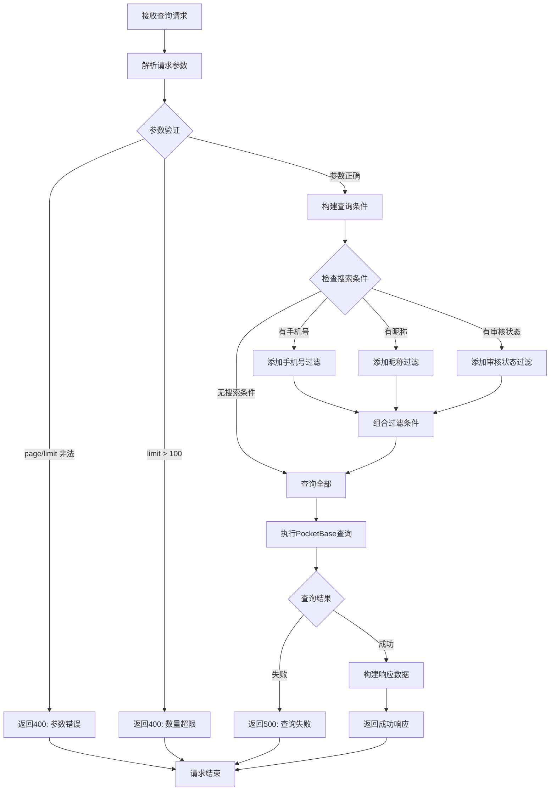

# 教师查询接口

## 功能描述

分页查询教师列表，支持按手机号、昵称和审核状态进行筛选，用于管理员管理教师账户。

## 查询处理流程



## 接口信息

-   **路径**: `POST /v1/teacher/find`
-   **权限**: 需要管理员权限
-   **对应原项目**: `api/controllers/teacher/find.js`

## 请求参数

### 可选参数

| 参数名    | 类型    | 说明         | 默认值 | 示例     |
| --------- | ------- | ------------ | ------ | -------- |
| page      | number  | 页码         | 1      | 2        |
| limit     | number  | 每页数量     | 10     | 20       |
| cellphone | string  | 手机号搜索   | ""     | "138"    |
| nickName  | string  | 昵称搜索     | ""     | "张老师" |
| verified  | boolean | 审核状态过滤 | null   | true     |

### 参数限制

-   `page`: 必须为正整数
-   `limit`: 必须为正整数，最大值 100
-   `cellphone`: 支持模糊匹配
-   `nickName`: 支持模糊匹配
-   `verified`: true(已审核) / false(未审核) / null(全部)

## 响应格式

### 成功响应

```json
{
    "code": 10000,
    "message": "查询成功",
    "data": {
        "items": [
            {
                "id": "teacher_id",
                "sn": "unique_sn",
                "cellphone": "13900139000",
                "nickName": "张老师",
                "avatar": "https://example.com/avatar.jpg",
                "realName": "张三丰",
                "gender": "male",
                "birthday": "1980-01-01",
                "blocked": false,
                "verified": true,
                "isAdmin": false,
                "lastLoginAt": "2024-01-01 10:00:00",
                "created": "2024-01-01 09:00:00",
                "updated": "2024-01-01 10:00:00"
            }
        ],
        "totalItems": 30,
        "totalPages": 3,
        "page": 1,
        "perPage": 10
    }
}
```

### 错误响应

```json
{
    "code": 400,
    "message": "页码和每页数量必须为正整数",
    "data": null
}
```

```json
{
    "code": 500,
    "message": "查询失败，请稍后重试",
    "data": null
}
```

## 业务逻辑

### 查询条件

1. **分页参数**: 验证 page 和 limit 的有效性
2. **搜索条件**: 支持手机号、昵称和审核状态的组合搜索
3. **排序规则**: 按创建时间倒序排列
4. **字段过滤**: 只返回必要的字段，排除敏感信息

### 审核状态筛选

-   `verified: true`: 只查询已审核的教师
-   `verified: false`: 只查询未审核的教师
-   `verified: null`: 查询所有教师（默认）

## 数据库操作

### 使用的集合

-   **teachers**: 教师信息主表

### 返回字段

出于安全考虑，返回以下字段：

-   `id`: 记录 ID
-   `sn`: 教师编号
-   `cellphone`: 手机号
-   `nickName`: 昵称
-   `avatar`: 头像
-   `realName`: 真实姓名
-   `gender`: 性别
-   `birthday`: 生日
-   `blocked`: 是否被封禁
-   `verified`: 是否已审核
-   `isAdmin`: 是否为管理员
-   `lastLoginAt`: 最后登录时间
-   `created`: 创建时间
-   `updated`: 更新时间

### 排除字段

为保护隐私，不返回以下敏感字段：

-   `password`: 密码
-   `tokenKey`: JWT 密钥
-   `lastLoginIp`: 登录 IP

## 权限要求

### 中间件链

```javascript
authMiddleware() → isAdminMiddleware() → teacherFindHandler()
```

### 管理员权限

-   只有管理员可以查询教师信息
-   普通教师无法查询其他教师
-   学生无法访问教师查询接口

## 审核管理

### 审核状态说明

| 状态            | 说明   | 权限     |
| --------------- | ------ | -------- |
| verified: false | 待审核 | 无法登录 |
| verified: true  | 已审核 | 正常使用 |
| blocked: true   | 已封禁 | 禁止登录 |

### 管理场景

-   新注册教师需要管理员审核
-   管理员可以查看待审核教师列表
-   支持按审核状态批量处理

## 搜索优化

### 索引建议

为提高查询性能，建议在以下字段创建索引：

-   `cellphone`: 手机号搜索
-   `nickName`: 昵称搜索
-   `verified`: 审核状态筛选
-   `created`: 排序字段

### 查询示例

```javascript
// 查询未审核教师
pb.collection('teachers').getList(1, 10, {
    filter: 'verified = false',
    sort: '-created',
});

// 组合搜索
pb.collection('teachers').getList(1, 10, {
    filter: 'cellphone ~ "139" && verified = true',
    sort: '-created',
});
```

## 性能考虑

### 查询优化

-   限制单次查询数量最大为 100
-   使用字段过滤减少数据传输
-   合理使用索引提高查询速度

### 分页策略

-   支持深度分页
-   避免大量数据一次性加载
-   缓存热门查询结果

## 错误处理

### 参数验证错误

| 错误场景     | 错误代码 | 错误消息                   |
| ------------ | -------- | -------------------------- |
| 页码非正整数 | 400      | 页码和每页数量必须为正整数 |
| 数量超限     | 400      | 每页数量不能超过 100       |

### 数据库错误

| 错误场景 | 错误代码 | 错误消息             |
| -------- | -------- | -------------------- |
| 查询失败 | 500      | 查询失败，请稍后重试 |
| 系统异常 | 500      | 服务器内部错误       |

## 隐私保护

### 数据脱敏

-   敏感字段不在查询结果中返回
-   手机号可根据需要进行部分隐藏
-   管理员操作记录审计日志

### 访问控制

-   严格的管理员权限验证
-   操作日志记录
-   敏感信息访问限制

## 依赖关系

-   依赖工具类：[pocketbase.js](mdc:src/utils/pocketbase.js) - 数据库操作
-   依赖中间件：[auth.js](mdc:src/middleware/auth.js) - 用户认证
-   依赖中间件：[isAdmin.js](mdc:src/middleware/isAdmin.js) - 管理员权限验证
-   依赖中间件：[response.js](mdc:src/middleware/response.js) - 响应格式化
-   外部依赖：`await-to-js` - 错误处理

## 使用示例

### 查询所有教师

```bash
curl -X POST http://localhost:1337/v1/teacher/find \
  -H "Content-Type: application/json" \
  -H "Authorization: Bearer admin_token" \
  -d '{}'
```

### 查询待审核教师

```bash
curl -X POST http://localhost:1337/v1/teacher/find \
  -H "Content-Type: application/json" \
  -H "Authorization: Bearer admin_token" \
  -d '{
    "verified": false,
    "page": 1,
    "limit": 20
  }'
```

### 按手机号搜索

```bash
curl -X POST http://localhost:1337/v1/teacher/find \
  -H "Content-Type: application/json" \
  -H "Authorization: Bearer admin_token" \
  -d '{
    "cellphone": "139",
    "verified": true,
    "page": 1,
    "limit": 10
  }'
```

### 组合搜索

```bash
curl -X POST http://localhost:1337/v1/teacher/find \
  -H "Content-Type: application/json" \
  -H "Authorization: Bearer admin_token" \
  -d '{
    "cellphone": "139",
    "nickName": "张",
    "verified": true,
    "page": 1,
    "limit": 10
  }'
```

## 相关接口

-   教师创建：[create.js](mdc:src/routes/teacher/create.js)
-   教师更新：[update.js](mdc:src/routes/teacher/update.js)
-   教师删除：[delete.js](mdc:src/routes/teacher/delete.js)
-   教师审核：专门的审核接口

## 更新历史

-   2024-01-XX: 从原 Sails.js 项目迁移，保持完全兼容
-   2024-01-XX: 增强审核状态过滤和隐私保护机制
