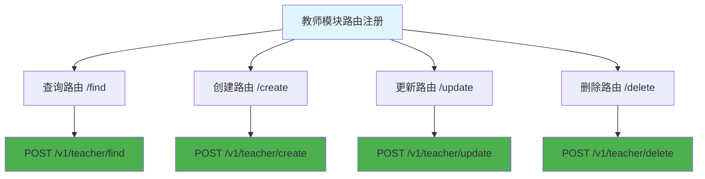

# 教师模块路由 (routes/teacher/index.js)

## 功能描述

教师模块的路由配置，包含教师相关的所有接口路由注册。

## mermaid 流程图



## 路由配置

| 路径      | 方法 | 功能     | 权限要求 |
| --------- | ---- | -------- | -------- |
| `/find`   | POST | 查询教师 | 需要认证 |
| `/create` | POST | 创建教师 | 需要认证 |
| `/update` | POST | 更新教师 | 需要认证 |
| `/delete` | POST | 删除教师 | 需要认证 |

## 路由注册实现

```javascript
/**
 * 注册教师相关路由
 * @param {*} app - Hono 应用实例
 * @param {*} authMiddleware - 认证中间件
 */
function teacherRoutes(app, authMiddleware) {
    // 查询教师列表（需要认证）
    app.post('/v1/teacher/find', authMiddleware(), teacherFindHandler);

    // 创建教师（需要认证）
    app.post('/v1/teacher/create', authMiddleware(), teacherCreateHandler);

    // 更新教师信息（需要认证）
    app.post('/v1/teacher/update', authMiddleware(), teacherUpdateHandler);

    // 删除教师（需要认证）
    app.post('/v1/teacher/delete', authMiddleware(), teacherDeleteHandler);
}

module.exports = teacherRoutes;
```

## 依赖关系

-   [查询处理器](mdc:src/routes/teacher/find.js.md)
-   [创建处理器](mdc:src/routes/teacher/create.js.md)
-   [更新处理器](mdc:src/routes/teacher/update.js.md)
-   [删除处理器](mdc:src/routes/teacher/delete.js.md)
-   [认证中间件](mdc:src/middleware/auth.js.md)

## 更新历史

| 版本 | 日期       | 说明                 |
| ---- | ---------- | -------------------- |
| 1.0  | 2024-12-26 | 创建教师模块路由配置 |
