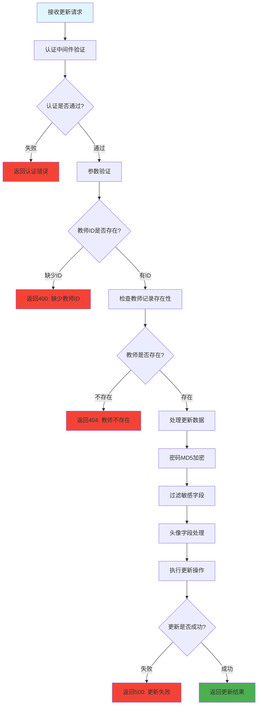

# 更新教师信息 (routes/teacher/update.js)

## 功能描述

更新教师信息接口，允许修改教师的基本信息，包含安全字段保护和密码加密处理。

## mermaid 流程图



## 接口信息

-   **路径**: `POST /v1/teacher/update`
-   **权限**: 需要认证
-   **Content-Type**: application/json

## 请求参数

### 必填参数

| 参数名 | 类型   | 说明    | 示例          |
| ------ | ------ | ------- | ------------- |
| id     | string | 教师 ID | "teacher_123" |

### 可选参数

| 参数名    | 类型   | 说明     | 示例          |
| --------- | ------ | -------- | ------------- |
| cellphone | string | 手机号   | "13800138000" |
| password  | string | 新密码   | "newpassword" |
| realname  | string | 真实姓名 | "李老师"      |
| nickName  | string | 昵称     | "小李"        |
| avatar    | string | 头像 URL | "avatar.jpg"  |
| gender    | number | 性别     | 1             |
| age       | number | 年龄     | 30            |
| province  | string | 省份     | "广东省"      |
| city      | string | 城市     | "深圳市"      |
| address   | string | 地址     | "南山区"      |
| hours     | number | 课时     | 100           |

## 请求示例

```json
{
    "id": "teacher_123",
    "realname": "张老师",
    "nickName": "小张",
    "age": 35,
    "province": "北京市",
    "avatar": "https://example.com/new-avatar.jpg"
}
```

## 响应格式

### 成功响应

```json
{
    "code": 10000,
    "message": null,
    "data": {
        "id": "teacher_123",
        "sn": "unique_sn",
        "cellphone": "13800138000",
        "realname": "张老师",
        "nickName": "小张",
        "age": 35,
        "province": "北京市",
        "avatar": "https://example.com/new-avatar.jpg",
        "updated": "2024-12-26T10:08:12.000Z"
    }
}
```

### 错误响应

```json
{
    "code": 400,
    "message": "缺少教师ID",
    "data": null
}
```

## 业务逻辑

### 1. 数据安全处理

**敏感字段保护** - 以下字段不允许通过此接口修改：

-   `sn` - 唯一编号
-   `created` - 创建时间
-   `updated` - 更新时间
-   `blocked` - 封禁状态
-   `verified` - 审核状态
-   `verifiedAt` - 审核时间
-   `verifiedBy` - 审核人
-   `isAdmin` - 管理员权限
-   `tokenKey` - 令牌密钥

### 2. 密码加密

**MD5 加密**: 如果提供新密码，自动使用 MD5 算法加密

### 3. 头像处理

**默认头像**: 如果头像为空或空字符串，使用环境变量 `DEFAULT_AVATAR`

## 安全考虑

### 权限控制

-   需要认证但无特殊权限要求
-   建议增加只能修改自己信息的限制
-   敏感字段需要特殊权限接口修改

### 数据验证

-   必须提供有效的教师 ID
-   自动过滤不允许修改的字段
-   密码自动加密处理

## 错误代码

| 错误代码 | 说明                |
| -------- | ------------------- |
| 40101    | 认证失败            |
| 400      | 缺少教师 ID         |
| 404      | 教师不存在          |
| 500      | 更新失败/服务器错误 |

## 依赖关系

-   [PocketBase 工具](mdc:src/utils/pocketbase.js.md) - 数据库操作
-   [认证中间件](mdc:src/middleware/auth.js.md) - 用户认证
-   [响应中间件](mdc:src/middleware/response.js.md) - 统一响应格式

## 使用示例

```bash
curl -X POST http://localhost:1337/v1/teacher/update \
  -H "Content-Type: application/json" \
  -H "token: YOUR_TOKEN" \
  -d '{
    "id": "teacher_123",
    "realname": "张老师",
    "nickName": "张教授",
    "age": 40
  }'
```

## 更新历史

| 版本 | 日期       | 说明             |
| ---- | ---------- | ---------------- |
| 1.0  | 2024-12-26 | 创建教师更新接口 |
