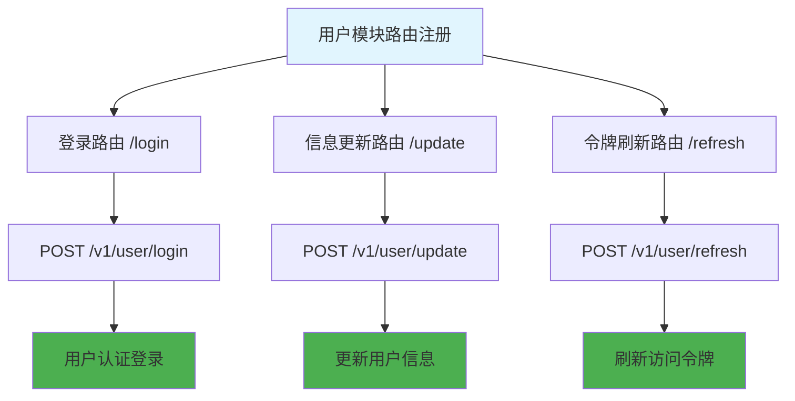

# 用户模块路由 (routes/user/index.js)

## 功能描述

用户模块路由配置，包含用户认证相关的所有接口路由，如登录、信息更新、令牌刷新等功能。

## mermaid 流程图



## 路由配置

### 接口列表

| 路径       | 方法 | 功能         | 权限要求 |
| ---------- | ---- | ------------ | -------- |
| `/login`   | POST | 用户登录     | 无       |
| `/update`  | POST | 更新用户信息 | 需要认证 |
| `/refresh` | POST | 刷新令牌     | 需要认证 |

### 完整路径

-   `POST /v1/user/login` - 用户登录
-   `POST /v1/user/update` - 更新用户信息
-   `POST /v1/user/refresh` - 刷新访问令牌

## 中间件应用

### 认证中间件

-   `/update` 接口需要认证中间件
-   `/refresh` 接口需要认证中间件
-   `/login` 接口无需认证（公开接口）

## 依赖关系

### 路由处理器

-   [登录处理器](mdc:src/routes/user/login.js.md) - 处理用户登录逻辑
-   [更新处理器](mdc:src/routes/user/update.js.md) - 处理用户信息更新
-   [刷新处理器](mdc:src/routes/user/refresh.js.md) - 处理令牌刷新

### 中间件依赖

-   [认证中间件](mdc:src/middleware/auth.js.md) - 验证用户身份

## 模块导出

```javascript
/**
 * 注册用户相关路由
 * @param {Hono} app - Hono 应用实例
 */
function registerUserRoutes(app) {
    // 登录 - 无需认证
    app.post('/v1/user/login', loginHandler);

    // 更新用户信息 - 需要认证
    app.post('/v1/user/update', authMiddleware, updateHandler);

    // 刷新令牌 - 需要认证
    app.post('/v1/user/refresh', authMiddleware, refreshHandler);
}

module.exports = { registerUserRoutes };
```

## 错误处理

### 统一错误响应

所有用户模块接口都使用统一的错误响应格式：

```json
{
  "code": 错误代码,
  "message": "错误信息",
  "data": null
}
```

### 常见错误代码

-   `40001` - 参数验证失败
-   `40101` - 认证失败
-   `40102` - 令牌过期
-   `50001` - 服务器内部错误

## 使用示例

### 用户登录

```bash
curl -X POST http://localhost:1337/v1/user/login \
  -H "Content-Type: application/json" \
  -d '{"email": "user@example.com", "password": "password"}'
```

### 更新用户信息

```bash
curl -X POST http://localhost:1337/v1/user/update \
  -H "Content-Type: application/json" \
  -H "Authorization: Bearer <token>" \
  -d '{"name": "新姓名"}'
```

### 刷新令牌

```bash
curl -X POST http://localhost:1337/v1/user/refresh \
  -H "Authorization: Bearer <token>"
```

## 更新历史

| 版本 | 日期       | 说明                 |
| ---- | ---------- | -------------------- |
| 1.0  | 2024-12-26 | 创建用户模块路由配置 |
