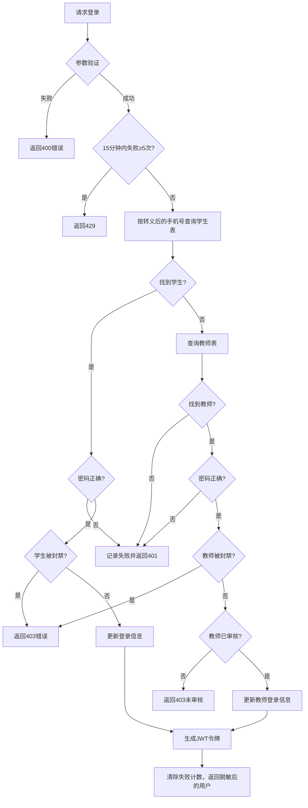

# 用户统一登录接口

## 功能描述

统一的用户登录接口，支持学生和教师登录。先查学生，再查教师；两边都没有该手机号时返回与密码错误相同的 401，不会自动注册（新用户通过微信手机号登录注册）。返回的用户记录经过 [publicUser](mdc:src/utils/publicUser.js) 脱敏，不含密码哈希、`tokenKey` 和微信身份标识。同一手机号 15 分钟内连续失败 5 次后返回 429。

## 登录流程



## 接口信息

-   **路径**: `POST /v1/user/login`
-   **权限**: 无需认证（公开接口）
-   **对应原项目**: `/Users/verdx/Documents/projects/misc/kanyue/ikanyue.mapi.sails/api/controllers/user/login.js`

## 请求参数

### 必传参数

| 参数名    | 类型   | 说明   | 示例           |
| --------- | ------ | ------ | -------------- |
| cellphone | string | 手机号 | "13800138000"  |
| password  | string | 密码   | "yourpassword" |

### 可选参数

无

## 响应格式

### 成功响应

```json
{
    "code": 10000,
    "message": null,
    "data": {
        "id": "record_id",
        "sn": "unique_sn",
        "cellphone": "13800138000",
        "role": "student",
        "token": "jwt_token",
        "isAdmin": false,
        "avatar": "https://example.com/default-avatar.jpg",
        "nickName": "用户8000"
        // 其他用户信息字段...
    }
}
```

### 错误响应

```json
{
    "code": 400,
    "message": "手机号和密码不能为空",
    "data": null
}
```

```json
{
    "code": 401,
    "message": "手机号或密码错误",
    "data": null
}
```

```json
{
    "code": 403,
    "message": "该账号已被封禁，请联系客服",
    "data": null
}
```

## 业务逻辑

### 处理流程

1. **参数验证**: 检查手机号和密码是否为空
2. **学生登录尝试**: 在 students 表中查找匹配的手机号
3. **学生密码验证**: 如果找到学生，验证 MD5 加密后的密码
4. **学生状态检查**: 验证账户是否被封禁
5. **教师登录尝试**: 如果学生登录失败，在 teachers 表中查找
6. **教师密码验证**: 验证教师密码和账户状态
7. **教师审核检查**: 验证教师账户是否已审核
8. **未注册手机号**: 如果都找不到，返回 401，不自动建号
9. **登录信息更新**: 更新最后登录时间、IP、方式
10. **JWT 生成**: 生成包含用户信息的 JWT 令牌

### 特殊处理

#### 密码加密

-   使用 MD5 算法对密码进行加密存储和验证
-   前端传入明文密码，后端加密后与数据库比较

#### 失败限流

同一手机号 15 分钟内连续失败 5 次后返回 429，登录成功会清零计数。计数保存在进程内存中。

#### 头像处理

-   如果用户头像为空，自动设置默认头像
-   从环境变量 `DEFAULT_AVATAR` 读取默认头像 URL

#### 登录信息记录

每次成功登录都会更新：

-   `lastLoginAt`: 登录时间
-   `lastLoginIp`: 登录 IP（从请求头获取）
-   `lastLoginMethod`: 登录方式（设置为 "password"）

## 数据库操作

### 查询操作

-   **students 表查询**: `pb.collection('students').getList(1, 1, { filter: cellphone=filterLiteral(cellphone) })`
-   **teachers 表查询**: `pb.collection('teachers').getList(1, 1, { filter: cellphone=filterLiteral(cellphone) })`

### 更新操作

-   **学生登录信息更新**: `pb.collection('students').update(student.id, updateData)`
-   **教师登录信息更新**: `pb.collection('teachers').update(teacher.id, updateData)`

### 字段说明

#### 学生表关键字段

-   `cellphone`: 手机号（唯一）
-   `password`: MD5 加密的密码
-   `blocked`: 是否被封禁
-   `sn`: 唯一标识符
-   `tokenKey`: JWT 密钥

#### 教师表关键字段

-   `cellphone`: 手机号（唯一）
-   `password`: MD5 加密的密码
-   `blocked`: 是否被封禁
-   `verified`: 是否已审核
-   `isAdmin`: 是否为管理员
-   `sn`: 唯一标识符

## 依赖关系

-   依赖的工具类：[pocketbase.js](mdc:src/utils/pocketbase.js)
-   依赖的工具类：[jwtAuth.js](mdc:src/utils/jwtAuth.js)
-   依赖的中间件：[response.js](mdc:src/middleware/response.js)
-   外部依赖：`await-to-js`、`licia/md5`、`licia/uuid`

## JWT 令牌生成

### 令牌内容

```javascript
const token = jwtAuth.sign(c.req, userId, userSn, role, isAdmin);
```

### 令牌包含信息

-   `id`: 用户 ID
-   `sn`: 用户唯一标识
-   `role`: 用户角色（"student" 或 "teacher"）
-   `isAdmin`: 是否为管理员（仅教师可能为 true）

## 错误处理

### 参数验证错误

-   错误代码：400
-   触发条件：手机号或密码为空

### 认证失败错误

-   错误代码：401
-   触发条件：密码不匹配

### 权限限制错误

-   错误代码：403
-   触发条件：
    -   学生或教师账户被封禁
    -   教师账户未通过审核

### 服务器错误

-   错误代码：500
-   触发条件：数据库操作失败、网络异常等

## 安全考虑

### 密码处理

-   前端传输明文密码（应使用 HTTPS）
-   后端使用 MD5 加密存储
-   不在响应中返回密码信息

### IP 记录

-   记录用户登录 IP，支持安全审计
-   优先使用代理头信息：`x-forwarded-for`、`x-real-ip`

### 令牌安全

-   JWT 令牌包含用户关键信息
-   令牌有效期由 JWT 配置控制
-   使用安全的签名算法

## 兼容性说明

### 与原项目完全兼容

-   登录逻辑完全一致
-   数据库查询和更新操作保持不变
-   响应格式和字段名称一致
-   错误处理和状态码对应

### 环境依赖

-   `DEFAULT_AVATAR`: 默认头像 URL 环境变量
-   PocketBase 数据库连接配置
-   JWT 密钥配置

## 更新历史

-   2024-01-XX: 从原 Sails.js 项目迁移，保持完全兼容
-   2024-01-XX: 完善错误处理和日志记录

## 测试用例

### 学生登录测试

```bash
curl -X POST http://localhost:1337/v1/user/login \
  -H "Content-Type: application/json" \
  -d '{
    "cellphone": "13800138000",
    "password": "student123"
  }'
```

### 教师登录测试

```bash
curl -X POST http://localhost:1337/v1/user/login \
  -H "Content-Type: application/json" \
  -d '{
    "cellphone": "13900139000",
    "password": "teacher123"
  }'
```

