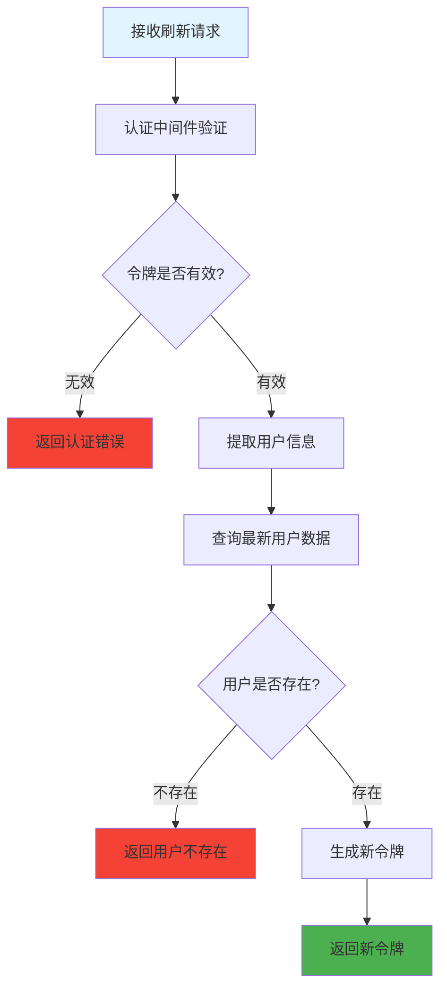

# 刷新用户令牌 (routes/user/refresh.js)

## 功能描述

刷新用户令牌接口，为已认证用户生成新的访问令牌，延长用户的登录状态。

## mermaid 流程图



## 接口信息

-   **路径**: `POST /v1/user/refresh`
-   **权限**: 需要认证
-   **Content-Type**: application/json

## 请求参数

无需请求体参数，令牌通过 Authorization Header 传递。

## 请求示例

```bash
curl -X POST http://localhost:1337/v1/user/refresh \
  -H "Authorization: Bearer YOUR_CURRENT_TOKEN"
```

## 响应格式

### 成功响应

```json
{
    "code": 10000,
    "message": null,
    "data": {
        "token": "new_jwt_token_here",
        "user": {
            "id": "user123",
            "email": "user@example.com",
            "name": "用户姓名",
            "role": "student"
        },
        "expires": "2024-01-02T10:08:12.000Z"
    }
}
```

### 错误响应

```json
{
    "code": 40101,
    "message": "认证失败",
    "data": null
}
```

## 错误代码

| 错误代码 | 说明         |
| -------- | ------------ |
| 40101    | 认证失败     |
| 40102    | 令牌过期     |
| 40103    | 用户不存在   |
| 50001    | 生成令牌失败 |

## 业务逻辑

### 1. 令牌验证

-   验证当前令牌的有效性
-   解析用户信息

### 2. 用户状态检查

-   检查用户账号是否仍然有效
-   验证用户权限

### 3. 新令牌生成

-   使用最新用户信息生成新令牌
-   设置合适的过期时间

## 依赖关系

-   [JWT 工具](mdc:src/utils/jwtAuth.js.md) - 令牌生成和验证
-   [PocketBase 工具](mdc:src/utils/pocketbase.js.md) - 用户数据查询
-   [认证中间件](mdc:src/middleware/auth.js.md) - 用户认证
-   [响应中间件](mdc:src/middleware/response.js.md) - 统一响应格式

## 使用场景

### 1. 令牌即将过期

客户端可以在令牌过期前主动刷新令牌

### 2. 长期登录

为用户提供无缝的登录体验

### 3. 安全更新

定期更新令牌提高安全性

## 安全考虑

1. **原令牌验证**: 必须提供有效的当前令牌
2. **用户状态**: 确保用户账号未被禁用
3. **频率限制**: 可考虑添加刷新频率限制
4. **令牌轮换**: 新令牌生成后原令牌失效（可选）

## 客户端集成

```javascript
// 自动刷新令牌的示例
async function refreshToken() {
    try {
        const response = await fetch('/v1/user/refresh', {
            method: 'POST',
            headers: {
                Authorization: `Bearer ${currentToken}`,
            },
        });

        const result = await response.json();
        if (result.code === 10000) {
            // 更新存储的令牌
            localStorage.setItem('token', result.data.token);
            return result.data.token;
        }
    } catch (error) {
        console.error('令牌刷新失败:', error);
        // 跳转到登录页面
        window.location.href = '/login';
    }
}
```

## 更新历史

| 版本 | 日期       | 说明                 |
| ---- | ---------- | -------------------- |
| 1.0  | 2024-12-26 | 创建刷新用户令牌接口 |
