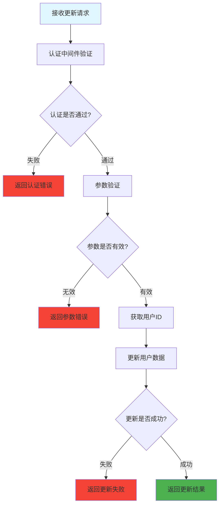

# 更新用户信息 (routes/user/update.js)

## 功能描述

更新用户信息接口，允许已认证用户修改自己的个人信息，如姓名、头像等非敏感数据。

## mermaid 流程图



## 接口信息

-   **路径**: `POST /v1/user/update`
-   **权限**: 需要认证
-   **Content-Type**: application/json

## 请求参数

| 参数名  | 类型   | 必填 | 说明         |
| ------- | ------ | ---- | ------------ |
| name    | string | 否   | 用户姓名     |
| avatar  | string | 否   | 头像 URL     |
| phone   | string | 否   | 手机号码     |
| profile | object | 否   | 用户资料信息 |

## 请求示例

```json
{
    "name": "新姓名",
    "avatar": "https://example.com/avatar.jpg",
    "phone": "13800138000",
    "profile": {
        "bio": "个人简介",
        "location": "所在地"
    }
}
```

## 响应格式

### 成功响应

```json
{
    "code": 10000,
    "message": null,
    "data": {
        "id": "user123",
        "name": "新姓名",
        "email": "user@example.com",
        "avatar": "https://example.com/avatar.jpg",
        "updated": "2024-12-26T10:08:12.000Z"
    }
}
```

### 错误响应

```json
{
    "code": 40001,
    "message": "参数验证失败",
    "data": null
}
```

## 错误代码

| 错误代码 | 说明             |
| -------- | ---------------- |
| 40001    | 参数验证失败     |
| 40101    | 认证失败         |
| 40102    | 令牌过期         |
| 50001    | 更新用户信息失败 |

## 依赖关系

-   [PocketBase 工具](mdc:src/utils/pocketbase.js.md) - 数据库操作
-   [认证中间件](mdc:src/middleware/auth.js.md) - 用户认证
-   [响应中间件](mdc:src/middleware/response.js.md) - 统一响应格式

## 安全考虑

1. **权限控制**: 用户只能更新自己的信息
2. **数据验证**: 对输入数据进行格式验证
3. **敏感信息**: 不允许更新邮箱、密码等敏感信息

## 使用示例

```bash
curl -X POST http://localhost:1337/v1/user/update \
  -H "Content-Type: application/json" \
  -H "Authorization: Bearer YOUR_TOKEN" \
  -d '{
    "name": "张三丰",
    "phone": "13800138000"
  }'
```

## 更新历史

| 版本 | 日期       | 说明                 |
| ---- | ---------- | -------------------- |
| 1.0  | 2024-12-26 | 创建更新用户信息接口 |
