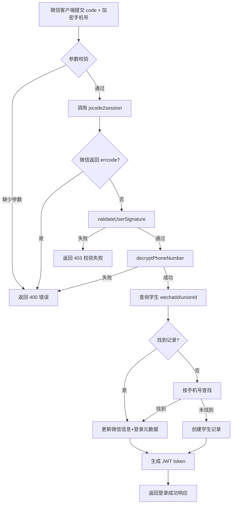

# 微信授权登录接口

## 功能描述

`POST /v1/user/wechat-login` 支持用户通过微信小程序一键授权（头像/昵称 + 手机号）完成快捷注册与登录。接口会优先绑定已有账户（按 `wechatId`/`wechatUnionId`/`cellphone` 顺序匹配），否则自动创建学生用户。

## 登录流程



## 接口信息

- **路径**：`POST /v1/user/wechat-login`
- **权限**：公开接口，无需 Token
- **请求格式**：`application/json` / `application/x-www-form-urlencoded`

## 请求参数

| 字段 | 类型 | 必填 | 说明 |
| ---- | ---- | ---- | ---- |
| `code` | string | 是 | `wx.login` 返回的 `code`，也可传 `authCode`/`auth_code` 或放在查询参数中 |
| `userInfo` | object | 否 | `getUserProfile` 返回的用户资料，用于头像 / 昵称 |
| `userInfo.avatarUrl` | string | 否 | 头像地址 |
| `userInfo.nickName` | string | 否 | 昵称 |
| `phone.encryptedData` | string | 是 | `getPhoneNumber` 返回的加密数据 |
| `phone.iv` | string | 是 | `getPhoneNumber` 返回的初始向量 |
| `rawData` | string | 否 | 微信返回的原始用户信息，配合 `signature` 校验 |
| `signature` | string | 否 | 微信返回的签名 |

## 响应示例

```json
{
  "code": 10000,
  "message": null,
  "data": {
    "id": "student_record_id",
    "sn": "student_sn",
    "cellphone": "13800138000",
    "role": "student",
    "token": "jwt_token",
    "nickName": "小明",
    "avatar": "https://example.com/avatar.jpg",
    "wechatId": "openid_xxx",
    "wechatUnionId": "unionid_xxx",
    "lastLoginAt": "2025-11-12T14:00:00.000Z",
    "lastLoginMethod": "wechat"
  }
}
```

## 业务规则

1. **微信认证**：通过 `exchangeCodeForSession` 调用 `jscode2session` 获取 `session_key/openid/unionid`。
2. **签名校验**：若提供 `rawData` 与 `signature`，使用 `validateUserSignature` 校验防篡改。
3. **手机号解密**：调用 `decryptPhoneNumber` 获取 `purePhoneNumber`，作为平台主账号标识。
4. **账号绑定优先级**：
   - 按 `wechatId` / `wechatUnionId` 精确匹配
   - 若未匹配，再按 `cellphone` 匹配现有学生账号
5. **自动建档**：找不到任何记录时，创建学生账号，默认昵称 `微信用户xxxx`。
6. **资料保留**：匹配到已有学生账号时，不会用微信返回的昵称/头像/真实姓名覆盖数据库中的自定义信息，仅刷新 `wechatId`/`wechatUnionId`/`wechatUserInfo`，并强制使用最新微信手机号回写 `cellphone`。如果数据库中的 `nickName`/`nickname`、`avatar`、`gender`、`age` 等字段为空，则使用微信资料进行补全。
7. **封禁判断**：命中账号但 `blocked=true` 时返回 403。
8. **登录元数据**：统一更新 `lastLoginAt`、`lastLoginIp`、`lastLoginMethod='wechat'`。
9. **响应格式**：生成 JWT（角色固定 `student`、`isAdmin=false`），并返回 PocketBase 记录。

## 数据库存取

- `pb.collection('students').getList`：按 `wechatId`/`wechatUnionId`/`cellphone` 查询
- `pb.collection('students').update`：刷新微信字段、手机号、登录元数据
- `pb.collection('students').create`：新建学生记录，填充 `tokenKey`、`sn`、`wechatUserInfo`

## 依赖

- `[wechat.js](mdc:src/utils/wechat.js)`：封装微信接口/解密逻辑
- `[pocketbase.js](mdc:src/utils/pocketbase.js)`：数据库访问
- `[jwtAuth.js](mdc:src/utils/jwtAuth.js)`：签发 JWT

## 更新记录

- 2025-11-12：新增接口，支持微信授权快捷登录
