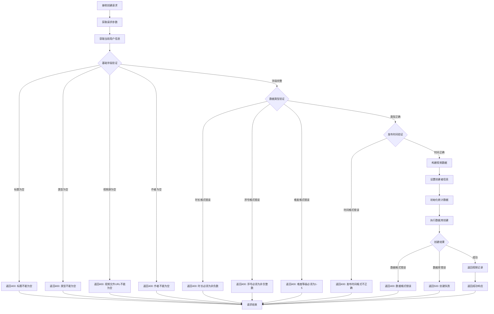

# 视频材料创建接口

## 功能描述

创建新的视频材料记录，支持设置视频标题、类型、描述、文件地址等详细信息，需要教师权限。

## 创建处理流程



## 接口信息

-   **路径**: `POST /v1/videoMaterial/create`
-   **权限**: 需要教师权限
-   **对应原项目**: `api/controllers/videoMaterial/create.js`

## 请求参数

### 必传参数

| 参数名      | 类型   | 说明         | 示例                            |
| ----------- | ------ | ------------ | ------------------------------- |
| title       | string | 视频标题     | "JavaScript 基础教程"           |
| type        | string | 视频类型     | "tutorial"                      |
| videoSource | string | 视频文件 URL | "https://example.com/video.mp4" |
| author      | string | 视频作者     | "张老师"                        |

### 可选参数

| 参数名      | 类型   | 说明         | 默认值   | 示例                   |
| ----------- | ------ | ------------ | -------- | ---------------------- |
| description | string | 视频描述     | ""       | "适合初学者的教程"     |
| content     | string | 详细内容     | ""       | "课程大纲..."          |
| publishedAt | string | 发布时间     | 当前时间 | "2024-01-01T10:00:00Z" |
| duration    | number | 视频时长(秒) | 0        | 1800                   |
| tags        | array  | 标签数组     | []       | ["JavaScript", "教程"] |
| sequence    | number | 排序序号     | 0        | 100                    |
| status      | string | 发布状态     | "draft"  | "published"            |
| coverImage  | string | 封面图片     | ""       | "cover.jpg"            |
| language    | string | 语言代码     | ""       | "zh-CN"                |
| difficulty  | number | 难度等级     | 1        | 3                      |
| resolution  | string | 视频分辨率   | ""       | "1080p"                |
| subtitles   | string | 字幕文件     | ""       | "subtitles.srt"        |

### 参数验证

-   **标题**: 不能为空或仅包含空格
-   **类型**: 不能为空或仅包含空格
-   **视频源**: 不能为空或仅包含空格
-   **作者**: 不能为空或仅包含空格
-   **时长**: 必须为非负数
-   **序号**: 必须为非负整数
-   **难度**: 必须为 1-5 之间的整数
-   **发布时间**: 必须为有效的 ISO 8601 格式

## 响应格式

### 成功响应

```json
{
    "code": 10000,
    "message": "视频材料创建成功",
    "data": {
        "id": "new_video_id",
        "title": "JavaScript 基础教程",
        "type": "tutorial",
        "description": "适合初学者的 JavaScript 教程",
        "videoSource": "https://example.com/video.mp4",
        "content": "详细的学习内容...",
        "publishedAt": "2024-01-01T10:00:00Z",
        "author": "张老师",
        "duration": 1800,
        "tags": ["JavaScript", "编程", "教程"],
        "sequence": 100,
        "status": "draft",
        "coverImage": "cover.jpg",
        "language": "zh-CN",
        "difficulty": 3,
        "resolution": "1080p",
        "subtitles": "subtitles.srt",
        "createdBy": "teacher_id",
        "viewCount": 0,
        "likeCount": 0,
        "created": "2024-01-01 10:00:00",
        "updated": "2024-01-01 10:00:00"
    }
}
```

### 错误响应

```json
{
    "code": 400,
    "message": "视频标题不能为空",
    "data": null
}
```

```json
{
    "code": 500,
    "message": "创建失败，请稍后重试",
    "data": null
}
```

## 业务逻辑

### 字段处理

1. **文本清理**: 自动清除所有文本字段的前后空格
2. **数组处理**: 确保 tags 为数组格式
3. **数值转换**: 自动转换时长、序号、难度为数值类型
4. **默认值设置**: 为可选参数设置合理的默认值

### 状态管理

-   新建视频默认状态为 "draft"（草稿）
-   需要手动设置为 "published" 才能公开
-   支持后续状态修改

### 权限控制

-   只有教师角色可以创建视频材料
-   创建者信息自动从认证上下文获取
-   管理员也可以创建视频材料

## 数据库操作

### 使用的集合

-   **videoMaterials**: 视频材料主表

### 创建字段

```javascript
{
    title: string,              // 视频标题
    type: string,               // 视频类型
    description: string,        // 视频描述
    videoSource: string,        // 视频文件URL
    content: string,            // 详细内容
    publishedAt: string,        // 发布时间 (ISO 8601)
    author: string,             // 作者名称
    duration: number,           // 视频时长(秒)
    tags: array,                // 标签数组
    sequence: number,           // 排序序号
    status: string,             // 发布状态
    coverImage: string,         // 封面图片
    language: string,           // 语言代码
    difficulty: number,         // 难度等级(1-5)
    resolution: string,         // 视频分辨率
    subtitles: string,          // 字幕文件
    createdBy: string,          // 创建者ID
    viewCount: number,          // 观看次数
    likeCount: number           // 点赞次数
}
```

### 自动字段

-   `id`: 系统自动生成的唯一标识
-   `created`: 创建时间戳
-   `updated`: 更新时间戳
-   `viewCount`: 观看次数（初始为 0）
-   `likeCount`: 点赞次数（初始为 0）

## 权限要求

### 中间件链

```javascript
authMiddleware() → isTeacherMiddleware() → videoMaterialCreateHandler()
```

### 用户信息依赖

需要从上下文获取已认证的教师信息：

```javascript
const user = c.get('user');
// 期望包含：{ id, sn, role: 'teacher', isAdmin }
```

## 视频类型管理

### 支持的类型

| 类型      | 说明   | 使用场景     |
| --------- | ------ | ------------ |
| tutorial  | 教程   | 技能学习教程 |
| lecture   | 讲座   | 学术讲座录像 |
| demo      | 演示   | 产品功能演示 |
| interview | 访谈   | 专家访谈节目 |
| workshop  | 工作坊 | 实践工作坊   |

### 难度等级

-   **1**: 入门级 - 零基础学习者
-   **2**: 初级 - 有基础知识
-   **3**: 中级 - 有一定经验
-   **4**: 高级 - 资深学习者
-   **5**: 专家级 - 专业人士

## 文件管理

### 视频文件

-   `videoSource`: 视频文件的完整访问 URL
-   支持多种视频格式（MP4、WebM、AVI 等）
-   建议使用 CDN 提供视频服务

### 封面图片

-   `coverImage`: 封面图片文件名
-   文件上传应通过专门的文件上传接口完成
-   支持自动生成视频缩略图

### 字幕文件

-   `subtitles`: 字幕文件 URL 或文件名
-   支持 SRT、VTT 等常见字幕格式
-   可以为多语言提供不同字幕

## 错误处理

### 参数验证错误

| 错误场景     | 错误代码 | 错误消息                      |
| ------------ | -------- | ----------------------------- |
| 标题为空     | 400      | 视频标题不能为空              |
| 类型为空     | 400      | 视频类型不能为空              |
| 视频源为空   | 400      | 视频文件 URL 不能为空         |
| 作者为空     | 400      | 视频作者不能为空              |
| 时长格式错误 | 400      | 视频时长必须为非负数          |
| 序号格式错误 | 400      | 排序序号必须为非负整数        |
| 难度格式错误 | 400      | 难度等级必须为 1-5 之间的整数 |
| 时间格式错误 | 400      | 发布时间格式不正确            |

### 数据库错误

| 错误场景     | 错误代码 | 错误消息                 |
| ------------ | -------- | ------------------------ |
| 数据格式错误 | 400      | 数据格式错误，请检查输入 |
| 创建失败     | 500      | 创建失败，请稍后重试     |
| 系统异常     | 500      | 服务器内部错误           |

## 性能考虑

### 数据验证

-   在应用层进行全面的参数验证
-   避免无效数据传递到数据库层
-   提供详细的错误信息反馈

### 文件处理

-   视频文件建议存储在专业的视频服务平台
-   支持视频转码和多分辨率
-   考虑视频上传的异步处理

## 依赖关系

-   依赖工具类：[pocketbase.js](mdc:src/utils/pocketbase.js) - 数据库操作
-   依赖中间件：[auth.js](mdc:src/middleware/auth.js) - 用户认证
-   依赖中间件：[isTeacher.js](mdc:src/middleware/isTeacher.js) - 教师权限验证
-   依赖中间件：[response.js](mdc:src/middleware/response.js) - 响应格式化
-   外部依赖：`await-to-js` - 错误处理

## 使用示例

### 基础创建

```bash
curl -X POST http://localhost:1337/v1/videoMaterial/create \
  -H "Content-Type: application/json" \
  -H "Authorization: Bearer teacher_token" \
  -d '{
    "title": "JavaScript 基础教程",
    "type": "tutorial",
    "videoSource": "https://example.com/video.mp4",
    "author": "张老师"
  }'
```

### 完整信息创建

```bash
curl -X POST http://localhost:1337/v1/videoMaterial/create \
  -H "Content-Type: application/json" \
  -H "Authorization: Bearer teacher_token" \
  -d '{
    "title": "JavaScript 基础教程",
    "type": "tutorial",
    "description": "适合初学者的 JavaScript 编程教程",
    "videoSource": "https://example.com/video.mp4",
    "content": "本教程包含变量、函数、对象等基础概念",
    "author": "张老师",
    "duration": 1800,
    "tags": ["JavaScript", "编程", "教程"],
    "sequence": 100,
    "status": "published",
    "coverImage": "cover.jpg",
    "language": "zh-CN",
    "difficulty": 3,
    "resolution": "1080p",
    "subtitles": "subtitles.srt"
  }'
```

## 扩展功能

### 未来优化

-   支持批量创建视频材料
-   添加视频转码功能
-   集成视频分析统计
-   支持视频章节标记

### 相关接口

-   查询接口：[find.js](mdc:src/routes/videoMaterial/find.js)
-   更新接口：[update.js](mdc:src/routes/videoMaterial/update.js)
-   删除接口：[delete.js](mdc:src/routes/videoMaterial/delete.js)

## 更新历史

-   2024-01-XX: 从原 Sails.js 项目迁移，保持完全兼容
-   2024-01-XX: 增强参数验证和类型管理功能
