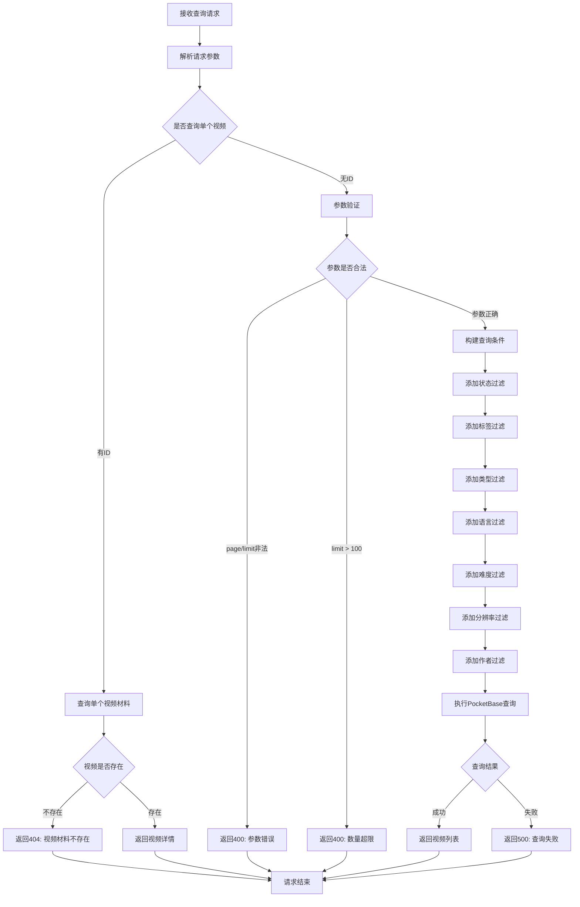

# 视频材料查询接口

## 功能描述

分页查询视频材料列表或获取单个视频材料详情，支持按状态、标签、类型、语言、难度、分辨率、作者等多种条件进行过滤。

## 查询处理流程



## 接口信息

-   **路径**: `POST /v1/videoMaterial/find`
-   **权限**: 需要基础认证
-   **对应原项目**: `api/controllers/videoMaterial/find.js`

## 请求参数

### 可选参数

| 参数名     | 类型   | 说明        | 默认值         | 示例         |
| ---------- | ------ | ----------- | -------------- | ------------ |
| id         | string | 视频材料 ID | ""             | "record_123" |
| page       | number | 页码        | 1              | 2            |
| limit      | number | 每页数量    | 20             | 10           |
| status     | string | 发布状态    | "published"    | "draft"      |
| sort       | string | 排序字段    | "-publishedAt" | "-created"   |
| tags       | string | 标签过滤    | ""             | "教育,编程"  |
| type       | string | 视频类型    | ""             | "tutorial"   |
| language   | string | 语言过滤    | ""             | "zh-CN"      |
| difficulty | string | 难度等级    | ""             | "3"          |
| resolution | string | 分辨率过滤  | ""             | "1080p"      |
| author     | string | 作者过滤    | ""             | "张老师"     |

### 参数说明

-   `id`: 如果提供则返回单个视频详情，忽略其他参数
-   `status`: 可选值为 "published"、"draft"、"all"
-   `tags`: 多个标签用逗号分隔，支持模糊匹配
-   `difficulty`: 难度等级 1-5，数字字符串
-   `sort`: 支持 PocketBase 排序语法

## 响应格式

### 单个视频响应

```json
{
    "code": 10000,
    "message": "查询成功",
    "data": {
        "id": "video_123",
        "title": "JavaScript 基础教程",
        "description": "适合初学者的 JavaScript 教程",
        "type": "tutorial",
        "videoSource": "https://example.com/video.mp4",
        "content": "详细的学习内容...",
        "publishedAt": "2024-01-01 10:00:00",
        "author": "张老师",
        "duration": 1800,
        "tags": ["JavaScript", "编程", "教育"],
        "sequence": 100,
        "status": "published",
        "coverImage": "cover.jpg",
        "language": "zh-CN",
        "difficulty": 3,
        "resolution": "1080p",
        "subtitles": "subtitles.srt",
        "viewCount": 1250,
        "likeCount": 89,
        "created": "2024-01-01 09:00:00",
        "updated": "2024-01-01 10:00:00"
    }
}
```

### 视频列表响应

```json
{
    "code": 10000,
    "message": "查询成功",
    "data": {
        "items": [
            {
                "id": "video_123",
                "title": "JavaScript 基础教程",
                "description": "适合初学者的 JavaScript 教程",
                "type": "tutorial",
                "videoSource": "https://example.com/video.mp4",
                "author": "张老师",
                "duration": 1800,
                "status": "published",
                "coverImage": "cover.jpg",
                "difficulty": 3,
                "publishedAt": "2024-01-01 10:00:00"
            }
        ],
        "totalItems": 50,
        "totalPages": 5,
        "page": 1,
        "perPage": 10
    }
}
```

### 错误响应

```json
{
    "code": 404,
    "message": "视频材料不存在",
    "data": null
}
```

## 业务逻辑

### 查询模式

1. **单个视频查询**: 提供 `id` 参数时返回完整视频详情
2. **列表查询**: 不提供 `id` 时进行分页列表查询

### 过滤条件

-   **状态过滤**: 支持按发布状态筛选
-   **标签过滤**: 支持多标签组合查询
-   **类型过滤**: 按视频类型精确匹配
-   **语言过滤**: 按语言精确匹配
-   **难度过滤**: 按难度等级精确匹配
-   **分辨率过滤**: 按分辨率精确匹配
-   **作者过滤**: 按作者名称模糊匹配

### 排序选项

-   `-publishedAt`: 按发布时间倒序（默认）
-   `-created`: 按创建时间倒序
-   `-viewCount`: 按观看次数倒序
-   `sequence`: 按序号正序

## 数据库操作

### 使用的集合

-   **videoMaterials**: 视频材料主表

### 查询优化

-   支持复合条件过滤
-   多种排序方式
-   合理的分页限制

### 索引建议

-   `status`: 状态查询
-   `tags`: 标签搜索
-   `type`: 类型过滤
-   `language`: 语言筛选
-   `difficulty`: 难度筛选
-   `author`: 作者搜索
-   `publishedAt`: 排序字段

## 权限要求

### 认证需求

-   需要通过基础认证中间件
-   学生和教师都可以查询视频材料
-   管理员具有完整查询权限

### 数据访问

-   所有认证用户都可以查看已发布的视频
-   草稿状态的视频仅作者和管理员可见

## 视频类型分类

### 常见类型

| 类型      | 说明   | 示例         |
| --------- | ------ | ------------ |
| tutorial  | 教程   | 编程基础教程 |
| lecture   | 讲座   | 学术讲座     |
| demo      | 演示   | 功能演示     |
| interview | 访谈   | 专家访谈     |
| workshop  | 工作坊 | 实践工作坊   |

### 难度等级

-   **1**: 入门级
-   **2**: 初级
-   **3**: 中级
-   **4**: 高级
-   **5**: 专家级

## 语言支持

### 支持的语言代码

-   `zh-CN`: 简体中文
-   `zh-TW`: 繁体中文
-   `en-US`: 英语
-   `ja-JP`: 日语
-   `ko-KR`: 韩语

## 性能考虑

### 查询优化

-   限制单次查询数量最大为 100
-   合理使用索引提高查询速度
-   避免不必要的字段查询

### 缓存策略

-   可考虑对热门视频进行缓存
-   分页结果缓存
-   视频元数据缓存

## 错误处理

### 参数验证错误

| 错误场景     | 错误代码 | 错误消息                   |
| ------------ | -------- | -------------------------- |
| 页码非正整数 | 400      | 页码和每页数量必须为正整数 |
| 数量超限     | 400      | 每页数量不能超过 100       |

### 数据库错误

| 错误场景       | 错误代码 | 错误消息             |
| -------------- | -------- | -------------------- |
| 视频材料不存在 | 404      | 视频材料不存在       |
| 查询失败       | 500      | 查询失败，请稍后重试 |
| 系统异常       | 500      | 服务器内部错误       |

## 依赖关系

-   依赖工具类：[pocketbase.js](mdc:src/utils/pocketbase.js) - 数据库操作
-   依赖中间件：[auth.js](mdc:src/middleware/auth.js) - 用户认证
-   依赖中间件：[response.js](mdc:src/middleware/response.js) - 响应格式化
-   外部依赖：`await-to-js` - 错误处理

## 使用示例

### 查询单个视频

```bash
curl -X POST http://localhost:1337/v1/videoMaterial/find \
  -H "Content-Type: application/json" \
  -H "Authorization: Bearer your_token" \
  -d '{
    "id": "video_123"
  }'
```

### 查询视频列表

```bash
curl -X POST http://localhost:1337/v1/videoMaterial/find \
  -H "Content-Type: application/json" \
  -H "Authorization: Bearer your_token" \
  -d '{
    "page": 1,
    "limit": 10,
    "status": "published"
  }'
```

### 多条件过滤查询

```bash
curl -X POST http://localhost:1337/v1/videoMaterial/find \
  -H "Content-Type: application/json" \
  -H "Authorization: Bearer your_token" \
  -d '{
    "tags": "JavaScript,教程",
    "type": "tutorial",
    "language": "zh-CN",
    "difficulty": "3",
    "page": 1,
    "limit": 20,
    "sort": "-viewCount"
  }'
```

### 按作者搜索

```bash
curl -X POST http://localhost:1337/v1/videoMaterial/find \
  -H "Content-Type: application/json" \
  -H "Authorization: Bearer your_token" \
  -d '{
    "author": "张老师",
    "status": "published",
    "sort": "-publishedAt"
  }'
```

## 相关接口

-   视频创建：[create.js](mdc:src/routes/videoMaterial/create.js)
-   视频更新：[update.js](mdc:src/routes/videoMaterial/update.js)
-   视频删除：[delete.js](mdc:src/routes/videoMaterial/delete.js)

## 更新历史

-   2024-01-XX: 从原 Sails.js 项目迁移，保持完全兼容
-   2024-01-XX: 增强多条件过滤和分类功能
