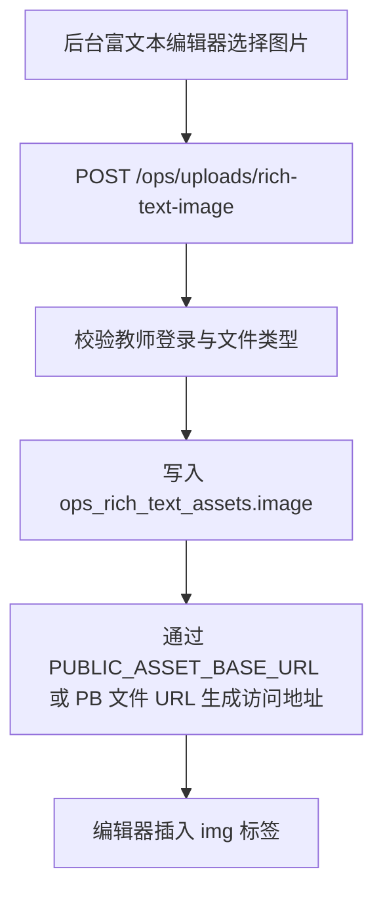

# richTextAssetService.js

富文本图片资产服务。它只负责把后台编辑器上传的图片写入 PocketBase 文件集合，并返回公开访问 URL。



## 职责

- 验证上传者至少是教师账号。
- 只允许 JPG、PNG、WebP、GIF 图片。
- 单张图片上限 10MB。
- 写入 `ops_rich_text_assets`，避免污染活动、素材或投放位集合。
- 优先使用 `PUBLIC_ASSET_BASE_URL` 拼接公开 URL；未配置时回退到 PocketBase 文件 URL。

## 返回

```json
{
  "id": "record_id",
  "recordId": "record_id",
  "collection": "ops_rich_text_assets",
  "filename": "image.png",
  "mimeType": "image/png",
  "size": 1024,
  "url": "https://kyoss.abcmem.com/<collectionId>/<recordId>/image.png"
}
```

## 约束

业务代码不直接读写 MinIO/S3 bucket key。文件仍先进入 PocketBase 文件字段，由 PocketBase 的对象存储配置负责同步；本服务只返回最终可访问地址。

## 更新记录

- 2026-06-05: 新增富文本图片上传服务，配套 `ops_rich_text_assets` 集合和后台编辑器上传入口。
