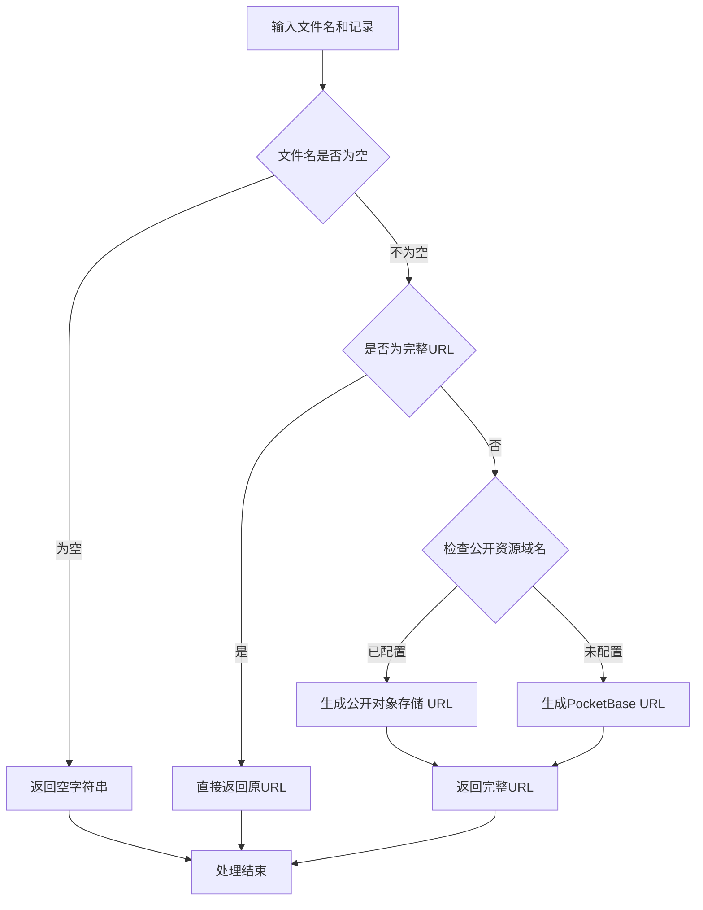

# 文件 URL 处理工具

## 功能描述

提供统一的文件 URL 处理功能，支持公开对象存储域名和 PocketBase 文件服务的 URL 生成，为不同类型的数据记录处理文件 URL 字段。对象存储同步由 PocketBase 配置负责，业务代码不持有 S3/MinIO key，也不直接操作桶。

## 文件 URL 处理流程



## 主要函数

### getFileUrl(record, filename)

**功能**: 根据配置生成文件的完整访问 URL

**参数**:

- `record`: 数据库记录对象，包含 collectionId 和 id
- `filename`: 文件名

**返回**: 完整的文件访问 URL

### processAudioMaterialFiles(record)

**功能**: 处理音频材料记录的文件 URL，支持 PocketBase 文件字段类型

**处理字段**:

- `audioSource` → `audioSourceUrl` (支持文件对象和字符串)
- `coverImage` → `coverImageUrl` (支持文件对象和字符串)

**文件字段处理**:

- 自动检测 PocketBase 文件字段格式
- 支持文件对象 `{name: "filename"}` 格式
- 兼容传统字符串文件名格式
- 确保生成正确的对象存储公开 URL 或本地文件 URL

### processVideoMaterialFiles(record)

**功能**: 处理视频材料记录的文件 URL

**处理字段**:

- `videoSource` → `videoSourceUrl`
- `coverImage` → `coverImageUrl`
- `thumbnail` → `thumbnailUrl`

### processActivityFiles(record)

**功能**: 处理活动记录的文件 URL

**处理字段**:

- `coverImage` → `coverImageUrl`
- `images` → `imageUrls` (数组)

### processBatchFiles(records, processor)

**功能**: 批量处理记录列表的文件 URL

**参数**:

- `records`: 记录数组
- `processor`: 处理器函数

## URL 生成策略

### 公开对象存储 URL 格式

```
https://kyoss.abcmem.com/ikanyue-mp/collection_id/record_id/filename
```

### PocketBase 本地 URL 格式

```
http://localhost:8090/api/files/collection_id/record_id/filename
```

### 环境变量配置

```bash
# 公开对象存储域名（优先）
PUBLIC_ASSET_BASE_URL=https://kyoss.abcmem.com/ikanyue-mp

# PocketBase配置（备选）
PB_URL=http://localhost:8090
PB_PUBLIC_URL=https://data.ikanyue.com
```

## 使用示例

### 音频材料 URL 处理

```javascript
const { processAudioMaterialFiles } = require('./utils/fileUrl.js');

// 传统字符串文件名格式（兼容）
const audioRecord1 = {
  id: 'audio_123',
  collectionId: 'audio_materials',
  title: '英语听力',
  audioSource: 'lesson1.mp3',
  coverImage: 'cover.jpg',
};

const processed1 = processAudioMaterialFiles(audioRecord1);
console.log(processed1.audioSourceUrl);
// https://kyoss.abcmem.com/ikanyue-mp/audio_materials/audio_123/lesson1.mp3
console.log(processed1.coverImageUrl);
// https://kyoss.abcmem.com/ikanyue-mp/audio_materials/audio_123/cover.jpg

// PocketBase文件字段对象格式（新支持）
const audioRecord2 = {
  id: 'audio_456',
  collectionId: 'audio_materials',
  title: '日语对话',
  audioSource: { name: 'dialog.mp3', size: 1024000 },
  coverImage: { name: 'poster.jpg', size: 256000 },
};

const processed2 = processAudioMaterialFiles(audioRecord2);
console.log(processed2.audioSourceUrl);
// https://kyoss.abcmem.com/ikanyue-mp/audio_materials/audio_456/dialog.mp3
console.log(processed2.coverImageUrl);
// https://kyoss.abcmem.com/ikanyue-mp/audio_materials/audio_456/poster.jpg
```

### 批量处理

```javascript
const { processBatchFiles, processAudioMaterialFiles } = require('./utils/fileUrl.js');

const audioList = [
  { id: '1', audioSource: 'file1.mp3' },
  { id: '2', audioSource: 'file2.mp3' },
];

const processedList = processBatchFiles(audioList, processAudioMaterialFiles);
```

### 活动图片处理

```javascript
const { processActivityFiles } = require('./utils/fileUrl.js');

const activityRecord = {
  id: 'activity_456',
  collectionId: 'activities',
  coverImage: 'cover.jpg',
  images: ['img1.jpg', 'img2.jpg', 'img3.jpg'],
};

const processed = processActivityFiles(activityRecord);
console.log(processed.coverImageUrl);
// https://kyoss.abcmem.com/ikanyue-mp/activities/activity_456/cover.jpg
console.log(processed.imageUrls);
// ['https://s3.amazonaws.com/bucket/activities/activity_456/img1.jpg', ...]
```

## 兼容性处理

### URL 检测

- 自动检测文件名是否已经是完整 URL
- 对于 http://或 https://开头的文件名，直接返回
- 避免重复处理已生成的 URL

### 环境适配

- 优先使用公开对象存储域名（生产环境）
- 降级到 PocketBase 本地文件（开发环境）
- 支持不同部署环境的自动切换

## 性能考虑

### 对象复制

- 使用浅拷贝避免修改原始记录
- 只添加新的 URL 字段，保持原始数据不变

### 批量处理

- 提供批量处理函数减少重复代码
- 支持不同类型记录的统一处理

## 依赖关系

- 无外部依赖，纯 JavaScript 实现
- 依赖环境变量配置
- 被各个路由接口模块引用

## 扩展性

### 新增数据类型

可以轻松添加新的文件处理函数：

```javascript
function processNewTypeFiles(record) {
  if (!record) return record;

  const processedRecord = { ...record };

  // 处理特定字段
  if (record.fileField) {
    processedRecord.fileFieldUrl = getFileUrl(record, record.fileField);
  }

  return processedRecord;
}
```

### 自定义 URL 格式

可以通过修改 getFileUrl 函数支持新的存储服务：

```javascript
// 支持其他云存储服务
if (process.env.CUSTOM_STORAGE_URL) {
  return `${process.env.CUSTOM_STORAGE_URL}/${filename}`;
}
```
