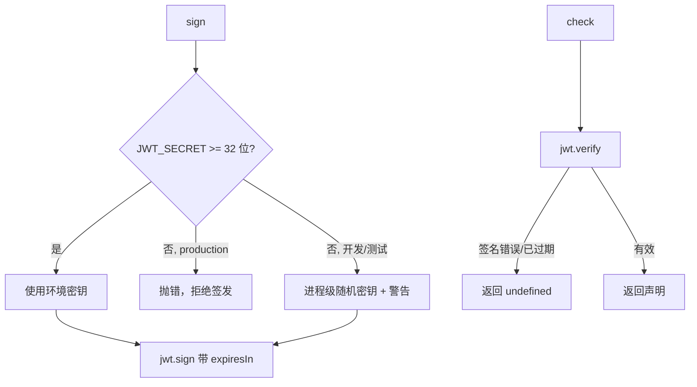

# JWT 认证工具 (utils/jwtAuth.js)

## 功能描述

签发和校验业务 API 的 JWT。密钥只来自环境变量 `JWT_SECRET`，每个令牌都带标准的 `exp` 声明。

## mermaid 流程图

## 接口

- `jwtAuth.sign(req, id, sn, role, isAdmin, claims = {}, { expiresIn })`：默认有效期 `APP_TOKEN_TTL`（30 天）。`req` 参数保留只为兼容调用方。
- `jwtAuth.check(token)`：签名不对、格式错误或已过期时返回 `undefined`。
- `OPS_TOKEN_TTL`（12 小时）与 `OPS_SCOPE`（`ops`）：后台登录签发的令牌必须带 `scope: 'ops'`，`opsAuthMiddleware` 只接受这种令牌。

## 有效期

| 令牌 | 有效期 | 说明 |
| --- | --- | --- |
| 小程序学员/教师 | 30 天 | 启动时调用 `/v1/user/refresh` 续期 |
| 后台运营 | 12 小时 | 能力声明（capabilities）最多滞后 12 小时 |
| 微信身份选择凭证 | 5 分钟 | 不能当作登录令牌使用 |

## 安全说明

- 更换 `JWT_SECRET` 会让所有已签发的令牌失效。
- 源码中不再保存任何密钥；历史上曾硬编码的密钥已视为泄露，线上必须使用新密钥。

## 更新历史

- 2026-09：密钥改为从环境变量读取，使用标准 `exp`，新增后台令牌 scope。
