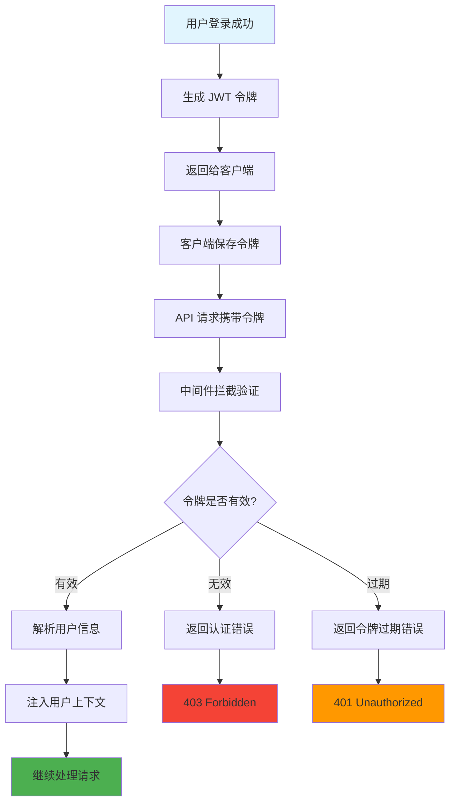

# JWT 认证工具类 (utils/jwtAuth.js)

## 功能描述

JWT（JSON Web Token）认证工具类，提供用户令牌的生成、验证和解析功能，确保 API 接口的安全性。

## mermaid 流程图



## 核心功能

### 1. 令牌生成 (generateToken)

```javascript
const token = generateToken(user);
```

-   使用用户信息生成 JWT 令牌
-   设置令牌过期时间
-   使用项目专用密钥签名

### 2. 令牌验证 (verifyToken)

```javascript
const decoded = verifyToken(token);
```

-   验证令牌有效性
-   检查令牌是否过期
-   解析用户信息

### 3. 令牌解析 (decodeToken)

```javascript
const payload = decodeToken(token);
```

-   解析令牌载荷信息
-   不验证签名（仅解析）

## 配置参数

### JWT 密钥

```javascript
const AUTH_KEY = 'V_NY6*rF-j.P'; // 与原项目保持一致
```

### 令牌配置

-   **过期时间**: 7 天 (`7d`)
-   **算法**: HS256
-   **签发者**: ikanyue-hono

## 令牌结构

### 载荷 (Payload)

```json
{
    "id": "用户ID",
    "email": "用户邮箱",
    "name": "用户姓名",
    "role": "用户角色",
    "iat": 1703577600,
    "exp": 1704182400,
    "iss": "ikanyue-hono"
}
```

## 使用示例

### 生成令牌

```javascript
const { generateToken } = require('../utils/jwtAuth');

// 用户登录成功后生成令牌
const user = {
    id: 'user123',
    email: 'user@example.com',
    name: '张三',
    role: 'student',
};

const token = generateToken(user);
console.log('生成的令牌:', token);
```

### 验证令牌

```javascript
const { verifyToken } = require('../utils/jwtAuth');

try {
    const decoded = verifyToken(token);
    console.log('用户信息:', decoded);
} catch (error) {
    console.error('令牌验证失败:', error.message);
}
```

## 错误处理

### 常见错误类型

-   **TokenExpiredError**: 令牌已过期
-   **JsonWebTokenError**: 令牌格式错误
-   **NotBeforeError**: 令牌尚未生效

### 错误处理示例

```javascript
const { verifyToken } = require('../utils/jwtAuth');

function authenticateToken(token) {
    try {
        const decoded = verifyToken(token);
        return { success: true, user: decoded };
    } catch (error) {
        if (error.name === 'TokenExpiredError') {
            return { success: false, error: '令牌已过期' };
        } else if (error.name === 'JsonWebTokenError') {
            return { success: false, error: '无效的令牌' };
        } else {
            return { success: false, error: '认证失败' };
        }
    }
}
```

## 安全考虑

### 1. 密钥管理

-   使用与原项目一致的密钥: `V_NY6*rF-j.P`
-   避免在代码中暴露密钥
-   生产环境应使用环境变量

### 2. 令牌传输

-   通过 Authorization Header 传输
-   格式: `Bearer <token>`
-   使用 HTTPS 传输

### 3. 令牌存储

-   客户端安全存储令牌
-   避免在 localStorage 中存储敏感令牌
-   推荐使用 httpOnly Cookie

## 依赖关系

-   **认证中间件**: [auth.js](mdc:src/middleware/auth.js.md) 使用此工具验证令牌
-   **用户登录**: [login.js](mdc:src/routes/user/login.js.md) 使用此工具生成令牌
-   **令牌刷新**: [refresh.js](mdc:src/routes/user/refresh.js.md) 使用此工具生成新令牌

## 更新历史

| 版本 | 日期       | 说明                             |
| ---- | ---------- | -------------------------------- |
| 1.0  | 2024-12-26 | 从原项目迁移，保持密钥和算法一致 |
