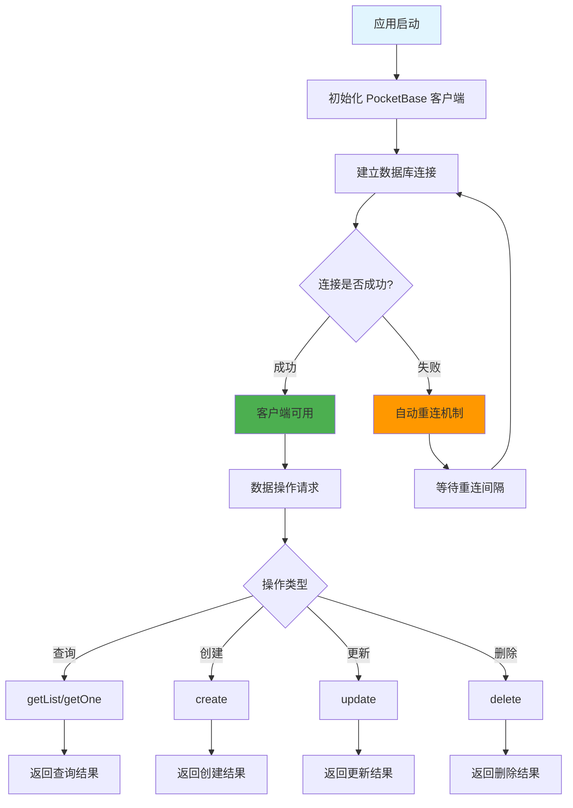

# PocketBase 工具类 (utils/pocketbase.js)

## 功能描述

PocketBase 数据库客户端工具类，提供数据库连接管理、自动重连机制和统一的数据操作接口。

## mermaid 流程图



## 核心功能

### 1. 客户端实例管理

-   单例模式确保全局唯一客户端
-   自动连接管理和重连机制
-   连接状态监控

### 2. 数据操作接口

-   **查询操作**: `getList()`, `getOne()`, `getFirstListItem()`
-   **创建操作**: `create()`
-   **更新操作**: `update()`
-   **删除操作**: `delete()`

### 3. 认证管理

-   管理员认证
-   用户令牌验证
-   权限验证

## 配置要求

### 环境变量

```env
POCKETBASE_URL=http://localhost:8090
POCKETBASE_ADMIN_EMAIL=admin@example.com
POCKETBASE_ADMIN_PASSWORD=your-password
```

### 数据库集合

项目依赖的 PocketBase 集合：

-   `users` - 用户信息
-   `students` - 学生数据
-   `teachers` - 教师数据
-   `audioMaterials` - 音频材料
-   `videoMaterials` - 视频材料
-   `activities` - 活动信息

## 使用示例

### 查询数据

```javascript
const pb = require('./pocketbase');

// 查询学生列表
const students = await pb.collection('students').getList(1, 20, {
    filter: 'status = "active"',
    sort: '-created',
});

// 查询单个学生
const student = await pb.collection('students').getOne('STUDENT_ID');
```

### 创建数据

```javascript
// 创建新学生记录
const newStudent = await pb.collection('students').create({
    name: '张三',
    email: 'zhangsan@example.com',
    grade: '高一',
});
```

### 更新数据

```javascript
// 更新学生信息
const updatedStudent = await pb.collection('students').update('STUDENT_ID', {
    grade: '高二',
});
```

### 删除数据

```javascript
// 删除学生记录
await pb.collection('students').delete('STUDENT_ID');
```

## 错误处理

### 常见错误类型

-   **连接错误**: 数据库服务不可用
-   **认证错误**: 管理员凭据无效
-   **权限错误**: 操作权限不足
-   **数据错误**: 字段验证失败

### 错误处理示例

```javascript
const to = require('await-to-js').default;

const [error, result] = await to(pb.collection('students').create(data));

if (error) {
    console.error('创建学生失败:', error.message);
    return c.error(50001, '创建学生失败');
}
```

## 依赖关系

-   **原项目兼容**: 完全保持与 Sails.js 项目的 PocketBase 操作一致
-   **JWT 认证**: 配合 [JWT 工具](mdc:src/utils/jwtAuth.js.md) 进行用户认证
-   **中间件集成**: 被 [认证中间件](mdc:src/middleware/auth.js.md) 调用

## 更新历史

| 版本 | 日期       | 说明                       |
| ---- | ---------- | -------------------------- |
| 1.0  | 2024-12-26 | 从原项目迁移，保持完全兼容 |
