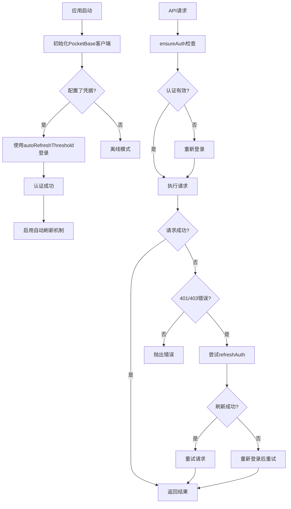
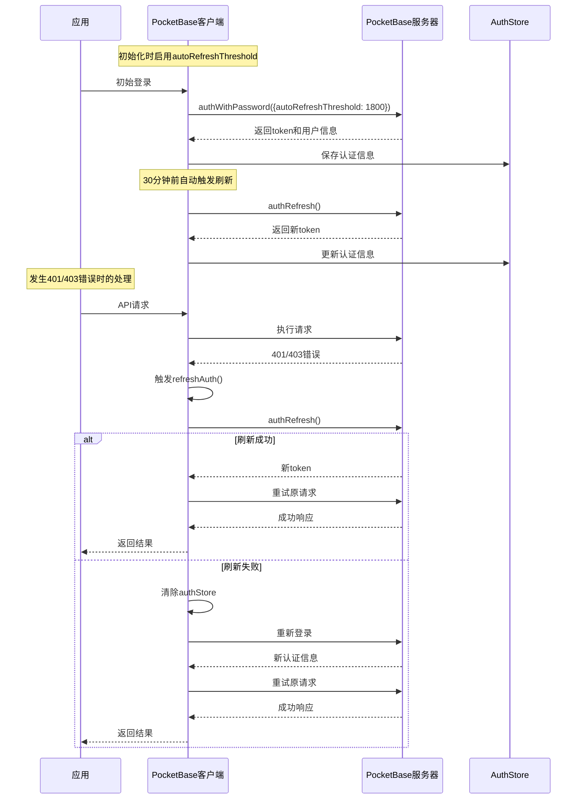

# PocketBase 客户端工具类

## 功能描述

PocketBase 客户端单例模式实现，为项目提供全局 PocketBase 访问能力，并具备自动 token 刷新机制，解决 superuser 授权时限问题。

## 主要特性

- 单例模式确保全局唯一实例
- 自动 token 刷新机制（autoRefreshThreshold）
- 智能错误处理和重试机制
- 环境配置自动加载
- 统一的错误响应格式

## 认证流程图



## Token 刷新机制流程图



## 核心方法

### 认证相关方法

#### `login()`

使用配置的凭据登录到 PocketBase，启用自动刷新机制。

#### `refreshAuth()`

刷新当前的认证 token，如果刷新失败则自动重新登录。

#### `ensureAuth()`

确保当前认证状态有效，必要时重新登录。

#### `isLoggedIn()`

检查当前认证状态是否有效。

### 数据操作方法

所有数据操作方法都包含：

- 自动认证检查
- 401/403 错误自动处理
- 智能重试机制

#### `getList(collectionName, page, perPage, filter)`

获取分页记录列表。

#### `getOne(collectionName, id)`

获取单个记录。

#### `create(collectionName, data)`

创建新记录。

#### `update(collectionName, id, data)`

更新现有记录。

#### `delete(collectionName, id)`

删除记录。

## 配置参数

### 环境变量

- `PB_URL`: PocketBase 服务器地址（默认: http://127.0.0.1:8090）
- `PB_EMAIL`: 超级用户邮箱
- `PB_PASSWORD`: 超级用户密码

### 内部配置

- `AUTO_REFRESH_THRESHOLD`: 30 分钟（1800 秒）
  - token 将在过期前 30 分钟自动刷新
  - 防止在关键操作时 token 过期

## 错误处理机制

### 认证错误处理

1. **401 Unauthorized**: 尝试刷新 token，失败后重新登录
2. **403 Forbidden**: 同 401 处理逻辑
3. **其他错误**: 直接抛出，由调用方处理

### 重试机制

- 认证错误时自动重试一次
- 重试前先尝试刷新 token
- 刷新失败则重新登录后重试

## 使用示例

```javascript
// 基本使用
const pb = require('./utils/pocketbase');

// 获取用户列表（自动处理认证）
try {
  const users = await pb.getList('users', 1, 20, {
    filter: 'status = true',
  });
  console.log('用户列表:', users);
} catch (error) {
  console.error('获取用户失败:', error.message);
}

// 创建新记录
try {
  const newUser = await pb.create('users', {
    email: 'test@example.com',
    name: 'Test User',
  });
  console.log('用户创建成功:', newUser);
} catch (error) {
  console.error('创建用户失败:', error.message);
}
```

## 依赖关系

- [await-to-js](https://www.npmjs.com/package/await-to-js) - 异步错误处理
- [dotenv](https://www.npmjs.com/package/dotenv) - 环境变量加载
- [pocketbase](https://www.npmjs.com/package/pocketbase) - PocketBase JavaScript SDK

## 更新历史

### v2.0 (当前版本)

- ✅ 添加 autoRefreshThreshold 自动刷新机制
- ✅ 新增 refreshAuth()方法
- ✅ 改进 ensureAuth()认证检查
- ✅ 增强 401/403 错误处理和重试机制
- ✅ 优化 isLoggedIn()判断逻辑

### v1.0 (原始版本)

- ✅ 基础 PocketBase 客户端封装
- ✅ 单例模式实现
- ✅ 基本 CRUD 操作
- ✅ 环境配置加载

## 故障排除

### 常见问题

1. **"only superuser can operate" 错误**

   - 原因：Token 过期导致授权失效
   - 解决：新版本已自动处理，通过 autoRefreshThreshold 和智能重试机制

2. **认证频繁失败**

   - 检查 PB_EMAIL 和 PB_PASSWORD 配置
   - 确认 PocketBase 服务器运行状态
   - 验证网络连接

3. **Token 刷新失败**
   - 检查 PocketBase 服务器版本兼容性
   - 确认\_superusers 集合配置正确

### 调试信息

客户端会输出详细的日志信息：

- 登录成功/失败状态
- Token 刷新操作
- 错误重试过程
- 认证状态变化

## 技术要点

### 为什么使用 autoRefreshThreshold？

1. **预防性刷新**: 在 token 即将过期前自动刷新，避免关键操作中断
2. **无感知更新**: 用户无需感知 token 刷新过程
3. **减少认证失败**: 大幅减少因 token 过期导致的请求失败

### 错误处理策略

1. **分层处理**: 区分认证错误和业务错误
2. **智能重试**: 只对可恢复的错误进行重试
3. **降级机制**: 刷新失败时降级到重新登录

### 性能优化

1. **单例模式**: 避免重复初始化
2. **连接复用**: 共享 PocketBase 连接实例
3. **最小化认证检查**: 只在必要时进行认证验证
