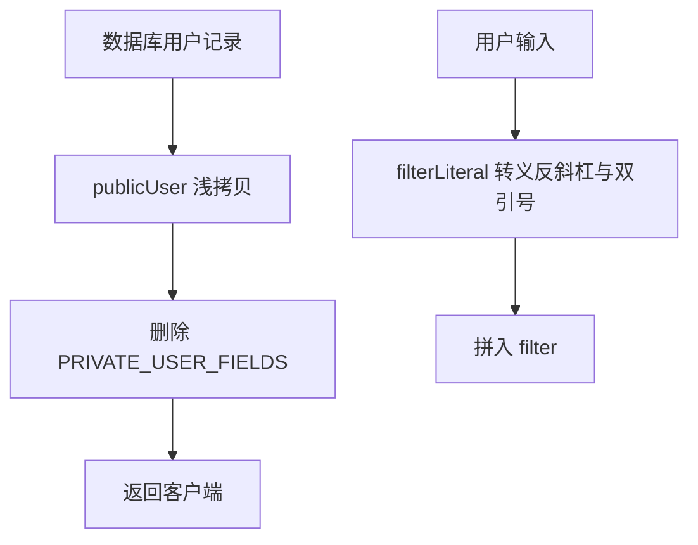

# 用户记录脱敏 (utils/publicUser.js)

## 功能描述

所有把学员或教师记录返回给客户端的接口，都要先经过 `publicUser`，去掉密码哈希、`tokenKey`、微信身份标识和登录 IP。`filterLiteral` 用于把用户输入安全地放进 PocketBase filter 字符串。

## mermaid 流程图

## 接口

- `publicUser(record)`：返回去掉敏感字段后的副本，不修改原对象。
- `filterLiteral(value)`：返回带双引号的安全字面量。
- `PRIVATE_USER_FIELDS`：`password`、`passwordHash`、`tokenKey`、`wechatId`、`wechatOpenId`、`wechatUnionId`、`wechatUserInfo`、`lastLoginIp`。

## 使用方

[login.js](mdc:src/routes/user/login.js)、[refresh.js](mdc:src/routes/user/refresh.js)、[update.js](mdc:src/routes/user/update.js)、[wechatIdentityService.js](mdc:src/services/courseCredits/booking/wechatIdentityService.js)，以及学员、教师的创建与更新接口。

## 更新历史

- 2026-09：新增，修复登录接口返回密码哈希的问题。
