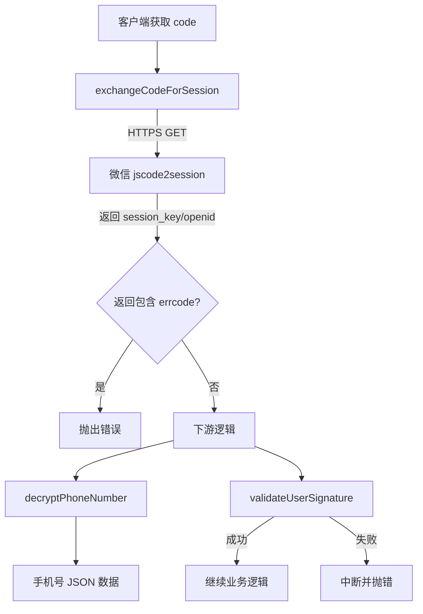
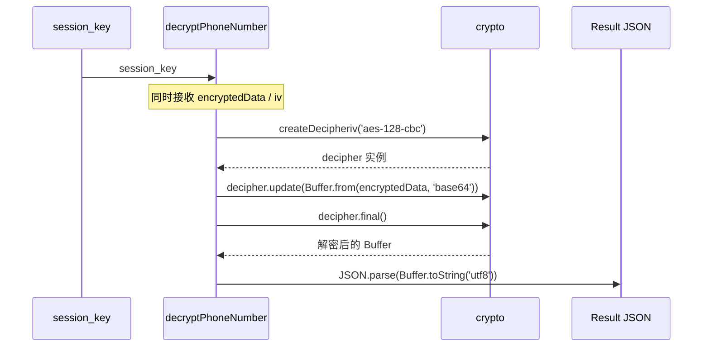

# 微信工具方法

## 功能概述

`src/utils/wechat.js` 封装了与微信小程序登录相关的三个工具方法：

- `exchangeCodeForSession(code)`：调用微信 `jscode2session` 接口换取 `session_key`、`openid`、`unionid`
- `decryptPhoneNumber(sessionKey, encryptedData, iv)`：解密 `getPhoneNumber` 返回的加密数据，拿到用户手机号
- `validateUserSignature(rawData, sessionKey, signature)`：验证 `rawData` 的签名，确保用户信息来源可靠

## 交互流程



## 关键实现

### exchangeCodeForSession

1. 校验 `WECHAT_APPID`、`WECHAT_SECRET` 环境变量。
2. 拼接 `jscode2session` 查询参数：`appid`、`secret`、`js_code`、`grant_type=authorization_code`。
3. 通过 `https.get` 请求微信接口，解析 JSON；若存在 `errcode` 非零，则抛出错误。

### decryptPhoneNumber



- 采用 AES-128-CBC，key/iv 均由微信返回的 base64 数据转换。
- 任一步骤失败都会抛出 `解密微信手机号失败` 错误，调用方可根据堆栈定位原因。

### validateUserSignature

使用 `sha1(rawData + session_key)` 与微信返回的 `signature` 对比，确保 `rawData` 未被篡改。若缺失任一参数则默认返回 `true`，方便在未传签名时跳过校验。

## 依赖

- Node 内置模块：`https`、`url`、`crypto`
- 环境变量：`WECHAT_APPID`、`WECHAT_SECRET`、`WECHAT_JSCODE2SESSION`

## 使用示例

```javascript
const {
  exchangeCodeForSession,
  decryptPhoneNumber,
  validateUserSignature,
} = require('../utils/wechat');

const session = await exchangeCodeForSession(code);
const phone = decryptPhoneNumber(session.session_key, encryptedData, iv);
if (!validateUserSignature(rawData, session.session_key, signature)) {
  throw new Error('微信用户信息校验失败');
}
```

## 更新记录

- 2025-11-12：新增文件，支持小程序一键登录流程
